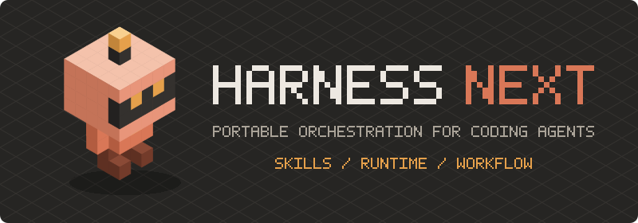

<p align="center">
  
</p>

<p align="center">
  <a href="https://github.com/PVMalove/agent-harness-next/releases"></a>
  
  
  <a href="https://github.com/PVMalove/agent-harness-next/actions/workflows/verify.yml"></a>
  <a href="./LICENSE"></a>
</p>

# Agent Harness Next

Agent Harness Next разворачивает в проект скиллы, hooks и контекстные документы и ведёт оркестрацию через Rust runtime и локальный runtime-store, оставляя Python policy-слоем.

[Сайт](https://pvmalove.github.io/agent-harness-next/) · [Быстрый старт](https://pvmalove.github.io/agent-harness-next/getting-started/) · [Архитектура](https://pvmalove.github.io/agent-harness-next/architecture/) · [Демо](https://pvmalove.github.io/agent-harness-next/demo/) · [Справочник](https://pvmalove.github.io/agent-harness-next/reference/)

## Сборки (Capabilities)

| Сборка | Для чего |
| --- | --- |
| `project-foundation` | Лёгкая доменно-нейтральная база из пяти ключевых скиллов. Вариант по умолчанию. |
| `mattpocock-suite` | Полный upstream-набор, закреплённый на проверенном коммите. |
| `engineering-suite` | Эпики и тикеты, триаж, двухосевое review, `qa-gate` и подготовка PR. |
| `backend-orchestration` | Роли и coordinator для распределённых систем: briefs, worktrees и ledger. |

Старое имя `pvmalove-suite` поддерживается как совместимый alias.

## Быстрый старт

Требуются Python 3.12+ и Git. Глобальный слой устанавливается однократно для выбранных runtime:

```bash
python3 bin/install-global.py --target-home "$HOME" --runtime claude --runtime codex
```

Затем подключите harness к проекту и проверьте окружение:

```bash
python3 harness/bin/harness.py init /path/to/repository --capability engineering-suite \
  --project-type software --stack python --base-branch main --language ru \
  --qa-gate-command "make test"
python3 harness/bin/harness.py health /path/to/repository
```

Без `--capability` устанавливается `project-foundation`. `harness diff` показывает изменения
управляемого snapshot, `harness update` обновляет его и сохраняет локальные правки.

## Состав `engineering-suite`

В `engineering-suite` переопределены в `skills/first-party/engineering/`: `to-spec`, `to-tickets`, `implement`, `ask-matt`, `code-review`, `grilling`, `grill-me`, `grill-with-docs`, `triage`, `wayfinder`, `diagnosing-bugs`, `tdd`; доп. скиллы: `qa-gate`, `to-guide`, `setup-labels`, `to-pull-requests`, `fast-implement`, `delivery-stats`, `architect`.

Сборка разворачивает проектные руководства `docs/agents/{artifacts,git-workflow,issue-tracker,test-author,triage-labels,worktrees}.md`
и общий контракт `.harness/docs/technical-english.md`. Корневой `docs/` остаётся документацией
исходного репозитория и в целевой проект не переносится.

## Документация

- [Быстрый старт](https://pvmalove.github.io/agent-harness-next/getting-started/) — требования, установка и `health`.
- [Архитектура](https://pvmalove.github.io/agent-harness-next/architecture/) — слои, runtime, store и безопасность.
- [Справочник](https://pvmalove.github.io/agent-harness-next/reference/) — CLI, конфигурация, hooks и агенты.
- [Демо](https://pvmalove.github.io/agent-harness-next/demo/) — веб-консоль на демонстрационных данных.
- [ADR](./docs/adr/) и [правила Git](./docs/agents/git-workflow.md) — действующие контракты и рабочий процесс.
- [CONTEXT.md](./CONTEXT.md) — глоссарий проекта; [docs/README.md](./docs/README.md) — индекс внутренней документации.

## Разработка

`backend-orchestration` проводит тикет через роли и coordinator: `/implement` ведёт этапы architect,
developer, review и QA, `/to-pull-requests` готовит ветку к публикации.
PR требует отдельного подтверждения; изменения проходят через issue, ветку и PR по
[правилам Git](./docs/agents/git-workflow.md); полный гейт — `make verify`. Заметки о выпуске — в
[CHANGELOG.md](./CHANGELOG.md), порядок выпуска — в [releases.md](./site/docs/agents/releases.md).

Проект распространяется по лицензии [MIT](./LICENSE). Лицензия закреплённого upstream-snapshot
находится в [`third_party/mattpocock-skills/LICENSE`](./third_party/mattpocock-skills/LICENSE).
