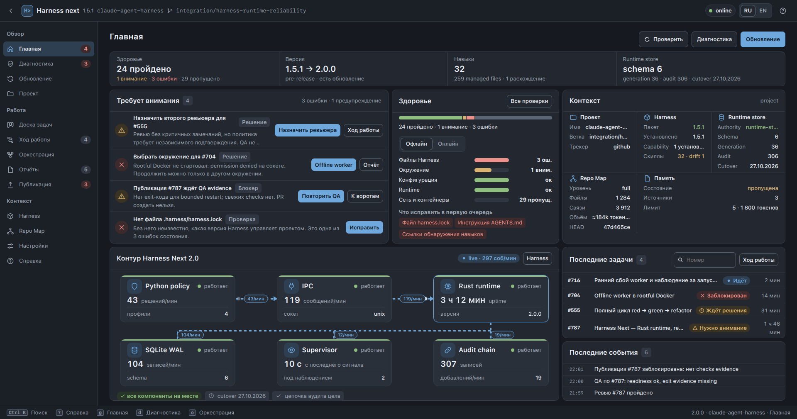
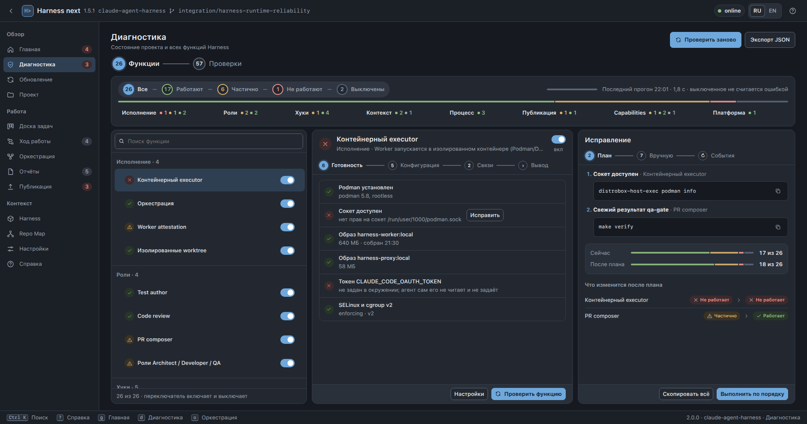
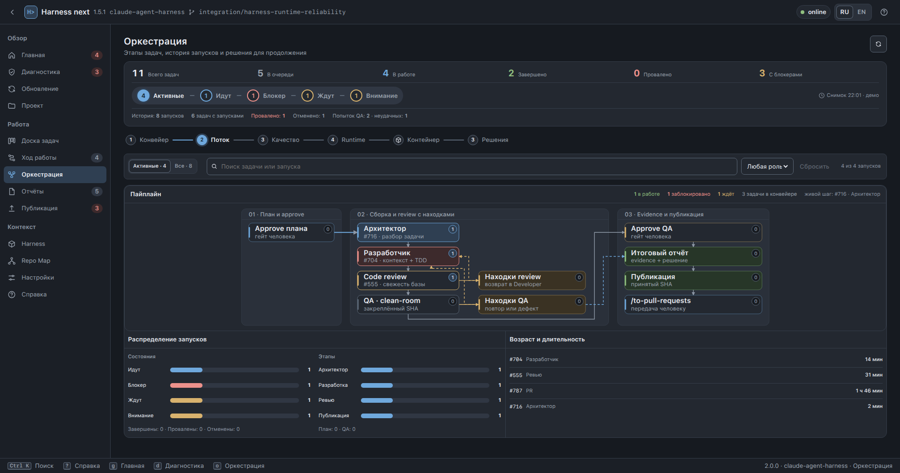
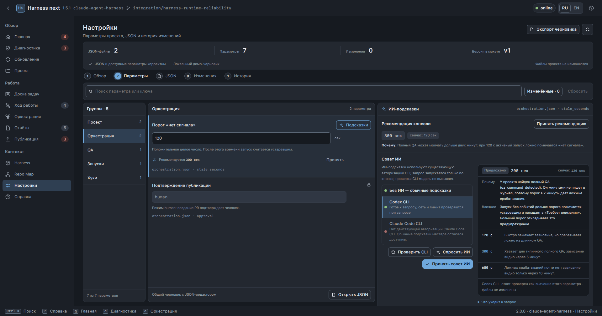

# RFC: редизайн веб-консоли Harness (макет v3)

**Статус:** DRAFT, ждёт решения владельца и тикетов реализации.
**Дата:** 2026-11-12.
**Связанные документы:** веб-консоль (#892, коммит `e7ac7bff`); прежний макет
`docs/design/web-console-mockups/`; тест `tests/web/unslop-css.test.ts`; справка консоли
`harness/console/kernel/help_text.py`.
**Макет:** автономный файл [web-console-v3.html](./web-console-v3.html) (открывается двойным
кликом, без сервера); исходники — `docs/rfc/web-console-v3/mockup/`, снимки —
`docs/rfc/web-console-v3/screens/`.

## 1. Контекст

Текущая веб-консоль (`harness/console/frontend/`) реализует прежний макет. Владелец признал её
интерфейс неудобным: экраны разной плотности, пустые зоны, лишние колонки, не везде видны реальные
данные, нет подсказок по настройке. Попытка свести навигацию к 7 пунктам отклонена: **все 13
экранов остаются**, меняется их внутреннее устройство.

Новый макет собран итерациями по замечаниям владельца и проверен по реальной консоли:
названия шагов, схемы и тексты взяты из кода (`Charts.tsx`, `format.ts`, `advisor.py`,
`help_text.py`), а не придуманы. Данные в макете демонстрационные.

## 2. Цели

1. Сохранить 13 экранов навигации (Главная, Диагностика, Обновление, Проект, Доска задач, Ход
   работы, Оркестрация, Отчёты, Публикация, Harness, Repo Map, Настройки, Справка) и улучшить
   каждый внутри.
2. Один язык интерфейса: общая сводка вверху экрана, конвейерные вкладки, панели с одинаковыми
   заголовками, действия справа, значки статуса вместо плашек в заголовках.
3. Каждый экран помещается в окно без прокрутки страницы и без пустой полосы (раздел 5).
4. Правила unslop (раздел 4): шкала шрифта, сетка 4 px, без свечений и лишней анимации.
5. Показывать реальную активность: анимация контура только пока по звену шли события.
6. Дать ИИ-подсказки по настройке параметров, как в терминальном мастере.
7. Диагностировать и включать/выключать функции Harness (контейнеры, test author, hooks, QA
   gate, capabilities и другие).

## 3. Не входит в цели

- Новая информационная архитектура и новые экраны.
- Светлая тема как отдельный дизайн (токены светлой темы сохраняются, макет её не пересматривал).
- Автоматическое выполнение рекомендаций ИИ: совет попадает только в черновик.
- Мобильная вёрстка как основной сценарий (поведение до 375 px сохраняется, но не оптимизируется).

## 4. Дизайн-система

Правила из направления владельца от 2026-11-11 и скилла unslop (CC BY 4.0, Damir Sokolovsky,
<https://github.com/heydamir/unslop>). Скилл использован как список правил, не устанавливался.

| Правило | Значение в макете |
| --- | --- |
| Шкала шрифта | `--fs-1…--fs-5` = 11, 13, 16, 20, 28 px; меньше 11 px нет, размеры только через токены |
| Начертания | 400–600, иерархия размером и цветом, регистр обычный, разрядки и курсива нет |
| Числа | `font-variant-numeric: tabular-nums` |
| Отступы | кратны 4 px (2 px только в мелких контролах), в CSS и в inline-стилях |
| Цвет | палитра исходной консоли без изменений; цвет только у статусов; свечений и градиентов нет |
| Движение | только `transform` и `opacity`; бесконечная анимация только у живого состояния; всё выключено при `prefers-reduced-motion` |
| Переключатели | любой флажок отображается переключателем 34×20 |

`tests/web/unslop-css.test.ts` проверяет те же правила по `src/styles/app.css`. Переход на новые
токены не должен ломать этот тест.

## 5. Вписывание в окно

Метод: измерение в iframe заданного размера по всем экранам и вкладкам (прокрутка страницы,
пустая полоса под содержимым, панели с пустой зоной больше 96 px).

- Экраны, кроме Главной: страница не прокручивается на 1920×1080, 1920×1010, 1920×950, 1680×950 и
  1440×900. Внутренняя прокрутка допускается только в длинных списках (26 функций и 57 проверок,
  колонки доски, события хода работы, дерево Repo Map, деталь запуска).
- Главная: пятиблочная раскладка без прокрутки от 1800 px по ширине (1920×1080, 1920×1010,
  1920×950); ниже 1800 px остаётся колонкой с прокруткой.
- Строки списков и фактов плотные. Свободная высота закрывается отдельными блоками («Связанные
  разделы», «Читать дальше», сводки), а не растягиванием строк.
- Невысокое окно (до 940–1000 px): скрываются подзаголовок страницы и второстепенные строки.

Известные пробелы: 1366×768 (Оркестрация, «Настройки · Параметры» и часть вкладок Справки
прокручиваются), Главная ниже 1800 px, режим reconnect (баннер занимает высоту).

## 6. Изменения по экранам

| Экран | Что меняется | Что нужно от сервера |
| --- | --- | --- |
| Главная | KPI-полоса; «Требует внимания» с действиями справа; «Здоровье»; «Контекст» 3×2; «Контур Harness Next 2.0»; «Последние задачи»; «Последние события» | Контур живёт по активности: нужны счётчики событий в минуту по звеньям и давность последнего события. Сейчас `Home.tsx` использует `active_batches` (требует проверки, есть ли такие поля в `home.snapshot`) |
| Диагностика | Вкладки «Функции» и «Проверки»; переключатели функций с подтверждением и предупреждением о зависимостях; план до/после; значки статуса без плашек | Реестра функций в консоли нет (по коду `harness/console/backend` и `kernel` слов feature нет, кроме `kernel/configuration.py`). Нужен модуль реестра и сообщение `features.snapshot` |
| Обновление | Сводка версии, состояния файлов, diff, решение конфликтов, режим обновления, seed-файлы переключателями, план миграции | `update_harness.snapshot` и `update_harness.diff` есть; список seed-файлов и шаги миграции требуют проверки |
| Проект | Мастер из 5 шагов («Выбор проекта … Итоговая диагностика»), блок «Схема внедрения», состав установки | `open_project.snapshot` есть; поля схемы внедрения требуют проверки |
| Доска задач | Карточки с приоритетом и SP, типом реализации, значками блокеров, ящик задачи | `task_board.snapshot` есть |
| Ход работы | Источники шагов, общая статистика, таймлайн кластерами, длительность справа от события | `steps`, `worker.steps` есть |
| Оркестрация | Шесть вкладок; во вкладке «Поток» схема пайплайна (11 узлов, 13 связей, 3 группы); «Контейнер» со сводкой состояний | Схема есть в `PipelineMap` (`Charts.tsx`): требуется только перенос стилей |
| Отчёты, Публикация | Единая сводка, вкладки Evidence, Качество, Готовность, ящик кандидата | `reports.*` есть |
| Harness | Пять вкладок (Обзор, Runtime, Адаптеры, Контейнеры, Команды), блок «Связанные разделы» | `harness.snapshot` есть |
| Repo Map | Файлы, Символы, Связи, фрагмент индекса явно отделён от общих счётчиков | `repo_map.snapshot` есть |
| Настройки | Пять вкладок (Обзор, Параметры, JSON, Изменения, История); ИИ-подсказки; рекомендации консоли; JSON выбранной версии в истории | ИИ-подсказки: в `Wizard.tsx` прямо написано, что они не реализованы; логика лежит в `harness/console/tui/advisor.py`. `configuration.snapshot` отдаёт только текущие документы, без содержимого версий (`.harness/config_versions`) |
| Справка | Семь вкладок (Начало, Разделы, Клавиши, Статусы, Безопасность, Вопросы, Документация), общий поиск | `help.snapshot` отдаёт разделы как Markdown; структурированные вкладки строятся на клиенте или сервер отдаёт структуру (открытый вопрос 2) |

### 6.1. ИИ-подсказки настроек

Повторяют терминальный мастер (`tui/advisor.py`, `tui/screens/configuration.py`):
рекомендация консоли без модели; выбор «Без ИИ / Codex CLI / Claude Code CLI»; «Проверить CLI»
(наличие, версия и авторизация, модель не вызывается); «Спросить ИИ» (только по кнопке, лимит
90 с, отмена); «Принять совет ИИ» (только в черновик). В запрос уходит только описание параметра
(файл, путь параметра, тип, варианты, описание, платформа, признаки проекта); команды, пути, имена
моделей и текущие значения не передаются. Ответ проверяется как значение параметра и на
совместимость со связанными параметрами; отказ возвращает обычные подсказки.

Требует от сервера: вынести логику advisor из `tui/` в общий слой, добавить сообщения проверки,
запроса и отмены в WS-протокол (`ws-schema.json`, `protocol.gen.ts`), не хранить токены и не читать
файлы авторизации.

### 6.2. Диагностика функций

26 функций в 8 категориях (исполнение, роли, хуки, контекст, процесс, публикация, capabilities,
платформа), состояния «Работает / Частично / Не работает / Выключена». Включение и выключение
проходит через существующий путь записи конфигурации с подтверждением; перед выключением
показываются блокеры и зависимые функции. Источники реестра: `harness/CAPABILITIES.json`,
`.claude/hooks`, `.claude/agents`, ключи `.harness/project.json` и `orchestration.json`.

## 7. План реализации

Пять срезов для тикетов (границы и оценки утверждает владелец; фронтенд и бэкенд внутри среза
идут вместе, чтобы каждый срез проверялся целиком):

1. **Каркас, Справка, Harness, Repo Map** (frontend, 8 SP): токены, сетка, верхняя панель, рельса,
   баннер связи, класс вписывания в окно, переключатели, плитки «Связанные разделы»; три экрана на
   новом каркасе. Остальные срезы блокируются этим.
2. **Главная, Доска задач, Ход работы** (frontend + backend, 8 SP): раскладка Главной, контур по
   реальной активности (счётчики событий в минуту в `home.snapshot`), лента событий; карточки доски,
   статистика и таймлайн хода работы.
3. **Диагностика функций, Обновление, Проект** (backend + frontend, 13 SP): реестр функций,
   `features.snapshot`, переключение через подтверждённую запись конфигурации, вкладка «Функции»;
   экраны Обновления и Проекта. Оценка на пороге 13, срез можно разделить по границе «реестр / экраны».
4. **Настройки** (backend + frontend, 8 SP): advisor из `tui/` в общий слой, сообщения проверки,
   запроса и отмены, ИИ-панель, содержимое версий в снимке, пять вкладок.
5. **Оркестрация, Отчёты, Публикация** (frontend, 8 SP): схема пайплайна во вкладке «Поток»,
   «Контейнер», вкладки Evidence, Качество и Готовность, ящик кандидата.

Проверка каждого среза: `npm test`, `npm run typecheck`, `npm run test:e2e` (включая axe),
`make lint`, измерение вписывания в окно на размерах раздела 5, снимки до/после.

## 8. Риски

- Ширина и высота: плотность рассчитана на окна от 1440×900; 1366×768 не вписывается.
- Размер изменения: 13 экранов; один тикет не укладывается в одно окно контекста, нужны срезы.
- Реестр функций затрагивает конфигурацию проекта: запись только через подтверждённый путь.
- ИИ-подсказки обращаются к внешним CLI: нужны таймаут, отмена, изоляция каталога и отказ при
  секретах в ответе, как в терминальной версии.
- Селекторы бесконечных анимаций контура не содержат слова live из правила теста unslop, хотя
  привязаны к состоянию (`data-live`, `busy`, `run`): решить, переименовать ли их.

## 9. Открытые вопросы

1. Какой эпик и какая интеграционная ветка принимают реализацию.
2. Структурированная справка: строить вкладки на клиенте из Markdown или отдавать структуру с
   сервера.
3. Нужен ли английский текст справки и подсказок в этой итерации (`catalog.json`, `i18n_strings.py`).
4. Показывать ли функции Диагностики только для чтения в первой итерации, а переключение вынести
   отдельным тикетом.

## 10. Макет

Автономный файл: `docs/rfc/web-console-v3.html`, собран из `mockup/` подстановкой CSS и скриптов в
один файл (при правке исходников пересобрать). Запуск исходников: `python3 -m http.server 8731 -d docs/rfc/web-console-v3/mockup`, затем
`http://127.0.0.1:8731/index.html`. Маршруты `#/home`, `#/diagnostics`, `#/update-harness`,
`#/open-project`, `#/board`, `#/agent-activity`, `#/orchestration`, `#/reports`, `#/publish`,
`#/harness`, `#/repo-map`, `#/configuration`, `#/help`. Меню состояния (верхняя панель, «online»)
переключает связь, активность контура и пустой проект. Параметры адреса для ревью:
`?set=orch.tab=flow,rep.tab=quality`, `?cfgai=done|fail|asking|applied`,
`?helptab=sections`, `?act=idle|fault`, `?theme=light` (вместе с `cfgai`).

Содержимое: `mockup/index.html`, `console.css`, `console.js`, данные `data*.js`, экраны
`screens-*.js`. Внешних ресурсов и сборки нет. Данные демонстрационные.

