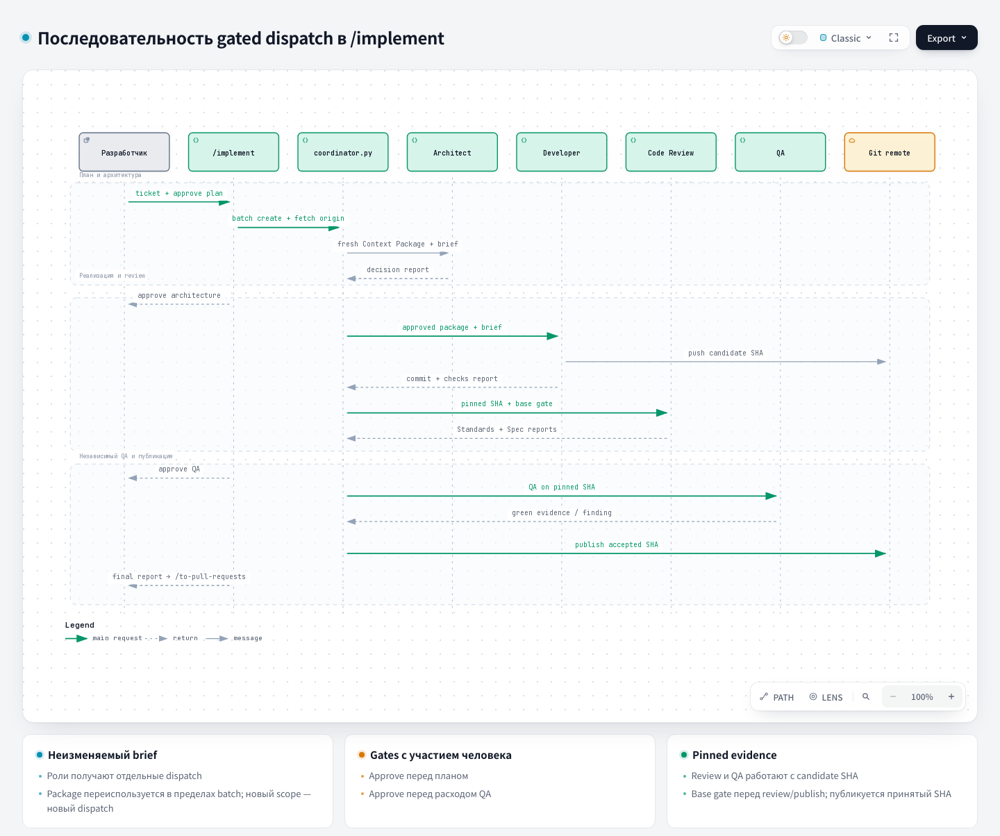

# Coordinator — Coordinator

Source: [`harness/orchestration/playbook.md`](https://github.com/PVMalove/agent-harness-next/blob/master/harness/orchestration/playbook.md). For statuses and evidence files, see the [Playbook](playbook.md) page.

## 1. Name and localization

- **English:** Coordinator
- **Russian (1:1):**

```text
Координатор
```

## 2. Translation of the role contract from the playbook

```text
The coordinator owns the batch lifecycle, dispatch approval, scope changes, and the decision to accept a completion report. The role manifest is the authoritative source for the role mode, the write boundary, the required evidence, and the risk triggers. The project configuration resolves the provider profile, the model, the fallback, the role write ceiling, the concurrency budget, and the verification commands; it cannot weaken the manifest contract.

Each batch has one ticket, one issue branch, and one isolated worktree. The coordinator records the resolved provider profile and model in the dispatch brief. Credentials never enter the brief, the project configuration, or the reports.

The coordinator records exactly one current state for each batch: `planned`, `awaiting-approval`, `active`, `paused`, `blocked`, `failed`, `completed`, or `abandoned` (`not-required` remains only in legacy records; new commands write `completed`). A role may report progress or a blocker, but it cannot move its own batch to another state or silently expand the brief. `reported` is the terminal outcome of one role dispatch, but it remains pending the coordinator's decision; the batch returns to `awaiting-approval` until the coordinator accepts the report, assigns a retry, blocks, marks a failure, abandons the batch, or creates a new dispatch.
```

## 3. Full description

The coordinator manages the lifecycle of one backend batch in `/implement`. It fixes the ticket, the explicit write scope (`--allowed-path`), the branch, and the worktree; builds the immutable brief; and accepts or rejects the role reports. Each dispatch is approved under `approval_policy`; the default is `manual_all`, where a human confirms each step. It does not write product code and does not choose the provider or the model: the project configuration resolves them, and the brief records them.

The coordinator starts after a ticket is selected or when the scope of the ticket changes. It first checks blockers, the concurrency budget, duplicate unfinished work, the single active writer, and the heavy QA queue. A file overlap with another batch does not block the start: such files are reconciled at integration. It then routes the work in sequence to the Architect, a write role, Code Review, and independent QA.

If a new fact appears after a dispatch, the coordinator first records a new decision. If the fact changes the scope, the DoD, the assignment, or the required evidence, the current dispatch ends, and the changed work is planned and approved as a new dispatch. A timeout, a model mismatch, a lack of evidence, or a risk outside the brief also leads to a new decision. A brief that was already sent is not edited.

## 4. Contracts

- **Input (Input/Brief):** the ticket and acceptance criteria; the explicit allowed paths of the batch; the issue branch and the isolated worktree; prohibitions; verification commands; the available concurrency budget; and the approve under `approval_policy`.
- **Output (Output/Report):** the batch state (`completed`, `paused`, `blocked`, `failed`, or `abandoned`), the decision log, and the accepted completion reports. For completion: all required evidence, the SHAs of the write roles, and the next safe step.

## Integration accounting after publish

A completed batch is not reopened and not rewritten. After an accepted publish, the coordinator
records the link between the ticket, the issue branch, the source batch, the published candidate SHA,
and the target SHA in a separate immutable integration record:

- `integration prepare --ticket T --branch B [--batch ID] [--candidate-commit SHA]` selects the
  single completed batch with an accepted publish, checks the SHA against the accepted report and
  against the remote, takes the accepted green QA of the same SHA, and writes the record
  idempotently. It does not substitute another batch, and every refusal contains a remedy.
- `integration status` is an observation with no write and no dispatch: `current`, `stale` (the
  integration ref moved ahead, so a new check of the pair is needed), or `unavailable`. Old QA is not
  carried over to a new pair.
- `integration refresh` prepares a PR when the integration base moves. If the target is unchanged,
  no rebase runs. Otherwise the own issue branch of the batch is rebased onto the exact target SHA and
  published through `--force-with-lease`. A dirty worktree, a worktree not on the issue branch, a
  changed remote branch, and writes to protected or `integration/*` branches are rejected. A conflict returns `state: conflict` with the resolver data. A
  rebase writes an immutable `IntegrationRefreshRecord`. The old QA stays as history; CI or local-QA
  confirms the new pair, and a repeat review is not needed (ADR 0014).
- `integration resolve` handles a text conflict with the integration target. A clean rebase is
  rejected; otherwise it creates a resolver batch and the brief of the `conflict-resolver` role
  (ADR 0015). Two automatic target SHAs are allowed; a third requires a human decision with
  `--extends-budget`. On incompatible requirements the resolver writes a checkpoint, the human answers
  through `integration resolver-event --kind human-decision`, and the same dispatch continues through
  `dispatch resume --trigger human-decision`. An accepted resolution takes the
  narrow route: no repeat review, but QA and CI or local-QA of the new pair are required.
- `integration local-qa --record <id> --ci-condition absent|unavailable|unusable --reason <text>` is
  the fallback full local QA of the exact candidate in an isolated checkout through the shared QA
  queue. It writes `verified` evidence only while the pair is current. It stores a failure as a finding.
  Infrastructure unavailability is a separate result with an explicit `--retry` and a limit.
- `integration link-evidence --kind ci|local-qa|resolver` is the only way to link future CI,
  local-QA, and resolver results. Each link is a separate record with its own pair of SHAs and
  `verification: unverified`. The operation does not run these routes itself.

- `integration next --ticket T --branch B [--pull-request N]` is a read-only PR continuation step
  (ADR 0017): `unavailable`, `resolver-open`, `refresh`, `route-failure`, `human-decision`,
  `confirm-pr`, `verify`, or `handoff`. A verification failure of a refreshed pair goes to the same
  resolver within the budget (`integration resolve` accepts such a failure, `resolver.trigger:
  verification-failure`). A failure of the original pair goes to an ordinary developer through a new
  batch of the same ticket and branch (`batch create`, then the ordinary pipeline and
  `integration prepare --batch <new batch>`). Operational failures do not count as a code failure.
  The `collect-ci` result carries a `next` hint (`wait` or `local-qa`).

The records live in the `reports/integration*`, `reports/resolver/`, and `reports/resolver-events/` directories of the existing `reports` directory: the ledger schema and
`ledger migrate` do not change. For details, see the [Backend orchestration](../backend-orchestration.md) page.

## Memory in the Context Package

The Context Package (the context package a role receives) in schema v3 stores the approved `goal` and DoD, the ADR cards, and the `memory` section separately.
The goal is passed locally through `batch create --goal`; the build does not call the tracker or the network.
The package runs one read-only search by goal + DoD in the existing index of the main
checkout. The pointers contain a bounded title, status, source type, path, hash of the source
bytes, date, superseded_by, and a generated inclusion reason. The package does not include the text of
sources, lessons, findings, or the source JSON of reports. Historical sources require verification;
the completion report keeps the status "not confirmed by a human".

`--no-memory` is supported in `dispatch propose`, `dispatch create`, and `context-package register`;
it records the `bypass` mode. `memory.enabled=false` records `disabled`. Both modes bypass the
search and take priority over the threshold. Without an index, the package gets empty pointers and
`index_missing`; the build does not create or update a cache. While there is no vector backend,
`min_similarity > 0` gives `vector_threshold_unavailable` before SQLite is opened. A zero threshold
keeps BM25/path ranking, with no normalization of BM25 into a cosine score. This is a gate of the Package
build; the existing standalone FTS search keeps its previous contract.

The builder selects whole pointers in the source order, at most `top_k` and at most
`min(top_k, 2)` for each validated source type, including `completion_report`.
Unfilled slots of one type are not given to another. The whole memory section, including
`diagnostic`, identity, and inclusion_reason, counts against `memory_policy.max_tokens` and against the
remainder of the shared token/byte budget. A pointer that is too large is skipped without using up a slot;
the main code context and the ADR cards stay. If even the mandatory empty v3 section does not fit
in the memory token ceiling or the shared budget, a bounded budget error is returned;
its overhead is not free.

Reuse requires a match of the pinned base/candidate, goal + DoD, the mode and the version of the selection policy,
and the freshness of all `memory.pointers`. If a frozen source changed, was deleted, or was revoked,
the next dispatch registers a new package, and the old one stays unchanged for the briefs already issued.
The appearance or update of only the index does not replace a frozen package. A legacy v2 package is checked against
the source fields and the integrity hash without a rewrite and is not reused as v3.
The freshness check reads bounded source bytes in the main checkout and checks the selected generation,
the allowlist, and the eligibility of the projection. A change, deletion, unavailability, or revocation of a source makes the
package stale; a change of only the index does not. The freshness check does not open SQLite
and does not run search/refresh; the existing admission gate for a stale package stays.

## 5. Architecture diagram



## Source

[coordinator.py](https://github.com/PVMalove/agent-harness-next/blob/master/harness/orchestration/coordinator.py)
