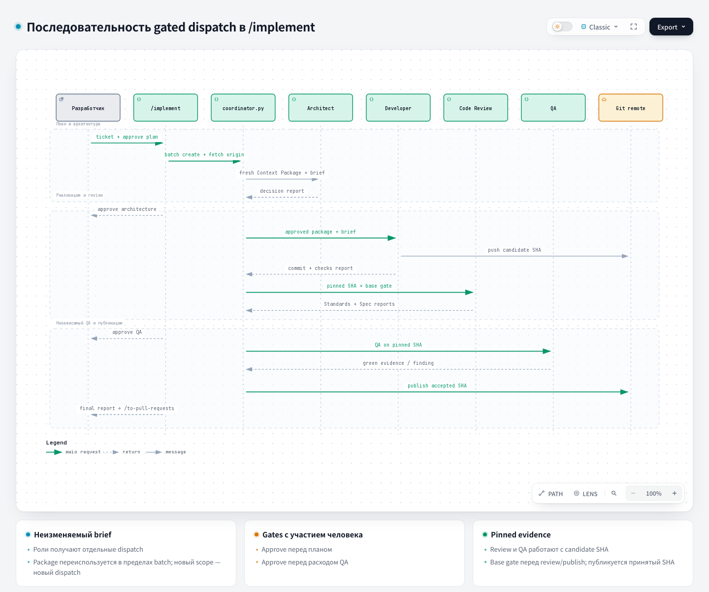

# Coordinator: координатор

Источник: [`harness/orchestration/playbook.md`](https://github.com/PVMalove/agent-harness-next/blob/master/harness/orchestration/playbook.md). Статусы и файлы доказательств описаны на странице [Playbook](playbook.md).

## 1. Название и локализация

- **English:** Coordinator
- **Русский (1:1):**

```text
Координатор
```

## 2. Перевод контракта роли из playbook

```text
Coordinator владеет жизненным циклом batch, одобрением dispatch, изменениями scope и решением принять completion report. Манифест роли задаёт режим роли, границу записи, обязательное доказательство и risk triggers. Конфигурация проекта задаёт профиль провайдера, модель, fallback, потолок записи роли, бюджет параллелизма и команды проверки; ослабить контракт манифеста она не может.

У каждого batch один тикет, одна issue-ветка и один изолированный worktree. Coordinator записывает выбранные профиль провайдера и модель в brief dispatch. Учётные данные никогда не попадают в brief, конфигурацию проекта или отчёты.

Coordinator записывает ровно одно текущее состояние каждого batch: `planned`, `awaiting-approval`, `active`, `paused`, `blocked`, `failed`, `completed` или `abandoned` (`not-required` остаётся только в старых записях; новые команды пишут `completed`). Роль может сообщить о прогрессе или блокере, но не может сама перевести свой batch в другое состояние или молча расширить brief. `reported` завершает один dispatch роли, но решение по нему остаётся за координатором: batch возвращается в `awaiting-approval`, пока coordinator не примет отчёт, не назначит retry, не заблокирует, не отметит провал, не откажется от batch или не создаст новый dispatch.
```

## 3. Полное описание

Координатор ведёт один backend-batch в `/implement` от начала до конца. Он фиксирует тикет, явный scope записи (`--allowed-path`), ветку и worktree, составляет неизменяемый brief и принимает или отклоняет отчёты ролей. Каждый dispatch проходит approve по `approval_policy`; по умолчанию это `manual_all`, и человек подтверждает каждый шаг. Продуктовый код координатор не пишет. Провайдера и модель он тоже не выбирает: их задаёт конфигурация проекта, а координатор записывает их в brief.

Координатор начинает работу, когда выбран тикет или изменилась его область. Сначала он проверяет блокировки, бюджет параллелизма, дубль незавершённой работы, единственного активного writer и очередь тяжёлого QA. Пересечение файлов с другим batch запуск не блокирует: такие файлы сводят при интеграции. Затем координатор по очереди направляет Architect, write-роль, Code Review и независимый QA.

Если после dispatch появился новый факт, coordinator сначала записывает новое решение. Если факт меняет scope, DoD, назначение или обязательное доказательство, текущий dispatch завершается, а изменённую работу планируют и одобряют как новый dispatch. Тайм-аут, несовпадение модели, нехватка доказательств или риск вне brief тоже ведут к новому решению. Уже отправленный brief не правят.

## 4. Контракты

- **Вход (Input/Brief):** тикет и критерии приёмки; явные allowed paths batch; issue-ветка и изолированный worktree; запреты; команды проверки; доступный бюджет параллелизма и approve по `approval_policy`.
- **Выход (Output/Report):** состояние batch (`completed`, `paused`, `blocked`, `failed` или `abandoned`), журнал решений и принятые completion reports. Для завершения нужны все обязательные доказательства, SHA write-ролей и следующий безопасный шаг.

## Integration accounting после publish

Завершённый batch не переоткрывается и не переписывается. После принятого publish coordinator
записывает связь тикета, issue-ветки, source batch, опубликованного candidate SHA и target SHA
в отдельную неизменяемую integration-запись:

- `integration prepare --ticket T --branch B [--batch ID] [--candidate-commit SHA]` выбирает
  единственный завершённый batch с принятым publish, сверяет SHA с принятым отчётом и с remote,
  берёт принятый зелёный QA того же SHA и идемпотентно пишет запись. Другой batch команда не
  подставляет, и каждый отказ называет способ исправления.
- `integration status` только наблюдает, ничего не пишет и не создаёт dispatch. Ответ: `current`,
  `stale` (integration ref ушёл вперёд, пару нужно проверить заново) или `unavailable`. Старый QA на
  новую пару не переносится.
- `integration refresh` готовит PR, когда integration base сдвинулась. Если target не изменился,
  rebase не запускается. Иначе команда перебазирует собственную issue-ветку batch на точный SHA
  target и публикует её через `--force-with-lease`. Грязный worktree, worktree не на issue-ветке,
  изменённую remote-ветку и запись в protected-ветки или `integration/*` команда отклоняет. Конфликт
  возвращает `state: conflict` с данными для resolver. Rebase пишет неизменяемый
  `IntegrationRefreshRecord`. Старый QA остаётся историей, новую пару подтверждают CI или local-QA,
  повторный review не нужен (ADR 0014).
- `integration resolve` передаёт текстовый конфликт с integration target роли `conflict-resolver`
  (ADR 0015). Чистый rebase команда отклоняет, иначе создаёт resolver batch и brief роли.
  Допустимы два автоматических target SHA; третий требует решения человека с `--extends-budget`.
  При несовместимых требованиях resolver пишет checkpoint, человек отвечает через
  `integration resolver-event --kind human-decision`, и тот же dispatch продолжается через
  `dispatch resume --trigger human-decision`. Принятая резолюция идёт узким маршрутом: повторного
  review нет, но QA и CI либо local-QA новой пары обязательны.
- `integration local-qa --record <id> --ci-condition absent|unavailable|unusable --reason <текст>`
  запускает запасной полный локальный QA точного candidate в изолированном checkout через общую
  очередь QA. Evidence с `verified` команда пишет, только пока пара текущая. Провал проверки она
  сохраняет как finding. Недоступность инфраструктуры даёт отдельный результат: повтор нужен явный,
  через `--retry`, и ограничен лимитом.
- `integration link-evidence --kind ci|local-qa|resolver` единственным способом привязывает будущие
  результаты CI, local-QA и resolver. Каждая привязка становится отдельной записью со своей парой
  SHA и `verification: unverified`. Сами эти проверки команда не запускает.

- `integration next --ticket T --branch B [--pull-request N]` только читает и выбирает следующий шаг
  продолжения PR (ADR 0017): `unavailable`, `resolver-open`, `refresh`, `route-failure`,
  `human-decision`, `confirm-pr`, `verify` или `handoff`. Провал проверки обновлённой пары уходит тому
  же resolver в пределах бюджета: `integration resolve` принимает такой провал (`resolver.trigger:
  verification-failure`). Провал исходной пары уходит обычному developer через новый batch того же
  тикета и ветки (`batch create`, затем обычный конвейер и `integration prepare --batch <новый batch>`).
  Операционные сбои провалом кода не считаются. Результат `collect-ci` содержит подсказку `next`
  (`wait` либо `local-qa`).

Записи лежат в каталогах `reports/integration*`, `reports/resolver/` и `reports/resolver-events/`
существующего каталога `reports`, поэтому схема ledger и `ledger migrate` не меняются. Подробности
на странице [Backend-оркестрация](../backend-orchestration.md).

## Память в Context Package

Context Package (пакет контекста, который получает роль) в схеме v3 отдельно хранит утверждённые
`goal` и DoD, ADR-карточки и секцию `memory`. Goal передаётся локально через `batch create --goal`;
сборка не обращается к трекеру или сети. Пакет один раз выполняет read-only поиск по goal и DoD в уже
существующем индексе главного checkout. Указатели содержат ограниченные заголовок, статус, тип
источника, путь, hash исходных байтов, дату, `superseded_by` и сгенерированную причину включения.
Текст источников, lessons, findings и исходный JSON отчётов в пакет не попадают. Исторические
источники требуют проверки; completion report сохраняет статус «не подтверждено человеком».

`dispatch propose`, `dispatch create` и `context-package register` принимают `--no-memory`; он
записывает режим `bypass`. `memory.enabled=false` записывает режим `disabled`. Оба режима обходят
поиск и важнее порога. Если индекса нет, пакет получает пустые указатели и `index_missing`; сборка
не создаёт и не обновляет кэш. Пока векторного backend нет, `min_similarity > 0` даёт
`vector_threshold_unavailable` ещё до открытия SQLite. Нулевой порог сохраняет ранжирование
BM25/path и не переводит BM25 в cosine score. Это правило сборки пакета; отдельный FTS-поиск
сохраняет прежний контракт.

Builder берёт указатели целиком в исходном порядке: не больше `top_k` всего и не больше
`min(top_k, 2)` на каждый проверенный тип источника, включая `completion_report`. Свободные слоты
одного типа другому не передаются. Вся секция памяти, включая `diagnostic`, identity и
`inclusion_reason`, входит в `memory_policy.max_tokens` и в остаток общего бюджета токенов и байтов.
Слишком большой указатель builder пропускает, слот при этом не тратится; основной кодовый контекст
и ADR-карточки сохраняются. Если в потолок токенов памяти или в общий бюджет не помещается даже
обязательная пустая секция v3, сборка возвращает ограниченную ошибку бюджета: её служебный объём
тоже учитывается.

Пакет переиспользуется, только если совпадают закреплённые base и candidate, goal и DoD, режим и
версия политики отбора, а все `memory.pointers` свежие. Если замороженный источник изменился,
удалён или отозван, следующий dispatch регистрирует новый пакет, а старый остаётся неизменным для
уже выданных brief. Новый или обновлённый индекс сам по себе замороженный пакет не заменяет.
Старый пакет v2 проверяется по исходным полям и integrity hash без перезаписи и как v3 не
переиспользуется.

Проверка свежести читает ограниченные исходные байты в main checkout и сверяет выбранную
generation, allowlist и допустимость проекции. Изменение, удаление, недоступность или отзыв
источника делают пакет stale; изменение только индекса этого не делает. Проверка свежести не
открывает SQLite и не запускает search или refresh. Пакет со статусом stale по-прежнему не проходит
admission gate.

## 5. Архитектурная схема



## Источник

[coordinator.py](https://github.com/PVMalove/agent-harness-next/blob/master/harness/orchestration/coordinator.py)
