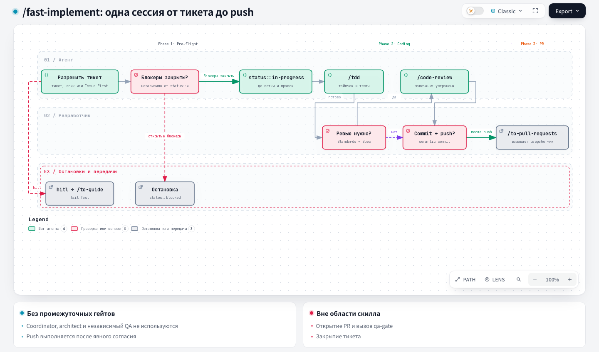

# Fast Implement — Fast implementation

## 1. Name and localization

- **English name:** `Fast Implement`
- **Russian translation:**

```text
Быстрая реализация
```

## 2. Full translation of the skill text

<div class="ah-skill-text" markdown="1">

```yaml
name: fast-implement
description: "Implement a piece of work in a single session, without the coordinator pipeline's approval gates."
disable-model-invocation: true
```

### Fast implementation

**Objective:** implement the work the user described in the spec or tickets in this session, without the architect step, the independent QA role, and the coordinator approval gates.

This is the short route. Use it for a ticket whose direction is not in question and whose blast radius is small. In every other case use `/implement`, which runs the gated architect → developer → code-review → QA pipeline.

#### Execution in three phases

A strict pipeline run in order: **pre-flight** (confirm that the ticket is actually startable and that this agent must do it) → **coding** (TDD, tests, an explicitly approved review, commit and push) → **PR and wrap-up** (offer the separate `/to-pull-requests` command). Only the developer can select `/to-pull-requests`.

##### Phase 1: pre-flight

On GitLab, every `glab` command names the project with `-R <project-url>`; `<project-url>` and the other GitLab placeholders (`<host>`, `<project-id>`) are defined in `docs/agents/issue-tracker.md` → GitLab → Conventions.

1. **Resolve the ticket.**
   - **A specific ticket is named** (an issue number, a URL, or a `.scratch/<feature>/issues/NN-*.md` path): use it.
     - **Fail fast on `hitl`:** if it carries `hitl` (see `docs/agents/triage-labels.md`), stop immediately and tell the user to run `/to-guide` instead — do not check anything else on this ticket: this agent implements only `afk` work.
     - **Fail fast without `pipeline::fast`:** for an `afk` ticket, require the explicit `pipeline::fast` label (GitHub/GitLab) or the `**Pipeline:** pipeline::fast` field (local tracker) — see `docs/agents/triage-labels.md`. If the label or field is absent entirely or is `pipeline::full`, stop immediately and tell the user to run `/implement` instead.
   - **An epic is named** (it carries `status::specs` or is otherwise the parent of a decomposition) rather than a specific ticket: pick the next ticket yourself instead of asking. Never auto-pick a `hitl` ticket — that execution mode always routes through `/to-guide`, not this agent.
     - **GitHub/GitLab:** run the same frontier query `/wayfinder` uses (`docs/agents/issue-tracker.md#wayfinding-operations`), scoped to the epic's sub-issues and filtered to `pipeline::fast` + `afk` — open, unblocked, unclaimed, first in decomposition order. Claim the chosen ticket (`gh issue edit <n> --add-assignee @me` on GitHub, `glab issue update <n> -R <project-url> --assignee @me` on GitLab) before any other write, the way `/wayfinder` does, so that a concurrent session (for example, a parallel worktree) does not pick the same ticket. If the filtered frontier is empty, stop and tell the user why: if open, unblocked, unclaimed tickets remain but all are `hitl`, say so and point at `/to-guide`; if unblocked `afk` tickets remain but none carries `pipeline::fast` (label missing or `pipeline::full`), say so and point at `/implement`; otherwise explain that nothing is unblocked yet, or that everything is already claimed.
     - **Local tracker:** read each `.scratch/<feature>/issues/NN-*.md` file in filename order — a purely linear chain — and take the first one that is `**Workflow:** status::ready`, `**Execution:** afk`, and `**Pipeline:** pipeline::fast`. If tickets remain but every `status::ready` one is `hitl`, say so — naming them — and point at `/to-guide` instead of picking one; if `afk` ones remain but none carries `**Pipeline:** pipeline::fast`, say so — naming them — and point at `/implement`.
     - Once chosen this way, treat the ticket exactly like one named explicitly for the rest of this process.
   - **Nothing is named:** when this repository defines a git workflow doc (for example, `docs/agents/git-workflow.md`) with an "Issue First" rule, stop and ask the user to name an existing ticket or run `/to-spec`/`/to-tickets` first — do not start the work. Otherwise, skip this check entirely.
2. **Check blockers**, on the resolved ticket, whatever its current `status::*` label. Read its blockers from this repository's tracker (native GitHub/GitLab dependency links, or the `Blocked by:`/`**Blocked by:**` field — see `docs/agents/issue-tracker.md`).
   - Any blocker still open → stop and tell the user which ones. Do not start the work. If the ticket is not already `status::blocked`, set it (the same label swap as in step 3).
   - All blockers closed/resolved (or none) → continue. A `status::blocked` ticket passes through `status::ready` in step 3.
3. **Mark it in progress before creating the issue branch or editing any file**, in every run mode, cloud and single-session runs included. A ticket carries exactly one `status::*` label (see `docs/agents/triage-labels.md`), so replace, do not add:
   - **GitHub:** `gh issue edit <n> --remove-label status::ready --remove-label status::blocked --add-label status::in-progress`, then confirm with `gh issue view <n> --json labels --jq '[.labels[].name]'` that `status::in-progress` is the only `status::*` label.
   - **GitLab:** `glab issue update <n> -R <project-url> --unlabel status::ready,status::blocked --label status::in-progress`, then confirm with `glab issue view <n> -R <project-url> -F json` that `status::in-progress` is the only `status::*` label in its `labels`.
   - **Local tracker:** set the file's `**Workflow:**` line to `status::in-progress`.
   - If the label write fails, stop and report it; do not start coding on an unmarked ticket.
4. **Git pre-flight, before editing files:**
   - Resolve the exact integration branch from the ticket's `## Integration Branch` section or, for a child ticket that omits it, from its parent epic. An absent value is a blocker; do not infer a branch from memory, the current checkout, or a service name.
   - The current branch must match `branch_pattern` and be an issue branch. If it does not, fetch the integration branch and create `feature/issue-<ID>-<slug>` from it before coding. Never commit or push directly to the project base branch or an `integration/*` branch.

##### Phase 2: coding

1. **Agree the seams before the first test.** Name the requirement and the public seam where its behavior is observed, with the public signatures and existing fixtures. When the ticket or spec already names them, restate them and ask the developer to confirm; otherwise propose them yourself. Stop for the developer's answer. Never invent a seam and never write a test before the developer has agreed it.
2. Use `/tdd` at those seams. Run `python3 -I -B .harness/health/test_author.py preflight --repo .` once before the first test. It selects runtime/model/effort from the explicit `test_author` profile in `.harness/project.json`, then invokes the supported protected adapter (`.claude/hooks/test-author-preflight.sh` for Claude). Missing settings or `runtime_unsupported` preserve ordinary TDD, without substituting another executor. Exactly `{"status":"ok"}` selects the test-author cycle below. Any other answer (`disabled`, a missing or failing hook, unavailable isolation, no `test_paths` or `test_runner`) selects the ordinary `/tdd` route in this session: tell the developer the sanitized `reason` (or that the hook failed) in one line, do not start an unprotected author, and do not re-run preflight hoping for another answer. Neither route adds a coordinator, architect or QA step.
3. **Test-author cycle.** It is the same cycle as the configured external developer in the full route (`Red-Green-Refactor with the optional test author` in the orchestration `developer.md` and the tdd skill), and you play the developer. For each implementation step, in order:
    - **Handoff:** save a prompt-file and call `python3 -I -B .harness/health/test_author.py run --repo . --prompt-file <path>`; it applies the project runtime/model/effort after preflight. Give the `test-author` the requirement, the agreed seam, the public signatures, the existing fixtures and one scenario. Never pass a proposed algorithm or implementation snippet as the basis of an expectation.
    - **Reply:** it answers in compact English with `status` (`red`, `needs_skeleton` or `contract_gap`), the requirement, the inputs, the source of the expectation, the test id and, for `red`, the sanitized runner JSON plus the failed assertion, the expectation and the actual result from the run's `log.txt`.
    - **Verify the expectation** against the requirement and its stated source before any implementation. An expectation derived from the implementation, or one the requirement does not support, goes back to the author as a failed call. An accepted expectation is never weakened to reach Green; only a justified contract change (the requirement or the agreed seam changed with the developer) allows correcting it, with a new author call and a new verification.
    - **Statuses:** `red` continues. `needs_skeleton`: write only types and signatures with no logic, then rerun the author on the same scenario. `contract_gap`: clarify the requirement or seam with the developer, never guess it.
    - **Not a behavioral Red:** a compile or import error, a fixture error, and an environment or runner refusal are never Red, whatever `status` says. A test that is Green immediately does not count as a cycle. Each is a failed author call.
    - **Green, then Refactor:** after a confirmed behavioral Red, write the minimal implementation that passes the unchanged test and run it by its test id; refactor only on Green, re-run the test, then request the next test.
    - **Attempt limit:** after three consecutive failed author calls on one test, stop the local retries and report the blocker to the developer. A guard denial counts as one failed call, and the denied call is never rephrased. Local retries create no dispatch and no ledger state.
4. Run typechecking regularly, single test files regularly, and the full test suite once at the end.
5. Ask the developer: "Run a code review?" Stop for their answer.
   - **Yes:** run `/code-review`. It launches the Standards and Spec subagents through the coding application's manually configured mechanism, waits for both reports, and returns its separate `## Standards` and `## Spec` report to this primary session. Address any requested changes, then repeat the relevant tests before continuing.
   - **No:** record that the developer declined review and continue.
6. Ask the developer for explicit permission to commit and push. Stop for their answer.
7. After approval, verify that the current branch still matches `branch_pattern` and is neither `base_branch` nor `integration/*`; commit the completed work with a Semantic Commit Message and push it to the current issue branch. Report the commit and push result to the developer.

##### Phase 3: PR and wrap-up

After a successful push, offer `/to-pull-requests <ticket>` as the next command. Do not invoke it automatically, open a PR, run `qa-gate`, or close the ticket in this skill. Leave `status::in-progress` on the ticket: this skill never removes it. Closing the ticket and moving its unblocked dependents to `status::ready` belong to `/to-pull-requests` after the merge.

</div>

## 3. Contracts

- **Input (Input/Brief):** a specific ticket or an epic, its criteria and the dependent tracker records; the developer's explicit permission for the review and for the commit/push.
- **Output (Output/Report):** the implementation in the issue branch, the check results, the ticket state and, after the push, an offer to open the PR with a separate skill.

## 4. Architecture diagram



## Source

[SKILL.md](https://github.com/PVMalove/agent-harness-next/blob/master/skills/first-party/engineering/fast-implement/SKILL.md)
