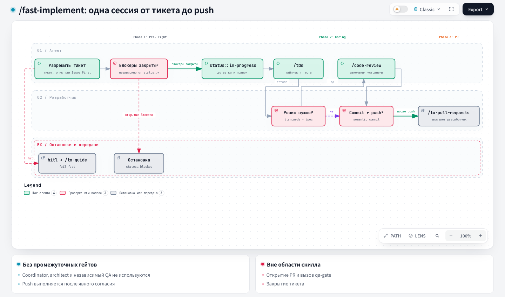

# Fast Implement: быстрая реализация

## 1. Название и локализация

- **Английское название:** `Fast Implement`
- **Русский перевод:**

```text
Быстрая реализация
```

## 2. Полный перевод текста скила

<div class="ah-skill-text" markdown="1">

```yaml
name: fast-implement
description: "Реализуйте часть работы за одну сессию без approval-gates конвейера координатора."
disable-model-invocation: true
```

### Быстрая реализация

**Цель:** реализуйте в этой сессии работу, которую пользователь описал в спецификации или тикетах. Без шага архитектора, без независимой роли QA и без approval-gates координатора.

Это короткий маршрут. Он подходит для тикета, направление которого не вызывает вопросов, а изменение затрагивает немного. Для всего остального используйте `/implement`: он запускает gated-конвейер architect → developer → code-review → QA.

#### Выполнение в трёх фазах

Строгий конвейер, фазы идут по порядку: **предварительная проверка** (убедиться, что тикет действительно можно начать и что его должен делать этот агент) → **кодирование** (TDD, тесты, review с явного согласия, коммит и пуш) → **PR и завершение** (предложить отдельную команду `/to-pull-requests`). Выбрать `/to-pull-requests` может только разработчик.

##### Фаза 1: предварительная проверка

В GitLab каждая команда `glab` называет проект через `-R <project-url>`. `<project-url>` и другие плейсхолдеры GitLab (`<host>`, `<project-id>`) определены в `docs/agents/issue-tracker.md` → GitLab → Conventions.

1. **Определите тикет.**
   - **Назван конкретный тикет** (номер issue, URL или путь `.scratch/<feature>/issues/NN-*.md`): используйте его.
     - **Сразу остановитесь на `hitl`:** если у тикета есть `hitl` (см. `docs/agents/triage-labels.md`), сразу остановитесь и предложите пользователю запустить `/to-guide`. Больше ничего по этому тикету не проверяйте: этот агент реализует только работу `afk`.
     - **Сразу остановитесь без `pipeline::fast`:** тикету `afk` нужна явная метка `pipeline::fast` (GitHub/GitLab) или поле `**Pipeline:** pipeline::fast` (локальный трекер), см. `docs/agents/triage-labels.md`. Если метки или поля нет совсем или там `pipeline::full`, сразу остановитесь и предложите пользователю запустить `/implement`.
   - **Назван эпик, а не конкретный тикет** (у него `status::specs` или он иначе служит родителем декомпозиции): выберите следующий тикет сами, не спрашивая. Никогда не выбирайте автоматически тикет `hitl`: этот режим выполнения всегда идёт через `/to-guide`, а не через этого агента.
     - **GitHub/GitLab:** выполните тот же запрос фронтира, что и `/wayfinder` (`docs/agents/issue-tracker.md#wayfinding-operations`), по подзадачам эпика с фильтром `pipeline::fast` + `afk`: открытый, незаблокированный, никем не взятый, первый в порядке декомпозиции. Возьмите выбранный тикет на себя (`gh issue edit <n> --add-assignee @me` в GitHub, `glab issue update <n> -R <project-url> --assignee @me` в GitLab) до любой другой записи, как это делает `/wayfinder`. Тогда параллельная сессия (например, в соседнем worktree) не возьмёт тот же тикет. Если после фильтра фронтир пуст, остановитесь и объясните пользователю причину. Если остались открытые, незаблокированные и никем не взятые тикеты, но все они `hitl`, скажите это и укажите на `/to-guide`. Если остались незаблокированные тикеты `afk`, но ни у одного нет `pipeline::fast` (метки нет или стоит `pipeline::full`), скажите это и укажите на `/implement`. Иначе объясните, что пока ничего не разблокировано или всё уже взято.
     - **Локальный трекер:** прочитайте файлы `.scratch/<feature>/issues/NN-*.md` в порядке имён (это строго линейная цепочка) и возьмите первый, у которого одновременно `**Workflow:** status::ready`, `**Execution:** afk` и `**Pipeline:** pipeline::fast`. Если тикеты остались, но каждый `status::ready` помечен `hitl`, скажите это, назовите их и укажите на `/to-guide`, ничего не выбирая. Если остались тикеты `afk`, но ни у одного нет `**Pipeline:** pipeline::fast`, скажите это, назовите их и укажите на `/implement`.
     - Дальше обрабатывайте выбранный так тикет точно так же, как явно названный.
   - **Ничего не названо:** если в репозитории есть документ git-процесса (например, `docs/agents/git-workflow.md`) с правилом «Issue First», остановитесь и попросите пользователя назвать существующий тикет или сначала запустить `/to-spec`/`/to-tickets`. Работу не начинайте. Если такого документа нет, пропустите эту проверку.
2. **Проверьте блокеры** выбранного тикета, какая бы метка `status::*` на нём ни стояла. Прочитайте блокеры через трекер этого репозитория: встроенные связи зависимостей GitHub/GitLab или поле `Blocked by:`/`**Blocked by:**` (см. `docs/agents/issue-tracker.md`).
   - Какой-то блокер ещё открыт → остановитесь и назовите пользователю открытые блокеры. Работу не начинайте. Если у тикета ещё нет `status::blocked`, поставьте эту метку (той же заменой, что в шаге 3).
   - Все блокеры закрыты или их нет → продолжайте. Тикет со `status::blocked` проходит через `status::ready` в шаге 3.
3. **Пометьте тикет как взятый в работу до того, как создадите issue-ветку или измените любой файл**, в любом режиме запуска, включая облачный и запуск в одной сессии. У тикета ровно одна метка `status::*` (см. `docs/agents/triage-labels.md`), поэтому заменяйте метку, а не добавляйте:
   - **GitHub:** `gh issue edit <n> --remove-label status::ready --remove-label status::blocked --add-label status::in-progress`, затем через `gh issue view <n> --json labels --jq '[.labels[].name]'` убедитесь, что `status::in-progress` осталась единственной меткой `status::*`.
   - **GitLab:** `glab issue update <n> -R <project-url> --unlabel status::ready,status::blocked --label status::in-progress`, затем через `glab issue view <n> -R <project-url> -F json` убедитесь, что `status::in-progress` осталась единственной меткой `status::*` в `labels`.
   - **Локальный трекер:** поставьте в строке `**Workflow:**` файла `status::in-progress`.
   - Если метку записать не удалось, остановитесь и сообщите об этом. Не начинайте писать код по непомеченному тикету.
4. **Проверьте Git, прежде чем менять файлы:**
   - Возьмите точное имя integration-ветки из раздела тикета `## Integration Branch`. Если в дочернем тикете этого раздела нет, возьмите его из родительского эпика. Если значения нет, это блокер: не выводите ветку из памяти, текущего checkout или имени сервиса.
   - Текущая ветка должна совпадать с `branch_pattern` и быть issue-веткой. Если это не так, сделайте fetch integration-ветки и до начала кода создайте от неё `feature/issue-<ID>-<slug>`. Никогда не коммитьте и не пушьте прямо в базовую ветку проекта или в ветку `integration/*`.

##### Фаза 2: кодирование

1. **Согласуйте seams до первого теста.** Назовите требование и публичный seam, на котором видно его поведение, вместе с публичными сигнатурами и существующими fixtures. Если тикет или спецификация уже называют их, повторите их и попросите разработчика подтвердить, иначе предложите сами. Остановитесь и дождитесь ответа разработчика. Никогда не придумывайте seam и не пишите тест, пока разработчик его не согласовал.
2. Работайте через `/tdd` на этих seams. Перед первым тестом один раз запустите `python3 -I -B .harness/health/test_author.py preflight --repo .`. Команда берёт runtime/model/effort из явного профиля `test_author` в `.harness/project.json` и вызывает поддерживаемый защищённый adapter (`.claude/hooks/test-author-preflight.sh` для Claude). Если настроек нет или ответ `runtime_unsupported`, остаётся обычный TDD, и другой исполнитель не подставляется. Ровно `{"status":"ok"}` выбирает цикл с тест-автором ниже. Любой другой ответ (`disabled`, hook отсутствует или упал, изоляция недоступна, нет `test_paths` или `test_runner`) выбирает обычный маршрут `/tdd` в этой сессии. Тогда одной строкой сообщите разработчику очищенную `reason` (или что hook упал), не запускайте незащищённого автора и не повторяйте preflight в надежде на другой ответ. Ни один маршрут не добавляет шаг coordinator, architect или QA.
3. **Цикл с тест-автором.** Это тот же цикл, что у настроенного внешнего developer в полном маршруте (раздел `Red-Green-Refactor with the optional test author` в `developer.md` оркестрации и скилл tdd), только developer здесь вы. Для каждого шага реализации по порядку:
    - **Передача:** сохраните задание в prompt-файл и вызовите `python3 -I -B .harness/health/test_author.py run --repo . --prompt-file <путь>`. После preflight команда применяет runtime/model/effort проекта. Передайте `test-author` требование, согласованный seam, публичные сигнатуры, существующие fixtures и один сценарий. Никогда не передавайте предложенный алгоритм или фрагмент реализации как основу ожидания.
    - **Ответ:** автор отвечает коротко по-английски: `status` (`red`, `needs_skeleton` или `contract_gap`), требование, входные данные, источник ожидания, id теста. Для `red` он добавляет очищенный JSON runner, упавшее утверждение, ожидание и фактический результат из `log.txt` запуска.
    - **Проверьте ожидание** по требованию и указанному источнику до любой реализации. Если ожидание выведено из реализации или требование его не подтверждает, верните его автору: это неудачный вызов. Принятое ожидание нельзя ослаблять ради Green. Исправить его можно только при обоснованном изменении контракта (требование или согласованный seam изменились вместе с разработчиком), и тогда нужны новый вызов автора и новая проверка.
    - **Статусы:** при `red` продолжайте. При `needs_skeleton` напишите только типы и сигнатуры без логики и снова вызовите автора на том же сценарии. При `contract_gap` уточните требование или seam у разработчика, не угадывайте.
    - **Не поведенческий Red:** ошибка компиляции или импорта, ошибка fixture и отказ окружения или runner никогда не считаются Red, что бы ни было в `status`. Тест, который сразу зелёный, не засчитывается как цикл. Каждый такой случай считается неудачным вызовом автора.
    - **Green, затем Refactor:** после подтверждённого поведенческого Red напишите минимальную реализацию, которая проходит неизменённый тест, и запустите тест по id. Рефакторьте только на Green, перезапустите тест и запросите следующий.
    - **Лимит попыток:** после трёх неудачных вызовов автора подряд по одному тесту прекратите локальные повторы и сообщите разработчику блокер. Отказ guard считается одним неудачным вызовом, и отклонённый вызов нельзя переформулировать. Локальные повторы не создают dispatch и состояние ledger.
4. Регулярно запускайте проверку типов и отдельные тестовые файлы, а полный набор тестов запустите один раз в конце.
5. Спросите разработчика: «Провести code review?» Остановитесь и дождитесь ответа.
   - **Да:** запустите `/code-review`. Он запускает подагентов Standards и Spec через механизм, вручную настроенный в coding application, ждёт оба отчёта и возвращает в эту основную сессию раздельный отчёт `## Standards` и `## Spec`. Внесите запрошенные изменения и перед продолжением повторите нужные тесты.
   - **Нет:** запишите, что разработчик отказался от review, и продолжайте.
6. Попросите у разработчика явное разрешение на коммит и пуш. Остановитесь и дождитесь ответа.
7. После разрешения проверьте, что текущая ветка всё ещё совпадает с `branch_pattern` и это не `base_branch` и не `integration/*`. Закоммитьте готовую работу с Semantic Commit Message и запушьте её в текущую issue-ветку. Сообщите разработчику результат коммита и пуша.

##### Фаза 3: PR и завершение

После успешного пуша предложите следующей командой `/to-pull-requests <ticket>`. В этом скилле не вызывайте её автоматически, не открывайте PR, не запускайте `qa-gate` и не закрывайте тикет. Оставьте на тикете `status::in-progress`: этот скилл никогда его не снимает. Тикет закрывает `/to-pull-requests` после мержа, он же переводит разблокированные зависимые тикеты в `status::ready`.

</div>

## 3. Контракты

- **Вход (Input/Brief):** конкретный тикет или эпик, его критерии и связанные записи трекера; явное разрешение разработчика на review и на коммит и пуш.
- **Выход (Output/Report):** реализация в issue-ветке, результаты проверок, состояние тикета, а после пуша предложение открыть PR отдельным скиллом.

## 4. Архитектурная схема



## Источник

[SKILL.md](https://github.com/PVMalove/agent-harness-next/blob/master/skills/first-party/engineering/fast-implement/SKILL.md)
