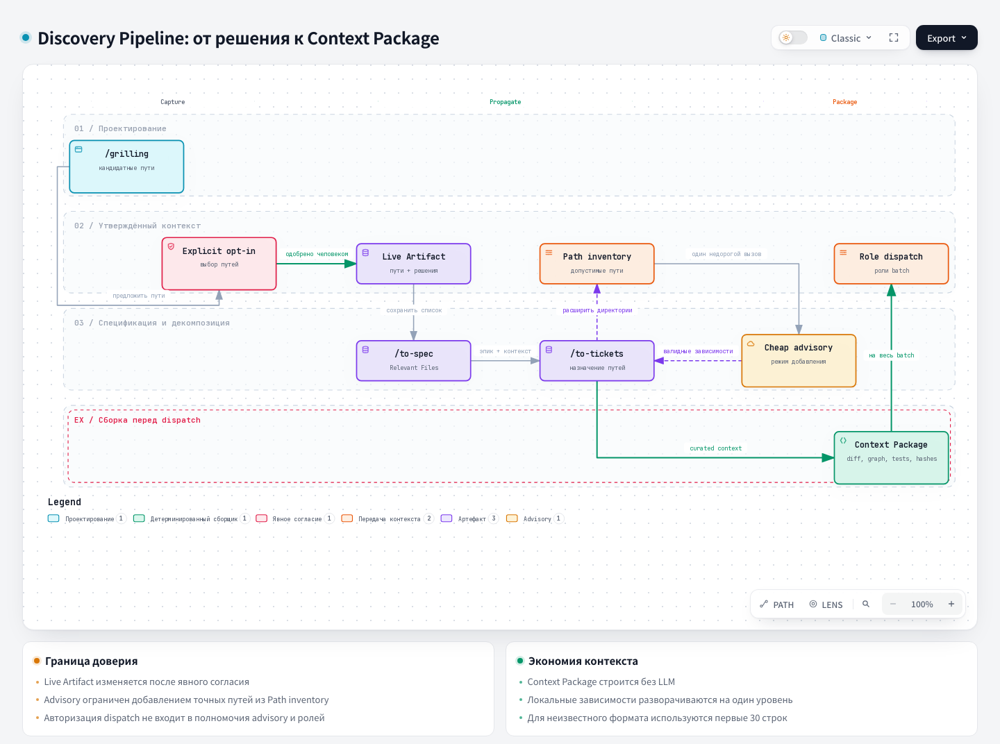

# Grilling — Hard interview

## 1. Name and localization

- **English name:** `grilling`
- **Russian translation:**

```text
Жёсткое интервью
```

## 2. Full translation of the skill text

<div class="ah-skill-text" markdown="1">

```yaml
name: grilling
description: Run a structured interview to stress-test a plan, idea, or decision. Use directly when asked to grill or as the interview engine for other skills.
```

### Set the scope

State the goal, what is in scope, and where the interview stops. Resolve ambiguities before the
first design round. Use `/grill-me` for interview and Discovery Context only, and
`/grill-with-docs` when the user also wants to maintain the glossary and consider ADRs.
A caller that combines this engine with `/domain-modeling` follows the `/grill-with-docs` write rules.

### Run the interview

1. Start each round with **Accepted decisions**, **Open questions and hypotheses**, and
   **Current assumptions** in the user's language. Give decisions stable IDs.
   Keep hypotheses to test distinct from assumptions in use.
2. Work from root decisions outward. Ask only questions whose prerequisites are settled.
   Verify facts with targeted reads. Bring ready questions forward while other facts are still pending.
3. Batch up to four ordinary clarifications (requirements, terms, simple choices) per round.
   Use one question-tool call for categorical questions if available, respecting its own limit.
   Put the recommended choice first. Use chat for open questions or when the tool is unavailable.
4. Give a significant fork its own round with the Decision & Clarity Protocol. Wait for the
   user's response before advancing any round.

Handle these commands at any round:

- `остановимся` (stop) ends the interview with a partial summary.
- `углубимся сюда` (go deeper here) keeps the focus on the indicated question and checks its evidence and trade-offs.
- `отложим этот вопрос` (defer this question) parks it and its dependents. Continue with independent questions.

For repository work, consult project memory once before the first design round when enabled.
Follow `.harness/instructions/project-memory.md` and repeat only if a settled decision changes
the subject. In a dispatch use the supplied Context Package and escalate missing evidence.
Run Repo Map once just before the first search for candidate paths, using
`python .harness/repo_map/repo_map.py --repo . --commit "$(git rev-parse HEAD)"`. Then use
targeted `rg` and reads. Keep the map in this session. If an evidence command is unavailable or
may write a cache while the write gate is closed, use targeted read-only searches instead.

### Decision & Clarity Protocol

Use for architecture choices, contract or schema changes, conflicting constraints, and
nontrivial implementations. Start read-only when investigating such a fork. No file writes
(including glossary, ADR, Discovery Context, or tool side effects) until the user explicitly
chooses a variant. Approval applies only to that decision. Each artifact still needs its own
approval. A detail request, deferral, or stop authorizes no write for the unresolved fork.

1. Give 2–3 sentences covering the decision and verified repository facts. Name missing evidence.
2. Render the matrix in a fenced `text` block with box-drawing borders (`┌─┐`, `│`, `├─┤`, `└─┘`).
   Give each viable option a full-width header and separate rows for Mechanism, Benefit, and Cost.
   Explain which components or contracts change, how they work, and the concrete benefits and costs.
   Wrap paragraphs across lines and keep technical detail and identifiers intact.
   - **[1] Рекомендуемое (Recommended)** — mechanism, reason to prefer it, and trade-off.
   - **[2] Компромиссное (Fast-Track)** — simplification, time saved, and debt or risk.
   - **[3] Полное (Full / Clean Architecture)** — target design, long-term benefit, and migration cost.
   If there are fewer than three technically distinct options, say why and omit unsupported rows.
3. Offer the displayed numbers (`1`, `2`, `3`) as explicit approval. Record the choice by decision ID.
   Offer `подробнее 1` (`2`, `3`, `все`) as a read-only chat command.
   Read references/drill-down-template.md ONLY when the user requests подробнее <N> (or details <N>).
   `все` / `all` expands each displayed row. After explaining, show the same choice again and wait.

### Discovery Context

- Show new candidate paths in a separate confirmation before asking design questions. Offer
  approve all, select paths, or skip. Wait for the answer. This step uses none of the four question slots.
- Only explicitly approved paths enter the list. You may read a declined file as evidence,
  but exclude declined paths from the artifact. Re-offer one only if a new decision makes it relevant.
- After approval, write the full list as ordered Markdown bullets with one repo-relative path per line
  in the spec folder's `artifacts/discovery-context.md` under `docs/tasks/`. Use `docs/agents/artifacts.md`
  for naming, or a descriptive slug before a ticket exists. While a fork is pending, hold path
  approvals in chat and persist them after selection. If the user stops first, keep them in chat.
- If available, publish the same list to one Live Artifact and update it on subsequent approvals.
  Otherwise, keep the approved list visible in the round summaries.

### Close the session

When no active questions remain or the user stops, give this summary in the user's language:

1. Goal and scope.
2. Accepted decisions, with IDs and the selected option number for each significant fork.
3. Rejected alternatives and why.
4. Open questions and assumptions. For an early stop or a blocking deferral, label the result
   partial and include **Открытые вопросы и блокеры для спецификации** with dependencies.
5. Approved files (Discovery Context). Show the list verbatim, or state that no paths were approved.
6. For `/grill-with-docs`, report actual glossary edits and ADRs proposed or created.
7. Risks and next step. Offer to revisit decisions by ID or, when ready, to run `/to-spec` manually.

Reread the artifact and compare the approved list line for line with the chat summary. If a
nonempty list could not be written or verified, report that status and keep it in chat. Never invoke
`/to-spec` automatically or treat the summary as approval to create tickets, branches, or code.

</div>

## 3. Contracts

- **Input (Input/Brief):** an idea, a plan, or a decision; the available facts and the questions on the frontier.
- **Output (Output/Report):** the tree of settled decisions, the synthesis of the plan, and an explicit request for the next step.

## 4. Architecture diagram



## Source

[SKILL.md](https://github.com/PVMalove/agent-harness-next/blob/master/skills/first-party/engineering/grilling/SKILL.md)
