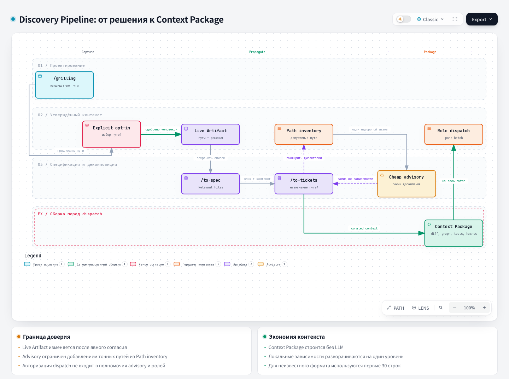

# Grilling: жёсткое интервью

## 1. Название и локализация

- **Английское название:** `grilling`
- **Русский перевод:**

```text
Жёсткое интервью
```

## 2. Полный перевод текста скила

<div class="ah-skill-text" markdown="1">

```yaml
name: grilling
description: Безжалостно расспрашивайте пользователя о плане, решении или идее, чтобы проверить его рассуждения на прочность. Срабатывает, когда пользователь хочет проверить концепцию или пишет триггерные фразы со словом «grill».
```

**Цель:** безжалостно расспрашивайте пользователя, чтобы разобрать предположения, проверить его логику на прочность и выстроить надёжное общее понимание. Представьте весь процесс как **дерево дизайна**: каждое решение ветвится на зависимые от него решения.

**Память проекта (интерактивные сессии):** если память проекта включена, перед первым раундом
дерева решений о коде или архитектуре репозитория один раз выполните
`harness memory search . "<цель, решение и модуль>"`, чтобы найти прошлые решения.
Повторяйте поиск, только если новое принятое решение меняет предмет. Если внешнего CLI нет,
используйте установленный entry point из `.harness/docs/project-memory.md`. Этот контракт описывает
конфигурацию, статусы поиска и указателей, проверку источников и продолжение без памяти. Считайте
найденное кандидатами в прецеденты. Правило явного согласия на пути в Live Artifact действует и
здесь. В dispatch оркестрации используйте выданный Context Package и сообщайте о нехватке
свидетельств, а не вызывайте поиск.

**Ключевая механика:**
1. **Раунды и фронтир:** проходите дерево отдельными раундами. **Фронтир** состоит из всех решений, предусловия которых уже приняты.
   - Задавайте вопросы текущего фронтира в одном раунде, не больше 4 вопросов. Если фронтир больше, перенесите остальные вопросы в следующий раунд.
   - Не задавайте зависимые вопросы, пока нет ответа на их предусловия.
   - Перед расчётом следующего раунда всегда ждите ответа пользователя.
2. **Отслеживание состояния (ствол):** в начале каждого раунда кратко перечислите только что принятые решения. Так вы подтверждаете общее понимание, прежде чем двигать фронтир дальше.
3. **Тон и роль:** ведите себя как острый, аналитичный и неумолимый интервьюер. Будьте вежливы, но беспощадно ищите слепые пятна, невысказанные предположения и логические скачки.
4. **Live Artifact (Discovery Context):** пока вы изучаете код, ведите внутренний список кандидатных путей к файлам, которые относятся к принимаемым решениям. Не добавляйте путь в артефакт или список без явного согласия пользователя (см. правило Opt-In ниже).
   - **Сначала Repo Map:** если тема сессии касается кода, запустите карту по требованию, один раз, прямо перед первым поиском кандидатных путей, а не при старте сессии: `python .harness/repo_map/repo_map.py --repo . --commit "$(git rev-parse HEAD)"`. Затем ищите пути точечным `rg` и чтением файлов. Если CLI нет, пропустите шаг. Вывод карты остаётся в этой сессии: не передавайте её сигнатуры внешней или дешёвой advisory-модели.
   - **Сохранённый список:** при каждом одобрении записывайте полный список одобренных путей в `artifacts/discovery-context.md` спецификации, в её собственном каталоге внутри `docs/tasks/`. Правила именования каталога описаны в `docs/agents/artifacts.md`; если ID задачи ещё неизвестен, используйте описательный slug. Этот файл хранит список при любом runtime. `/to-spec` читает его и заполняет раздел спецификации `## Relevant Files (Discovery Context)`.
   - **Через артефакт:** если runtime умеет публиковать артефакты, дополнительно создайте Live Artifact один раз, когда пользователь одобрит первый кандидатный путь, и перечислите в нём одобренные пути. При каждом следующем одобрении публикуйте тот же артефакт заново: тот же идентификатор или заголовок означает обновление, а не новый артефакт.
   - **Текстовый fallback:** если публиковать артефакты нельзя, один раз предупредите пользователя. Тогда держите список одобренных путей в чате отдельным разделом в конце сводки ствола каждого раунда (механика 2). Долговременное хранение уже даёт сохранённый список, поэтому этот раздел нужен только для наглядности между раундами.
   - **Opt-In:** в начале каждого раунда вместе со сводкой ствола покажите одной группой новые кандидатные пути, найденные с прошлого раунда: «Найдены файлы, относящиеся к `<решение>`: `path/a`, `path/b`. Добавить в Live Artifact?» с вариантами «Да, добавить все» / «Выбрать по одному» / «Нет, пропустить». Используйте `AskUserQuestion`, если он доступен, иначе задайте тот же выбор обычным текстом.
     - Этот запрос согласия не расходует лимит в 4 вопроса фронтира (механика 1): это учёт артефакта, а не вопрос дизайна.
     - В артефакт или список попадают только пути, которые пользователь явно одобрил. Согласия по умолчанию нет.
     - Отклонённый путь по умолчанию не предлагайте каждый раунд. Предложите его снова, только если он всплыл в связи с новым решением.
     - В этой механике список только пополняется: не удаляйте и не меняйте уже одобренные пути.

**Форматы вопросов:**
- **Категориальные вопросы через инструмент:** если в этом runtime доступен `AskUserQuestion`, задавайте каждый раунд через него, а не обычным текстом.
  - *Формат:* один вопрос на запись, чтобы у каждого была своя вкладка с коротким `header` и 2–4 взаимоисключающими `options` (`label` и `description`, что означает этот выбор). Пользователь всё равно может ввести свободный ответ через всегда доступный вариант «Other».
  - *Рекомендация:* ставьте рекомендуемый вариант первым и добавляйте к его метке суффикс «(Recommended)».
  - *Ограничения:* один вызов вмещает не больше 4 вопросов. Если фронтир больше, покажите первые 4 сейчас и перенесите остальные в следующий раунд. Не отбрасывайте их молча и не делайте дополнительных вызовов в том же раунде.
- **Обычный текст и открытые вопросы:** не каждый вопрос фронтира сводится к нескольким готовым вариантам, и не в каждом runtime есть `AskUserQuestion`. Если инструмент недоступен, в начале сессии один раз предупредите пользователя и до конца сессии пишите обычным текстом. Если вопрос действительно открытый (например, «как назвать это понятие?») и 2–4 варианта исказят его, задайте этот вопрос обычным текстом:

  ```
  🤔 **<Заголовок вопроса>**: <Текст вопроса: объясните, *почему* это решение критично сейчас, и кратко изложите компромиссы; это может быть несколько абзацев>

  🤖 **Рекомендация:** <Ваш рекомендуемый ответ или направление>
  ```

**Сбор информации (факты и решения):**
- Искать *факты* должны вы, а принимать *решения* должен пользователь.
- Если вопросу фронтира нужны данные из окружения (файловая система, API и т. п.), отправьте подагента или найдите их своими инструментами. Не просите пользователя что-то искать.
- *Без блокировки:* работающий инструмент или исследование считается просто непринятым предусловием. Не задерживайте из-за него раунд: сразу задайте остальные вопросы текущего фронтира. Отчёта инструмента ждут только зависимые вопросы.

**Завершение:**
Сессия закончена, когда фронтир пуст: каждая ветвь дерева дизайна пройдена и молчаливых предположений не осталось. Сведите итоговый план, затем попросите пользователя подтвердить его:

- **Да, перейти к `/to-spec`:** скажите пользователю, что следующий шаг он делает сам: вызывает `/to-spec` вручную. Затем завершите сессию grilling. Это рекомендуемый вариант.
- **Нет, нужны правки:** попросите пользователя назвать номера решений, которые нужно изменить, заново откройте только эти ветви и продолжите grilling.

Если доступен `AskUserQuestion`, задайте этот последний вопрос через него. Иначе покажите те же два варианта обычным текстом и ждите. Не вызывайте `/to-spec` сами и не считайте подтверждение разрешением создавать тикеты, ветки или код.

</div>

## 3. Контракты

- **Вход (Input/Brief):** идея, план или решение; доступные факты и вопросы на фронтире.
- **Выход (Output/Report):** дерево принятых решений, синтез плана и явный запрос следующего шага.

## 4. Архитектурная схема



## Источник

[SKILL.md](https://github.com/PVMalove/agent-harness-next/blob/master/skills/first-party/engineering/grilling/SKILL.md)
