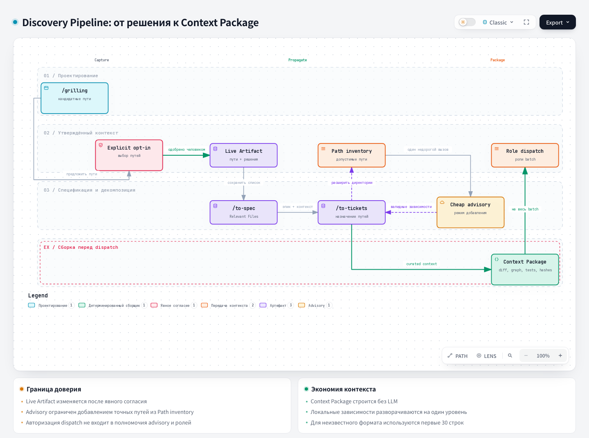

# Grilling: жёсткое интервью

## 1. Название и локализация

- **Английское название:** `grilling`
- **Русский перевод:**

```text
Жёсткое интервью
```

## 2. Полный перевод текста скила

<div class="ah-skill-text" markdown="1">

```yaml
name: grilling
description: Проводит структурированное интервью для проверки плана, идеи или решения. Вызывается напрямую или как движок других скиллов.
```

### Границы и раунды

Зафиксируйте цель и границы интервью. Для интервью и согласования Discovery Context используйте
`/grill-me`. Для ведения глоссария и ADR добавьте `/grill-with-docs`. Если движок работает вместе
с `/domain-modeling` (из `/grill-with-docs`, `/triage` или напрямую), перед правкой глоссария или ADR
прочитайте `references/domain-doc-writes.md`: его правила главнее немедленной записи из `/domain-modeling`.

В начале каждого раунда покажите принятые решения с номерами, открытые вопросы и гипотезы,
а также текущие допущения на языке пользователя. Начинайте с корневых развилок и переходите к зависимым вопросам после
решения их предусловий. Задавайте до четырёх обычных уточнений за раунд, остальные переносите
в следующий раунд. Для каждого варианта назовите последствия, рекомендуемый вариант ставьте первым
и объясняйте выбор. Для категориальных вопросов используйте доступный инструмент опроса. Открытые
вопросы задавайте в чате. Дождитесь ответа пользователя перед новым раундом.

- «Остановимся» завершает интервью частичным итогом.
- «Углубимся сюда» оставляет указанный вопрос в фокусе и уточняет факты и компромиссы.
- «Отложим этот вопрос» откладывает вопрос и все зависимые от него вопросы.

Перед первым раундом о репозитории обратитесь к включённой памяти проекта по инструкции
`.harness/instructions/project-memory.md`. В dispatch используйте выданный Context Package.
Перед первым поиском путей запустите Repo Map для текущего коммита. Если инструмент недоступен
или при запрете записи может обновить кэш, воспользуйтесь точечным поиском в режиме чтения.

### Протокол значимой развилки

Для архитектурного выбора, изменения контракта или схемы, конфликта ограничений и сложной реализации
выделите отдельный раунд. В 2–3 предложениях изложите суть развилки и проверенные факты из репозитория.
Покажите матрицу в блоке `text` с видимыми рамками (`┌─┐`, `│`, `├─┤`, `└─┘`). Дайте каждому варианту
заголовок на всю ширину и отдельные строки «Механизм», «Польза», «Цена». Опишите, какие компоненты
или контракты меняются, как работает вариант и к каким последствиям он приводит. Переносите
подробные объяснения по строкам, сохраняя технические детали и имена.

- **[1] Рекомендуемое (Recommended)** — механизм, основание для рекомендации и компромисс.
- **[2] Компромиссное (Fast-Track)** — упрощение, выигрыш во времени, долг или риск.
- **[3] Полное (Full / Clean Architecture)** — целевая архитектура, долгосрочная польза и цена перехода.

Если технически различных вариантов меньше трёх, укажите причину и покажите доступные варианты.
Номер варианта утверждает решение. «Подробнее 1», «подробнее 2», «подробнее 3» и «подробнее все»
открывают шаблон разбора только по запросу. Разберите файлы, контракты, проверку и риски, затем
повторите меню. До явного выбора не записывайте файлы и не запускайте инструменты с записью.

### Discovery Context и итог

До вопросов раунда отдельно покажите найденные пути. Пользователь может подтвердить все, выбрать
нужные или пропустить. Запрос не расходует лимит вопросов. Добавьте только явно одобренные пути,
даже если читали отклонённый файл. Записывайте полный список, по одному пути в пункте и при желании
с пояснением, в `artifacts/discovery-context.md` внутри каталога задачи под `docs/tasks/`; для
дочерней задачи это каталог эпика по `docs/agents/artifacts.md`. Пока значимая развилка открыта,
держите одобренные пути в чате и запишите их после выбора варианта. При досрочной остановке пути
остаются в чате. При наличии Live Artifact
обновляйте один и тот же артефакт. При недоступности держите список в чате.

Когда активных вопросов больше нет или пользователь просит закончить, подведите итог. Он содержит цель и границы, принятые решения с номерами вариантов, отклонённые альтернативы
и причины, открытые вопросы и допущения, согласованные пути, фактически обновлённые документы
для `/grill-with-docs`, риски и следующий шаг. Для частичного итога выделите
«Открытые вопросы и блокеры для спецификации». Сверьте файл со списком в чате построчно.
Если файл недоступен для записи или проверки, сообщите об этом и оставьте список в чате.
Предложите пересмотреть решения по номерам или вручную вызвать `/to-spec`, когда решения готовы.
Дождитесь ответа и пересматривайте только названные решения и зависимые от них вопросы.

</div>

## 3. Контракты

- **Вход (Input/Brief):** идея, план или решение; доступные факты и вопросы на фронтире.
- **Выход (Output/Report):** дерево принятых решений, синтез плана и явный запрос следующего шага.

## 4. Архитектурная схема



## Источник

[SKILL.md](https://github.com/PVMalove/agent-harness-next/blob/master/skills/first-party/engineering/grilling/SKILL.md)
