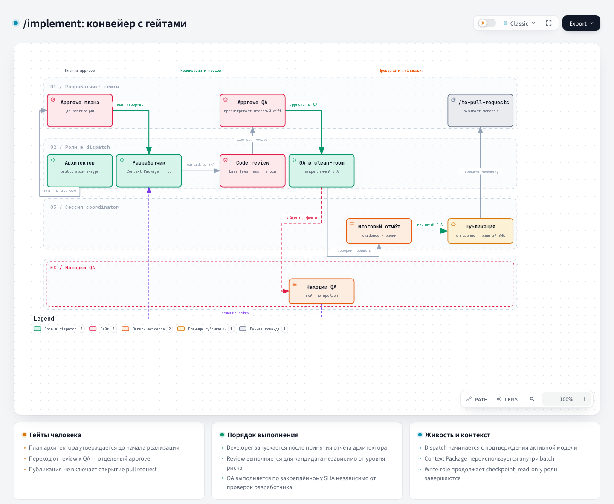

# Implement — Implementation

## 1. Name and localization

- **English name:** `Implement`
- **Russian translation:**

```text
Реализация
```

## 2. Full translation of the skill text

<div class="ah-skill-text" markdown="1">

```yaml
name: implement
description: Take one backend ticket through the approved handoffs of the architect, the developer, review, QA, and publish.
disable-model-invocation: true
```

### Implementation

**Objective:** take exactly one ticket through `architect → developer → code-review → qa → publish`,
then offer `/to-pull-requests`. This session is the coordinator: it creates and observes the dispatch,
but does not implement the ticket itself.

#### Route

This is the opt-in `backend-orchestration` route. Confirm that the installed coordinator is available:

```bash
python .harness/orchestration/coordinator.py --repo . dispatch status
```

If the command is unavailable or does not read the state, stop and offer `/fast-implement`. Do not
repair and do not assume the opt-in capability. Finish one batch before starting the next.

If another batch holds the same unfinished ticket, branch, or worktree, or `concurrency_budget` is
exhausted, check `batch list --open`, the conflicting dispatch, and its decision packet. Tell the
developer which batch blocks the work and how to finish it in the normal order. If its worker can no
longer send a report, first run `batch auto-report`, `batch decision-packet`, `dispatch status`, and
`ledger validate`, and state the `startup` assessment of this dispatch: the worker state, the failure
classification, and what remains unknown. Explain which option applies — waiting, fixing the start, a
human-approved `batch resume-stop`, `batch rewind`, or cancelling an unsent dispatch — and why the
others do not fit. Only after that, offer `batch abandon` as a separate explicit human decision about
the whole batch: show a copy-ready command with the actual batch ID, the verified operator name,
`--approved-at "$(date -u +%Y-%m-%dT%H:%M:%SZ)"`, and a reason based on the observed failure. Do not
substitute `--approved-by` as if the operator has already approved the action, and do not run the
command for the operator without that approval. `ledger clean` deletes only orphaned evidence, and
`ledger reset` does not clear an active batch.

#### The coordinator contract

Resolve the ticket, the integration branch, and the blockers according to the tracker/Git guidance.
The ticket status is part of this pre-flight, before `batch create` and before the issue branch is
created: check the blockers under any current label (any open → stop, name them, make sure that
`status::blocked` is set); otherwise replace the `status::*` label with `status::in-progress` exactly as
steps 2–3 of phase 1 of `/fast-implement` do, and verify that it is the only `status::*` label. A failed
label write is a blocker, not a warning. Before `batch create`, run the scope preflight with a bounded
number of files and lines; on refusal, split the ticket with `/to-tickets`. When you call `batch create`,
pass `--required-gate review --required-gate qa` explicitly: the full implementation route requires the
independent Standards/Spec reviews and a clean serialized QA. Before the write-role (`developer`) worker
starts, the coordinator checks that these required gates are present in `required_gates`; when they are
absent, it stops before the dispatch and prevents a deadlock in the risk-trigger check. Use an isolated
issue branch and worktree; protected branches and `integration/*` are not write targets. An open batch is evidence that you show to the developer, not a record to reuse or replace.

If `dispatch send` rejected an unsupported adapter flag, fix `--adapter-arg` and send the same approved
dispatch once more; show the `limitation` from `adapter_preflight` when it is present. Startup
diagnostics are described in the "Worker startup failure" section.

Offer each handoff and stop for the developer's explicit approval before you create or send a dispatch. A report is evidence, not the authority to advance the batch. The architect is mandatory before the developer dispatch; review keeps separate Standards and Spec evidence; independent QA verifies the candidate commit; publish sends only the accepted SHA. The final report precedes a separately approved publish dispatch. A write-role worker that stopped before any change returns an honest report with `outcome: blocked`, bound to the verified checkout, with empty `changed_files` and no checks run; the coordinator returns an explicit recovery route (`retry`, `block`, or a human-chosen `abandon`) without registering a candidate and without weakening the rules for completed reports.

Under `approval_policy: auto`, the coordinator makes each path decision itself and writes it as
`policy:auto` (the "Automatic path" section in the playbook). The session does not write `--approved-by`
or `--approved-at`: `batch approve`, `dispatch create`, and a planned `dispatch resume --trigger` run
without them. For every report that the `report submit` or `qa run` chain did not accept, including the
publish report, the session runs `batch auto-decide --batch <id>`. The session passes only the inputs
that require judgment: `--commit-plan-file` with an exact copy of the architect's plan, only
if the architect report does not carry a `commit_plan` field,
`--findings-file`, `--bug-ticket` after a bug ticket is filed through the tracker CLI, and
`--block-bypass --note`. The session does not choose the decision itself. After any command refuses and
after a `stopped` outcome, the session runs `batch auto-report --batch <id>`. A stop is final for the
batch: check `batch decision-packet`, `dispatch status`, and `ledger validate` before you offer waiting,
fixing the start, a human-approved `batch resume-stop`, or `batch rewind --to <gate>`. If the
infrastructure budget is exhausted, the batch stays paused until such a human decision. Before
`/to-pull-requests`, the session shows the final report; a PR opens only after explicit confirmation,
and auto-merge is prohibited.

A defect found in a clean developer report whose DoD is met inside its allowed paths is no reason for a retry:
accept the report through `batch decide --findings-file <path>`, and after the policy auto-accept run
`batch carry-over --batch <id> --findings-file <path>` while the code-review dispatch is not created. The
finding goes into the code-review brief as a carried-over item (the `carry-over` route), and the single developer
retry is spent after the review. Retry a developer report without an accept only for an unmet DoD item
or a change outside the scope.

A worker that bypassed a hook or tool block (with another form of the command, another tool, a
script file, `eval`, another interpreter, or a split command) violates the protocol: such a
report cannot be accepted or closed through an override warning, and the violation is recorded in `--note`. For
the architect and the developer (publish included), the decision is `retry` with the developer category (not `tooling`) or
`block`. For the read-only role code-review, qa, or verification, `--reason-category block-bypass`
is passed to `batch decision-packet` and, when its `route_preview.retry.route` equals `bypass-rerun`,
to `batch decide --decision retry`: the same stage repeats on the same SHA without a new candidate and
without spending a developer retry, and a new dispatch requires explicit approval under any `approval_policy`
except `auto`. A report that instead
stopped with `tooling_blocker` is checked first: its `command` is legal under the brief (zone and
tool policy), and the `message` rejects it. If this is a false trigger, file or reuse a
bug ticket for the tool through the tracker CLI (tool, command, message, dispatch ID), name it
in `--note`, and run `batch decide --decision retry` when `route_preview.retry.route` equals
`tooling-retry`: the same stage repeats on the same SHA (the developer continues from its last
commit), and `retry_policy.max_developer_retries` is not spent. An illegal command is not a false
trigger: retry with the developer category that the evidence confirms. The
`tooling-retry-repeated` attention, raised by a third consecutive tooling retry on one candidate, is cleared only
after the tool is fixed.

Each dispatched role first writes a model self-report against the immutable brief and sends a
heartbeat; these facts serve as evidence and give no reason to change the immutable brief. Between send and report
the coordinator polls the watchdog. A mismatch or a stale dispatch is a blocker; recovery creates a new
approved dispatch and does not edit the brief or the state. Silence or a timeout does not prove that the
worker stopped; the restart rules are in the "Worker startup failure" section.

For the `in-process` transport, send fixes the immutable handoff, and then the coordinator immediately
starts the role subagent in the specified worktree. An external adapter is only a transport and keeps
the same handoff, liveness, approval, and report contract.

**The test author in the full route.** The test-author preflight serves only the checkout where it
lives. A developer with the `in-process` transport runs
`"$CLAUDE_PROJECT_DIR/.claude/hooks/test-author-preflight.sh" --worktree <send.worker_worktree>`;
for a separate worker checkout, the answer is `disabled` with the reason `checkout_mismatch`.
A developer with the `external` transport (headless `claude -p` in the worktree) does not enable the
author and does not run the preflight: the reason is `transport_unsupported`. Any answer other than
`{"status":"ok"}` leaves the ordinary TDD with the reason named in the output and never becomes a blocker.

Before the first dispatch, the coordinator may register an immutable Context Package, built by
`context_builder.py` without an LLM from the pinned `base_commit`/`candidate_commit`. It contains the exact diff,
5–10 starting files with reasons, the bounded graph, the related tests, the ADR/precedent cards, and the SHA-256
of the included files. Direct local imports expand one level; unknown formats
get the first 30 lines. Before each dispatch, the freshness of the package is checked in shadow mode.

Write roles may write a checkpoint and continue the same dispatch in a new worker session; a checkpoint
is not a completion report and carries only the SHA, the changed files, the remaining DoD, the checks, the risks,
the blockers, and the link to the package. Read-only roles cannot checkpoint or resume. A rate-limit resume is allowed
automatically; the other planned triggers require a coordinator decision.

#### The worker prompt

Every worker prompt is this template, filled from the result of `dispatch send` and the CLI call
that sent it. The brief and the Context Package carry the task; the prompt also carries the mandatory
lifecycle. `<coordinator CLI>` is substituted with the Python executable, the absolute path of `coordinator.py`,
and the absolute `--repo` of the original dispatch (plus `--state-dir` when it is set). Paths are escaped for the
worker shell. The ledger address is preserved even when you work from another worktree. The heartbeat interval is
copied verbatim from `dispatch send.heartbeat.every_seconds`.

```text
You are the <role> worker for dispatch <dispatch_id>.
Brief: <brief path from dispatch send>
Report staging path: <report_staging_path from dispatch send, verbatim>
Coordinator CLI: <coordinator CLI>
Before task work, run git rev-parse --show-toplevel, git branch --show-current and git rev-parse HEAD
in your runtime's current directory. Confirm your actually active model and the probed Git top-level:
<coordinator CLI> dispatch self-report --dispatch <dispatch_id> --model "<actual active model>" --worktree "<probed Git top-level>"
Proceed only after a successful self-report; escalate a mismatch or unavailable model identity.
Immediately after self-report and at least every <heartbeat.every_seconds> seconds while working, run:
<coordinator CLI> dispatch heartbeat --dispatch <dispatch_id>
Context Package <context_package_id>: start from its starting_files, symbol_graph and
related_tests. For a starting file with non-empty sections, read only the start_line–end_line
ranges the task needs.
Work within the brief; escalate a blocker for anything the brief and the package leave out.
Before your final reply, write the completion report JSON to the exact report staging path using
the common and role-specific report contract, with report_language: ru, then run:
<coordinator CLI> report submit --file "<report_staging_path>"
Completion means the report is recorded in the ledger. Include the submit result in your final reply.
If submission fails before recording, return the command and error as a blocker; keep the report file.
If the result includes completion, relay it to the coordinator for report complete; the report is
already recorded, so submit it only once. Chat text alone does not complete the dispatch.
```

This lifecycle is mandatory for every new or resumed worker session, including a developer retry.
A session that stopped at a checkpoint follows the separate checkpoint protocol instead of the completion
report. Final text without a recorded completion or a valid checkpoint is an unfinished
handoff; the coordinator requests the missing protocol from the same available worker session.

A developer retry adds two lines from the `retry_start` of its `dispatch preflight`:

```text
Retry handoff: <retry_start.handoff, verbatim JSON>
Retry starting files: <paths from retry_start.starting_files>
```

Large documents (the role catalog, `playbook.md`, `backend-orchestration.md`, `git-workflow.md`) and
earlier reports reach the worker only as `sections` ranges of the Context Package or through the retry
handoff. The prompt assigns exactly its own brief and, for a retry, the blocking findings from the handoff.

A developer retry always starts a new session from the compact handoff and does not continue the history of the previous
developer session. The decision packet of the preflight carries `retry_context_estimate` and
`retry_context_warning` as evidence; they never block a dispatch. Code-review and QA stay new independent sessions; by the template
only their prompt changes. The handoff, the smart zone threshold, and the compact are defined in the
"Developer-retry handoff" section of the playbook.

#### Authoritative guidance

This is a short coordinator contract, not a second orchestration procedure. The full rules are
module-owned guidance:

- `.harness/orchestration/playbook.md` owns the lifecycle, the authority, the immutable brief, the completion
  evidence, the parallelism, and the metric rules.
- `.harness/orchestration/roles/` owns the boundary, the required proof, and the specialist trigger of each role.
- `--help` and the `remedy` output of the coordinator CLI own the CLI procedure and the operational recovery in the target
  project. The developer guide `backend-orchestration.md` describes the setup and the project
  configuration, but lives only in the source repository and is not shipped to a project.
- `docs/agents/git-workflow.md` owns the issue-branch, commit, push, and PR boundaries.

Follow these files without duplicating or weakening their rules. Do not invent token metrics:
use only provider- or runtime-observed telemetry and keep the missing-data notes.

#### Completion

After an accepted publish, record the integration link before the merge or the deletion of the branch:
`python .harness/orchestration/coordinator.py --repo . integration prepare --ticket "#<ID>" --branch "<issue-branch>"`
(add `--batch <batch-id>` when several batches published the branch). The command writes only the
immutable integration record and is safe to repeat; on refusal, give its remedy to the developer and do not bypass it. Do not
edit a completed batch and its reports by hand.

Then offer `/to-pull-requests <ticket>`. Do not run it automatically,
do not open or merge a PR, do not write to the integration branch, and do not close the ticket with this skill. Leave
`status::in-progress` on the ticket: closing it and moving the unblocked dependents to `status::ready` is done by
`/to-pull-requests` after the merge.

</div>

## 3. Contracts

- **Input:** an AFK ticket, the installed opt-in capability, and the developer's explicit approvals.
- **Process:** the coordinator runs five handoffs, checks the model self-report and the liveness, and accepts
  only proven reports.
- **Output:** the accepted candidate SHA, the QA evidence, and an offer of `/to-pull-requests`.

## 4. Architecture diagram



## Recovery

`auto-report` observes, `auto-decide` records `paused`. A manual `resume-stop` and `rewind --to`
keep the original stop and enable `manual_all` for all following steps, including 429.
A human accepts a stage report that an infrastructure failure alone blocked after the work was finished with the
`accept-conditional` decision: the stage stays an open condition that a later independent gate
closes, and publish refuses until then. Without structural evidence, `resume-stop` uses a cautious
heuristic over the blockers text; the human still decides.
Rewind does not change the Git history, but excludes the old dependent QA/review/risk from the active chain.
The counters are kept. Repeated developer work spends the retry budget; a restart after a
confirmed environment failure draws on a separate infrastructure budget.
Before send, the coordinator checks the explicit worker directory with `--worktree`, and the worker confirms the
actual path/branch/HEAD with the self-report. The coordinator CLI stays bound to the main repo/state.
The coordinator itself never does `cd` into a worktree, not even as `cd <worktree> && …`: the shell working directory
persists between commands, so one such call moves the whole session into the worktree. Worktree files
are read by absolute paths: `git -C <worktree> …`, `rg <pattern> <path in the worktree>`, and the file-reading
tools. If the session has moved after all, return it to the main checkout before the next
command. The detailed limits are set by `.harness/orchestration/playbook.md`, section Operator recovery.

### Worker startup failure

Silence, a timeout, or a missing report does not mean that the task has lost its purpose. Before
offering recovery or `batch abandon`, the coordinator runs the read-only commands
`batch auto-report`, `batch decision-packet`, `dispatch status`, and `ledger validate`.
`dispatch status` shows the `startup` assessment for each dispatch: the worker state (`absent`,
`reported`, `rejected-at-startup`, `stopped`, `live`, or `unknown`), the failure classification, and what
remains unknown. Capacity, rate-limit, and service-unavailable are classified separately from
code defects.

`dispatch send` validates the `--adapter-arg` flags against `dispatch --help` of the adapter before it passes the brief,
so an unsupported flag stops the send, and the dispatch stays approved and
unsent. `dispatch runtime-probe` checks the app-server runtime on an ephemeral read-only thread
without tools: the brief model in `model/list`, the `thread/start` fields, and the completion of one turn. A
capacity error after `thread/start` gives a classified failure, not READY. The probe writes nothing to the
ledger and does not replace the model self-report.

`batch resume-stop` restarts only a worker with a known outcome. If `startup` shows
`live` or `unknown`, the command refuses: the operator stops the worker through the runtime and repeats it
with the `--runtime-stopped` flag. For a rejected self-report, the previous contract does not change: a human
approval retires the dispatch, and the ledger rejects its late records. If the infrastructure
budget is exhausted, `resume-stop` refuses, and the batch stays paused until a human decision: wait,
fix the start, change the attention policy, run `rewind`, or decide on
`batch abandon` separately. `dispatch cancel`
cancels only an unsent dispatch, and `batch abandon` closes the whole batch; the brief, the report,
the Context Package, and the audit stay as evidence in both cases.

## Updating the launch and observation route

An example `.harness/orchestration/adapters/claude_code.py` ships, selected explicitly with
`--adapter`. The runtime executable is selected separately; the pack does not turn `codex` into an adapter.
The parent's access is checked and, before feature work, the worker's own tools. A global
sandbox shutdown is not required; an unsuitable profile is not repeated without preparing the environment.

The console reads the existing stream locally, without extra tokens and model messages.
The receipt, the process, the exit code, the ledger, and the handing over and acceptance of the report are shown separately. The first self-report
has its own deadline; only a proven outcome allows recovery. `resume-stop --restart`
allows one human confirmation to approve an unchanged successor, keeping manual_all
and the operational budget. A ready source report can be passed through the standard report relay with an audit,
keeping fail/not_run. The architect-retry reason now comes from brief.retry_reason; the external
extra-prompt-file and the manual Retry reason line are no longer needed.

## Source

[SKILL.md](https://github.com/PVMalove/agent-harness-next/blob/master/skills/first-party/engineering/implement/SKILL.md)
