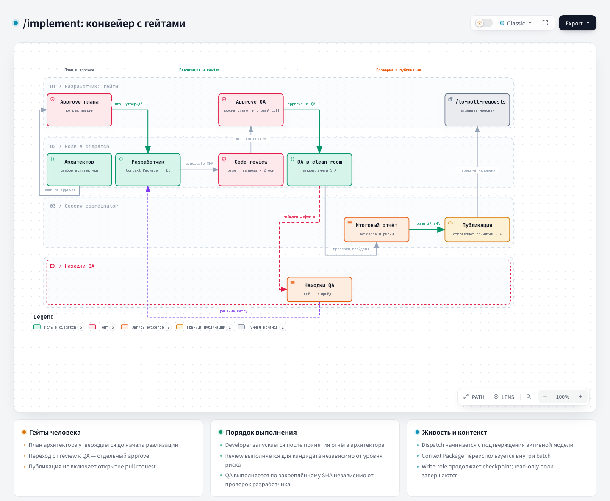

# Implement: реализация

## 1. Название и локализация

- **Английское название:** `Implement`
- **Русский перевод:**

```text
Реализация
```

## 2. Полный перевод текста скила

<div class="ah-skill-text" markdown="1">

```yaml
name: implement
description: Провести один backend-тикет через утверждённые handoff архитектора, разработчика, review, QA и publish.
disable-model-invocation: true
```

### Реализация

**Цель:** провести ровно один тикет через `architect → developer → code-review → qa → publish`,
затем предложить `/to-pull-requests`. Эта сессия **и есть** coordinator: она создаёт dispatch и
наблюдает за ними, но сама тикет не реализует.

Языковой контракт: агенты общаются между собой и пишут свободный текст протокола и доказательств
состояния по-английски. Каждый completion report для этого coordinator пишется по-русски и содержит
`"report_language": "ru"`; команды, пути, ID и цитаты доказательств остаются дословными. Значения,
которые читает машина, остаются точными английскими enum: `outcome: completed | blocked | failed`,
`result: pass | fail | not_run` у проверки и `blockers.status` / `risks.status: none | present`.
Каждое поле blockers/risks это объект status/details; переводится только описание. Правило касается
и текста, который пишет сама сессия: переведите тикет на английский, прежде чем он попадёт в batch
или промпт воркера. `definition_of_done` и `prohibited_changes` с кириллицей отклоняются сразу.
Промпт воркера с непереведённым текстом тикета нарушает тот же контракт, но coordinator этого не
видит.

#### Маршрут

Это opt-in маршрут `backend-orchestration`. Проверьте, что установленный coordinator работает:

```bash
python .harness/orchestration/coordinator.py --repo . dispatch status
```

Если команда недоступна или не читает своё состояние, остановитесь и предложите разработчику
`/fast-implement`. Ответ `ledger_busy` не означает недоступность: блокировку ledger держит другая
операция coordinator, поэтому повторите команду через `retry_after_seconds`. Не выводите и не чините
opt-in capability сами. Доведите один тикет до конечного состояния batch, прежде чем браться за
следующий.

До любой записи в трекер (смены метки `status::*`) проверьте, что сессия запущена в основном
checkout и может писать в каждый каталог, куда пишет конвейер:

- `.git/worktrees` (для существующего issue worktree: его каталог git-метаданных из
  `git -C <worktree> rev-parse --absolute-git-dir`);
- каталог issue worktree, если он уже есть;
- `.harness/.sandboxes/scratch/inbox/`.

Проверьте каждый каталог: создайте и удалите в нём один временный файл. Сессия в sandbox пишет только
внутри своего каталога. Worktree, созданный другой сессией, остаётся read-only в `.git/worktrees`
даже из основного checkout. Если проверка не прошла, остановитесь с одним сообщением: назовите каталог
и действие, то есть откройте сессию в основном checkout, которая может писать в issue worktree и его
git-метаданные. Не трогайте ни трекер, ни ledger. `batch create`, а для write-роли также
`dispatch preflight` и `dispatch send` отказывают, если сессия не может писать в issue worktree или
каталог его git-метаданных.

Если другой batch держит тот же незавершённый тикет, ветку или worktree либо исчерпан
`concurrency_budget`, проверьте `batch list --open`, конфликтующий dispatch и его decision packet.
Сообщите разработчику, какой batch блокирует работу и как завершить его штатно. Если его воркер
больше не может прислать report, сначала запустите `batch auto-report`, `batch decision-packet`,
`dispatch status` и `ledger validate` и процитируйте оценку `startup` этого dispatch: состояние
воркера, классификацию сбоя и то, что осталось неизвестным. Объясните, какой вариант подходит:
ожидание, исправление запуска, одобренный человеком `batch resume-stop`, `batch rewind` или отмена
неотправленного dispatch. Объясните, почему не подходят остальные. Только после этого предложите
`batch abandon` как отдельное явное решение человека обо всём batch. Покажите готовую к копированию
команду с фактическим ID batch, проверенным именем оператора,
`--approved-at "$(date -u +%Y-%m-%dT%H:%M:%SZ)"` и причиной, которая опирается на наблюдаемый сбой.
Не подставляйте `--approved-by` так, будто оператор уже одобрил действие, и не выполняйте команду за
него без этого одобрения. `ledger clean` удаляет только осиротевшие доказательства, а `ledger reset`
не очищает активный batch.

#### Подготовка batch

Coordinator берёт любую процедуру только из источников для агентов: этот скилл,
`.harness/orchestration/playbook.md`, `.harness/orchestration/roles/`, руководства в `docs/agents/`,
вывод `--help` и `remedy` CLI coordinator. Coordinator не берёт процедуру из русских документов для
людей (`backend-orchestration.md`, `site/docs/`, `ARCHITECTURE.md`, `site/docs/skills/`,
`site/docs/hooks/`). Coordinator не копирует соглашения из другого batch и не читает файлы ledger в
`.harness/orchestration/state/`. Состояние он читает только командами CLI (`batch list`,
`batch decision-packet`, `dispatch status`). Если эти источники не дают нужного шага, это блокер:
coordinator останавливается, сообщает о нём разработчику и не восстанавливает шаг сам.

Начинайте эти шаги только после pre-flight тикета из раздела «Контракт coordinator»
(блокеры, `status::in-progress`).

1. **Integration ref.** Возьмите значение секции `## Integration Branch` тикета. Если её нет,
   возьмите `## Git base`. Если нет ни той, ни другой, возьмите ту же секцию родительского эпика.
   Если у тикета есть родительский эпик, а значения нет, это блокер: не выводите его из checkout или
   из памяти. Тикет без родительского эпика использует `base_branch`: не передавайте
   `--integration-ref`.
2. **Issue worktree.** Создайте его до `batch create`: `batch create` отказывает, если
   `git worktree list` не показывает worktree. Точные команды и восстановление после
   недоделанного `git worktree add -b` описаны в `docs/agents/worktrees.md` → Coordinator issue
   worktree. Оставайтесь в основном checkout.
3. **Scope batch.** Запустите `batch preflight` с теми же флагами scope, что и у `batch create`.
   Сначала переведите тикет на английский: `batch create` отклоняет кириллицу в `--goal`,
   `--definition-of-done` и `--prohibited-change`. Команды, пути и ID оставьте дословными.
4. **Создание batch.** Повторяйте флаги-списки по одному разу на каждое значение.

   ```bash
   python .harness/orchestration/coordinator.py --repo . batch create \
     --ticket "#<ID>" --branch "feature/issue-<ID>-<slug>" --worktree "<absolute worktree path>" \
     --integration-ref "<integration-branch>" --goal "<English goal>" \
     --definition-of-done "<English item>" --prohibited-change "<English item>" \
     --allowed-path "<path or glob>" --expected-file "<path>" --expected-service "<service>" \
     --expected-changed-lines <N> --required-gate review --required-gate qa
   ```

   Обязательны `--ticket`, `--branch`, `--worktree`, `--definition-of-done`, `--prohibited-change` и
   хотя бы один `--allowed-path`. `--branch` должен соответствовать `branch_pattern`.
   `--expected-file`, `--expected-service` и `--expected-changed-lines` обязательны, если политика
   проекта требует оценок. Слишком большой тикет CLI отклоняет и печатает `remedy`.
5. **Одобрение batch.** `batch approve --batch <id> --approved-by <operator> --approved-at <UTC time>`
   переводит batch из `planned` в `awaiting-approval`. Для этого нужно явное одобрение оператора:
   покажите команду, как для `batch abandon`, и не запускайте её за него.

**План коммитов.** Architect кладёт свой план в поле отчёта `commit_plan`. `report submit` отклоняет
план, который нарушает правила ниже или называет путь вне `allowed_paths` batch; accept закрепляет
план из отчёта. Файл плана передавайте, только если в отчёте плана нет. Закрепите его командой
`batch decide --batch <id> --decision accept --approved-by <operator> --approved-at <UTC time> --commit-plan-file <path>`.
Это решение одобряет оператор; никогда не подставляйте `--approved-by` за него. Файл плана рядом с
планом из отчёта должен содержать тот же план. Пишите файл в `.harness/.sandboxes/scratch/inbox/` или
в scratchpad сессии проекта `.harness/.sandboxes/scratch/sessions/<session_id>/scratchpad/`. Путь вне
репозитория и его worktree, например внешний scratchpad в `/tmp`, отклоняется. Файл это JSON-объект с
единственным ключом `commit_plan`: непустой список в порядке коммитов.

```json
{"commit_plan": [{"id": "tests", "summary": "Add failing tests", "expected_paths": ["tests/**"], "covers": [1]}]}
```

У каждой записи ровно такие поля:

- `id`: уникальный, до 64 символов из букв, цифр, `.`, `_`, `-`; первый символ буква или цифра;
- `summary`: непустой;
- `expected_paths`: непустой список относительных путей или glob, без ведущего `/` и без `..`;
- `covers`: непустой список номеров пунктов `--definition-of-done`, считая с 1, без повторов.

Каждый пункт definition of done должен попасть хотя бы в одну запись. Сломанный файл CLI отклоняет и
печатает ожидаемый формат.

#### Контракт coordinator

Определите тикет в трекере, issue-ветку и блокеры, не открывая второй batch на ту же работу. Статус
тикета входит в этот pre-flight: после проверки записи из раздела «Маршрут», до `batch create` и до
создания issue-ветки. Проверьте блокеры тикета при любой текущей метке. Если хоть один ещё открыт,
остановитесь, назовите их и убедитесь, что на тикете стоит `status::blocked`. Иначе замените метку
`status::*` на `status::in-progress` так же, как шаги 2–3 фазы 1 `/fast-implement`, и проверьте, что
она единственная `status::*`. Неудачная запись метки это блокер, а не предупреждение.

До `batch create` запустите preflight на уровне batch с ограниченными ожидаемыми файлами, сервисами и
размером diff. Закрепите явный scope writer через `--allowed-path` (повторяйте флаг; путь или glob
внутри потолка записи developer). Batch с пересекающимися файлами работают параллельно в своих
worktree, а изменение вне scope отклоняется. Если preflight отклонил тикет, разделите его через
`/to-tickets`. Никогда не поручайте architect выяснять, нужно ли было делить слишком большой тикет.
При `batch create` укажите `--required-gate review --required-gate qa`: полный конвейер implement
явно задаёт оба независимых gate, review по Standards/Spec и serialized clean-room QA. До dispatch
write-роли (`developer`) проверьте, что эти обязательные gate записаны в `required_gates` batch. Если
их нет, остановитесь сразу и не отправляйте воркера в обход risk gate.

Для каждого handoff выберите checkout воркера и передайте его абсолютный путь как `--worktree` в
`dispatch preflight`. Покажите `batch decision-packet`, затем создайте одобренный неизменяемый brief.
Передайте тот же явный `--worktree` в `dispatch send`; code-review также сохраняет `--checkout`.
Preflight и send проверяют выбранный путь, ветку и startup SHA. Запустите воркера ровно в
`send.worker_worktree` механизмом runtime, который умеет работать в уже существующем каталоге.
Проверьте этот механизм до запуска: одно `isolation: worktree` не доказывает привязку к существующему
worktree. Если runtime не может выбрать этот checkout, сообщите о блокере.

Coordinator остаётся в основном checkout. Никогда не делайте `cd` в worktree из сессии coordinator,
даже в виде `cd <worktree> && …`: рабочий каталог shell сохраняется между командами, поэтому один
`cd` переносит всю сессию. Читайте файлы worktree по абсолютным путям: `git -C <abs worktree> …`,
`rg <pattern> <abs worktree path>` и инструменты чтения файлов с абсолютными путями. Если сессия всё
же сместилась, верните её `cd` в основной checkout до следующей команды. Выбранный путь это только
намерение; фактический рабочий каталог воркера доказывает self-report. Передайте воркеру
`report_staging_path` из brief дословно: роль, которой приходится угадывать место для отчёта, пишет
его вне проекта.

**Runtime Claude Code.** Инструмент Agent не умеет выбрать существующий checkout: субагент стартует в
основном checkout, а `EnterWorktree` там отказывает. Есть два пути; назовите, какой использует batch.

- `external` (строгий): задайте `transport` ролей воркеров как `external` в
  `.harness/orchestration.json` и отправляйте с
  `--adapter <main-repo>/.harness/adapters/claude_worker.py` (абсолютный путь). `dispatch send`
  запускает адаптер в `send.worker_worktree`, а адаптер запускает там headless `claude -p` с моделью,
  effort и `allowed_tools` из brief. Поэтому рабочий каталог воркера это issue worktree. Под runtime
  (brief с `execution`) адаптер ждёт воркера на переднем плане и выходит с его кодом; без
  `execution` он отсоединяет воркера. Промпт собирает адаптер. Для retry положите строки retry в файл
  внутри репозитория и передайте `--adapter-arg=--extra-prompt-file=<path>`. Слой разрешений может
  запретить запуск агента из сессии coordinator. Такой отказ это остановка: покажите разработчику
  точную команду `dispatch send` для его собственного терминала, затем продолжайте через
  `dispatch wait`.
- `in-process` (доказательство слабее): рабочий каталог субагента это основной checkout, поэтому
  проверка каталога из шаблона его остановит. Замените эту проверку в его промпте: пусть он узнаёт
  top-level, ветку и HEAD через `git -C <worker_worktree>`, запускает каждую команду через `git -C`
  или `cd <worker_worktree> &&` и указывает абсолютные пути ко всем файлам. Тогда его self-report
  доказывает checkout, в котором он работает, а не его рабочий каталог; скажите об этом в итоговом
  отчёте.

**Тест-автор в полном маршруте.** Автор наследует runtime/model/effort из утверждённого brief
developer, без отдельного назначения роли и без подмены профилем проекта. Выбранный runtime без
защищённого адаптера даёт `runtime_unsupported`, и остаётся обычный TDD. Текущий защищённый адаптер
позволяет developer Claude Code с transport `external` вызывать автора в `send.worker_worktree` через
`Agent(test-author)` без переопределения model/effort. До dispatch установите harness ровно в этот
checkout. Связанному worktree репозитория, основной checkout которого человек уже отметил как
доверенный в Claude Code, не нужен свой диалог доверия и экспорт `CLAUDE_PROJECT_DIR`: preflight
берёт корень проекта из Git (ADR 0033). Никогда не копируйте runtime-состояние или доверие основного
checkout.

Developer запускает свой
`.claude/hooks/test-author-preflight.sh --worktree <send.worker_worktree> --brief <approved brief path>`
и включает автора только после ответа ровно `{"status":"ok"}` и при разрешении `Agent(test-author)`
или `Agent` в утверждённом brief. Политика роли developer по умолчанию содержит именованное
разрешение; переопределение проекта главнее. Без разрешения developer получает
`agent_tool_unavailable` и обычный TDD; инструменты при запуске не расширяются. Передайте автору общий
корень логов runner из промпта адаптера и один путь теста внутри scope brief.

Для `in-process` основной preflight с `--worktree <send.worker_worktree>` отвечает
`checkout_mismatch`: guard и runner основного checkout обслуживают только основной checkout. Поэтому
промпт воркера называет launcher этого worktree для каждого handoff:
`python3 -I -B <send.worker_worktree>/.harness/health/test_author.py run --repo <send.worker_worktree> --brief <approved brief path> --prompt-file <path>`.
Launcher проверяет preflight этого worktree и запускает автора с его guard и runner по тому же
правилу разрешения из brief. Отказ (exit 3 с причиной) оставляет обычный TDD с этой причиной.
Показывайте выбранного исполнителя в отказах и никогда не подставляйте Claude вместо
неподдерживаемого runtime. Отказ preflight или недоступный автор никогда не создают блокер и не
меняют Rust ledger. Напишите это в промпте воркера.

`dispatch send` сверяет флаги адаптера с его `dispatch --help` до handoff и отклоняет
неподдерживаемый флаг. Исправьте значения `--adapter-arg` и отправьте тот же одобренный dispatch ещё
раз. Покажите `limitation` из `adapter_preflight` в результате send, если он есть. Чтобы
диагностировать app-server runtime без воркера, запустите `dispatch runtime-probe`; его результат это
доказательство, а model self-report воркера всё равно обязателен.

Coordinator никогда не пишет код фичи и не чинит состояние вручную. Report это доказательство, а не
разрешение двигаться дальше. Architect идёт раньше developer; принятый candidate проходит
обязательные gate review, QA и publish. Write-роль, которая остановилась до изменений, возвращает
честный отчёт `outcome: blocked`: он привязан к проверенному коммиту checkout, `changed_files` пусты,
проверки не запускались. Decision packet coordinator возвращает явный маршрут восстановления
(`retry`, `block` или выбранный человеком `abandon`), не регистрирует candidate и не ослабляет
проверку отчётов `completed`.

Перед каждым dispatch write-роли неизменяемый brief несёт упорядоченный план коммитов. Каждая запись
описывает одно логическое изменение, которое можно проверить отдельно, его ожидаемые файлы и пункты
DoD, которые оно закрывает. Одну запись используйте, только если всё одобренное изменение нельзя
разделить. Coordinator выводит по одной записи на пункт DoD; чтобы взять план architect, закрепите его
при accept architect командой `batch decide --decision accept --commit-plan-file <path>`.
Восстановление сохраняет принятый план или заменяет его новым одобренным планом, который объясняет
изменённую границу. Completion report developer сопоставляет каждый созданный коммит с записями,
которые он закрывает. Если сопоставление не один к одному, нужны `dod_coverage` и
`divergence_justification`. Отчёт с пунктом `not_covered` можно принять только через
`override-warning` с note, отличной от `none`, или вернуть через `retry`. Отчёт, у которого
`changed_files` лежат вне `write_paths` brief, записывается с элементом `scope_warnings` и
принимается только так же. Не сливайте несвязанные реализацию, тесты, документацию или правки типов в
один восстановительный коммит только потому, что они вместе попали в индекс.

Следуйте настроенной политике одобрения. При `manual_all` каждый переход требует явного одобрения:
покажите decision packet, спросите и ждите. При `low_risk` чистый завершённый отчёт batch, чьи
allowed paths лежат внутри `low_risk_paths`, coordinator принимает сам с аудируемым решением политики,
и следующий подходящий dispatch может быть уже одобрен. При `milestone` чистые отчёты вне вех QA,
publish и риска тоже принимаются автоматически; на остальных вехах остановитесь. Продолжайте с
записанного `next_action` и не просите оператора повторить решение политики. Блокеры, упавшие
проверки, risk triggers, findings review и publish по-прежнему требуют ручного решения, где оно
положено. Никогда не пишите `--approved-by` за оператора и не пересказывайте решение, которого он не
принимал. `human_approval_gate: tty` требует подтверждения в терминале оператора для переходов, которым
ещё нужно одобрение человека. Выбирая маршрут восстановления для `retry` или `abandon`, покажите
`route_preview` из decision packet (с `--reason-category` или `--retry-role`, которые вы собираетесь
передать в `batch decide`) и следуйте таблице Recovery route в `.harness/orchestration/playbook.md`
(ситуация → маршрут → кто одобряет → доказательства). Сообщайте о каждом сбое запуска под его
классификацией (неподдерживаемый флаг, отсутствующий или отклонённый self-report, capacity,
rate-limit, service-unavailable) вместе с маршрутом восстановления.

Если runtime store удерживает batch (attention `operational-hold` или отказ, чей `REMEDY` называет
recovery), запустите `recovery status --batch <id> --json`, устраните причину, разрешите открытое
attention и выполните `recovery resume --batch <id>`. Recovery не перезапускает принятый этап и не
запускает воркера: продолжайте командой из поля `next`, которую она печатает. Отказ
`ambiguous-effect` ждёт решения человека. После правки конфигурации перед следующим переходом
выполните `config validate --canonical --json`. Подробности: раздел «Operational hold and recovery
commands» в `.harness/orchestration/playbook.md`.

При `approval_policy: auto` coordinator принимает каждое решение пути по политике и записывает его
как `policy:auto`; следуйте разделу «Automatic path» в `.harness/orchestration/playbook.md`. Не пишите
`--approved-by` и `--approved-at`: запускайте `batch approve`, `dispatch create` и плановый
`dispatch resume --trigger` без них. Для каждого ожидающего отчёта, который цепочка `report submit`
или `qa run` не приняла, включая отчёт publish, запустите `batch auto-decide --batch <id>`. Передавайте
только:

- `--commit-plan-file` с точной копией плана architect, только если в отчёте нет `commit_plan`;
- `--findings-file` для findings coordinator по отчёту developer;
- `--bug-ticket` после того, как вы завели или нашли bug-тикет на инструмент через CLI трекера;
- `--block-bypass --note`, если роль обошла блокировку.

Ничего другого не передавайте и никогда не выбирайте решение сами. После отказа команды запустите
`batch auto-report --batch <id>`, чтобы увидеть доказательства. Эта read-only команда не записывает
остановку. Если она показывает `observed_stop`, запустите `batch auto-decide --batch <id>`, чтобы
записать паузу даже без ожидающего отчёта, затем снова покажите `batch auto-report`. На этой паузе
автоматический путь заканчивается навсегда. Проверьте `batch decision-packet`, `dispatch status` и
`ledger validate`, прежде чем предлагать ожидание, исправление запуска, одобренный человеком
`batch resume-stop` или `batch rewind --to <gate>` для повтора более раннего gate. Если
инфраструктурный бюджет исчерпан, batch остаётся на паузе до такого решения человека. Используйте
процедуру «Operator recovery» из playbook. Исходная остановка остаётся в истории; все дальнейшие
одобрения, включая распознанные продолжения после 429, идут по `manual_all`. Учитывайте одобрение,
которое человек уже явно дал в этой сессии на конкретную операцию; никогда не придумывайте его.

Если отчёт стадии `blocked` только из-за сбоя инфраструктуры, а работа выглядит законченной
(например, коммиты developer соответствуют плану), человек может решить
`batch decide --decision accept-conditional --infrastructure-failure --note <cause>`. Конвейер идёт
дальше, как после `accept`, но стадия остаётся открытым условием. Его должен независимо закрыть
более поздний accept code-review или qa; пока условие открыто, publish отказывает. Никогда не
выбирайте это решение сами и предпочитайте `resume-stop`, если стадию можно просто перезапустить.

Воркер, который обошёл блокировку hook или инструмента (другой формой команды, другим инструментом,
файлом-скриптом, `eval`, другим интерпретатором или разбиением команды), нарушает протокол. Такой
отчёт нельзя принять или закрыть через warning-override; запишите нарушение в `--note`. Для architect
или developer (включая publish) решите `retry` с категорией причины developer (не `tooling`) или
`block`. Для read-only роли code-review, qa или verification передайте
`--reason-category block-bypass` в `batch decision-packet`, а когда его `route_preview.retry.route`
равен `bypass-rerun`, и в `batch decide --decision retry`. Та же стадия повторяется на том же SHA,
без нового candidate и без расхода developer retry. Её новый dispatch требует явного одобрения при
любой `approval_policy`, кроме `auto`.

Отчёт, который вместо этого остановился с `tooling_blocker`, сначала проверьте до retry: его
`command` законна по brief (allowed paths и политика инструментов), а `message` её отклоняет. Если это
ложное срабатывание, заведите или найдите bug-тикет на инструмент через CLI трекера (инструмент,
команда, сообщение, ID dispatch), укажите его в `--note` и выполните `batch decide --decision retry`,
когда `route_preview.retry.route` равен `tooling-retry`. Та же стадия повторяется на том же SHA
(developer продолжает от своего последнего коммита), и `retry_policy.max_developer_retries` не
расходуется. Незаконная команда не ложное срабатывание: делайте retry с той категорией причины
developer, которую подтверждают доказательства. Attention `tooling-retry-repeated` поднимает третий
подряд tooling retry на одном candidate; разрешайте его только после исправления инструмента.

Если вы нашли дефект в чистом отчёте developer, чей DoD выполнен внутри его allowed paths, не делайте
retry. Примите отчёт через `batch decide --findings-file <path>`, а после auto-accept по политике
выполните `batch carry-over --batch <id> --findings-file <path>`, пока dispatch code-review ещё не
создан. Finding попадает в brief code-review как перенесённый пункт (маршрут `carry-over`), а
единственный developer retry тратится после review. Делайте retry отчёта developer без accept только
при невыполненном пункте DoD или изменении вне scope.

Каждый воркер записывает model self-report, и за ним следит событийный watchdog. Эти факты служат
доказательствами и никогда не дают повода править неизменяемый brief.

Используйте общий ID Context Package из brief для architect, developer и возобновлённых сессий
воркеров, пока закреплённые base/candidate не изменились. До эскалации читайте только его стартовые
файлы и прямо упомянутые символы. Изменённый candidate получает один новый общий пакет для своего
review, а не дубль для каждой роли. Продолжения и retry останавливаются на бюджете проекта; 429 не
исключение из этого бюджета.

Между send и report запускайте `dispatch wait`. `stale`, несовпадение модели или worktree, изменённый
снимок harness и упавший детерминированный gate это блокеры для coordinator, а не повод для широкого
восстановления силами LLM. Молчание или timeout не доказывают, что воркер остановился.
`batch resume-stop` отказывает воркеру, чьё состояние `startup` равно `live` или `unknown`:
остановите его через runtime и повторите команду с `--runtime-stopped`. Transport `in-process` и
external сохраняют один и тот же контракт brief и доказательств.

Занятый ledger (`ledger is locked by another operation` или `ledger_busy` от `dispatch status`)
это временное состояние: повторите `dispatch wait` или `dispatch status`. Если переданный результат
`report submit` содержит `completion`, отчёт уже записан: никогда не просите воркера отправить его
снова. Выполните его `command` (`report complete --dispatch <dispatch-id>`) сами и повторяйте, пока ни
один шаг не упадёт; команда идемпотентна. Если упавший шаг требует человека, следуйте его remedy.
Никогда не удаляйте блокировку ledger или файлы состояния вручную. Блокировку, которая не
освобождается, снимает `coordinator.py --repo . ledger release-lock`; команда отказывает, если
процесс-владелец жив. `ledger lock-status` показывает владельца и время до освобождения по timeout и
не захватывает блокировку. Для блокировки остановленного воркера из sandbox покажите оператору готовую
к копированию команду
`ledger release-lock --force --approved-by <operator> --approved-at <time> --reason <why>`. Это его
действие, а не ваше, при любой `approval_policy`.

В эпоху runtime store coordinator разных batch пишут параллельно и читают из снимков.
`revision_conflict` по `generation` значит, что другая команда первой приняла решение по всем batch:
повторите команду. QA lane это lease с fencing token и heartbeat (`lease_ttl_seconds`). Истёкший
lease мёртвого владельца (`owner-dead`) не требует `--force`: его снимает следующий `qa run` или
обычный `ledger release-lock`. `[lease_held]` с `stale_heartbeat=true` значит, что владелец может быть
жив (`owner-alive`, `owner-pid-reused`, `owner-in-other-environment`, `owner-unknown`). Такой lease
никогда не освобождается автоматически; его снимает только `ledger release-lock --force` или
`qa clear-stale-lease` оператора. `harness-runtime serve` должен работать в PID namespace, который
видит процессы coordinator.

Никогда не запускайте `harness-runtime serve` из своего Bash. В Claude Code его запускает hook
`runtime-autostart` перед первой командой coordinator и освобождает в конце хода (ADR 0031); в Codex
и на Windows его запускает разработчик. При предупреждении `[runtime-autostart-failed]` или отказе
`[runtime_unavailable]` остановите маршрут и передайте разработчику причину, remedy и путь к журналу
(`<repo-id>.serve.log`).

#### Внешний запуск и наблюдение

Используйте поставляемый пример явно: `--adapter .harness/orchestration/adapters/claude_code.py`;
`claude` и `codex` это исполняемые файлы runtime, а не адаптеры. Прочитайте раздел «Observable
external workers» в playbook: требование видимой консоли, явный выбор фонового режима, нативная проба
доступа и режим sandbox на один вызов. Проба на стороне родителя не доказывает доступ sandbox
инструмента воркера. Запустите нативную пробу воркера до работы над фичей; постоянный EROFS/EPERM
требует починки окружения.

Сигналы жизненного цикла получайте через `dispatch wait`. Консоль и `dispatch observe` читают
существующие события локально: никаких дополнительных вызовов модели, промптов о прогрессе агента или
логов в контексте модели. Для воркера под надзором `dispatch logs --dispatch <id> --follow` печатает
события его run-лога строками JSON до конца выполнения и не держит блокировку ledger. У воркера
`in-process` нет потока событий (об этом говорит `stream_reason`); следите за его self-report,
heartbeat и `checkpoints`, которые перечисляет `observe`. Доказанный ранний выход идёт по пути
auto-report → auto-decide → человеческий `resume-stop --restart`. Одно подтверждение покрывает только
неизменённого преемника и никогда не сбрасывает инфраструктурный бюджет. Готовый, но не отправленный
отчёт идёт по разделу playbook «Delivering a worker report after a tool refusal», а не через новый
запуск developer. Сохраните исходные результаты файлов и проверок и происхождение передачи.

#### Промпт воркера

Каждый промпт воркера это шаблон ниже, заполненный из результата `dispatch send` и вызова CLI,
которым dispatch отправили. Задачу несут brief и Context Package; промпт дополнительно несёт
обязательный жизненный цикл. В `<coordinator CLI>` подставьте исполняемый файл Python, абсолютный путь
`coordinator.py` и абсолютный `--repo` (плюс `--state-dir`, если он задан) этого dispatch.
Экранируйте пути для shell воркера. Адрес ledger оставьте тем же, даже если воркер работает в другом
worktree. Интервал heartbeat скопируйте дословно из `dispatch send.heartbeat.every_seconds`.

```text
You are the <role> worker for dispatch <dispatch_id>.
Brief: <brief path from dispatch send>
Report staging path: <report_staging_path from dispatch send, verbatim>
Coordinator CLI: <coordinator CLI>
Expected worker checkout: <worker_worktree from dispatch send, canonical absolute path>
Expected startup SHA: <worker_snapshot_commit from dispatch send>
Before task work, run git rev-parse --show-toplevel, git branch --show-current and git rev-parse HEAD
in your runtime's current directory. Compare the top-level path and HEAD with the expected values
above, and the branch with the brief. Stop on any mismatch; do not reset Git history or claim
another checkout as your actual directory. Confirm your active model and the probed Git top-level:
<coordinator CLI> dispatch self-report --dispatch <dispatch_id> --model "<actual active model>" --worktree "<probed Git top-level>"
Proceed only after a successful self-report; escalate a mismatch or unavailable model identity.
Immediately after self-report and at least every <heartbeat.every_seconds> seconds while working, run:
<coordinator CLI> dispatch heartbeat --dispatch <dispatch_id>
Context Package <context_package_id>: start from its starting_files, symbol_graph and
related_tests. For a starting file with non-empty sections, read only the start_line–end_line
ranges the task needs.
Work within the brief; escalate a blocker for anything the brief and the package leave out.
Before your final reply, write the completion report JSON to the exact report staging path using
the common and role-specific report contract, with report_language: ru.
Use exact English enums: outcome = completed | blocked | failed; checks_run[].result = pass | fail | not_run.
Set blockers and risks (also in every review axis) to {"status": "none", "details": ""} when absent,
or {"status": "present", "details": "<Russian description>"} when present. A none status requires empty
details; present requires a non-empty description. Put other explanations in output. Strings, translated
statuses, passed and not-run are invalid; no aliases or old report formats are accepted.
Then run:
<coordinator CLI> report submit --file "<report_staging_path>"
Completion means the report is recorded in the ledger. Include the submit result in your final reply.
If submission fails before recording, return the command and error as a blocker; keep the report file.
If the result includes completion, relay it to the coordinator for report complete; the report is
already recorded, so submit it only once. Chat text alone does not complete the dispatch.
```

Retry architect читает `retry_reason` из своего неизменяемого brief. Coordinator обязан записать
непустую английскую `batch decide --note`; эта note, исходный dispatch и digest решения привязываются
к следующему переходу. Исторические или структурные retry без note человека несут вместо неё
запечатанное обоснование маршрута с явным источником; никогда не называйте его объяснением человека.
Не добавляйте дополнительный файл промпта и не читайте TMPDIR, который зависит от sandbox. Явный
retry человека с непустой note подтверждает только неизвестную причину этого решения; остальные
findings attention остаются независимыми.

Developer retry добавляет две строки из `retry_start` своего `dispatch preflight`:

```text
Retry handoff: <retry_start.handoff, verbatim JSON>
Retry starting files: <paths from retry_start.starting_files>
```

Этот жизненный цикл обязателен для каждой новой или возобновлённой сессии воркера, включая
developer retry. Продолжение, которое остановилось на checkpoint, следует протоколу checkpoint вместо
отправки completion report. Финальный ответ без записанного completion или валидного checkpoint
coordinator считает незавершённым handoff и запрашивает недостающий протокол у той же доступной
сессии воркера.

Большие документы (каталог ролей, `playbook.md`, `git-workflow.md`) и прежние отчёты попадают к
воркеру только диапазонами секций Context Package или через retry handoff. Brief developer несёт
принятый дизайн architect в `accepted_design`; не пересказывайте его в промпте. Промпт поручает ровно
свой brief, а для retry ещё блокирующие findings из handoff (developer) или строку причины retry
(architect).

Developer retry всегда стартует новой сессией из компактного handoff и никогда не продолжает историю
прежней сессии developer. Decision packet preflight несёт `retry_context_estimate` и
`retry_context_warning` retry как доказательства; они никогда не блокируют dispatch. Code-review и QA
остаются новыми независимыми сессиями; по этому шаблону строится только их промпт. Handoff, порог
smart zone и компактизацию определяет раздел playbook «Developer-retry handoff».

#### Авторитетные руководства

Это короткий контракт coordinator, а не второе руководство по оркестрации. Полные правила это
module-owned guidance:

- `.harness/orchestration/playbook.md` отвечает за жизненный цикл, полномочия, неизменяемый brief,
  доказательства завершения, параллелизм и правила метрик.
- `.harness/orchestration/roles/` отвечает за границу, обязательные доказательства и триггер
  специалиста каждой роли.
- Вывод `--help` и `remedy` CLI coordinator отвечает за синтаксис команд и операционное
  восстановление.
- `docs/agents/git-workflow.md` отвечает за границы issue-ветки, коммита, push и PR.
- `docs/agents/worktrees.md` отвечает за создание issue worktree и его восстановление.

Следуйте этим файлам, не дублируя и не ослабляя здесь их правила. В частности, не придумывайте
метрики токенов: используйте только телеметрию, которую наблюдал провайдер или runtime, и сохраняйте
пометки об отсутствующих данных.

#### Завершение

После принятого publish запишите integration-связь, пока ветку не смержили и не удалили:
`python .harness/orchestration/coordinator.py --repo . integration prepare --ticket "#<ID>" --branch "<issue-branch>"`
(добавьте `--batch <batch-id>`, если ветку публиковали несколько batch). Команда пишет только
неизменяемую integration-запись, и её безопасно повторять. Если она отказала, передайте разработчику
её remedy и не обходите его. Никогда не правьте завершённый batch и его отчёты вручную.

При `approval_policy: auto` сначала покажите итоговый отчёт `batch auto-report --batch <id>`
(решения, принятые риски, findings, retry, бюджет, покрытие DoD, результаты review и QA). Затем
предложите `/to-pull-requests <ticket>`. Не запускайте его автоматически, не открывайте и не мержьте
PR, не пишите в integration-ветку и не закрывайте тикет этим скиллом. PR требует явного подтверждения
разработчика при любой `approval_policy`; auto-merge запрещён. Оставьте на тикете
`status::in-progress`: закрыть его и перевести разблокированные зависимые тикеты в `status::ready`
должен `/to-pull-requests` после мержа.

</div>

## 3. Контракты

- **Вход:** AFK-тикет, установленная opt-in capability и явные одобрения разработчика.
- **Процесс:** coordinator проводит пять handoff, проверяет model self-report и liveness и принимает
  только доказанные отчёты.
- **Выход:** принятый candidate SHA, доказательства QA и предложение `/to-pull-requests`.

## 4. Архитектурная схема



## Восстановление

`auto-report` наблюдает, `auto-decide` записывает `paused`. Ручные `resume-stop` и `rewind --to`
сохраняют исходную остановку и включают `manual_all` для всех следующих шагов, включая 429.
Если отчёт стадии заблокирован только сбоем инфраструктуры, а работа закончена, человек принимает его
решением `accept-conditional`. Стадия остаётся открытым условием, которое закрывает более поздний
независимый gate; до этого publish отказывает. Без структурного доказательства `resume-stop`
предлагает причину по осторожной эвристике текста blockers; решает по-прежнему человек.
Rewind не меняет историю Git, но исключает старые зависимые QA, review и risk из активной цепочки.
Счётчики сохраняются. Повторная работа developer тратит retry budget; перезапуск после
подтверждённого сбоя окружения тратит отдельный инфраструктурный бюджет.

Перед send coordinator проверяет явный каталог воркера через `--worktree`, а воркер подтверждает
фактические путь, ветку и HEAD через self-report. CLI coordinator остаётся привязан к основному
репозиторию и его состоянию. Сам coordinator никогда не делает `cd` в worktree, даже в виде
`cd <worktree> && …`: рабочий каталог shell сохраняется между командами, поэтому один такой вызов
переносит в worktree всю сессию. Файлы worktree читаются по абсолютным путям: `git -C <worktree> …`,
`rg <шаблон> <путь в worktree>` и инструменты чтения файлов. Если сессия всё же сместилась, верните
её в основной checkout до следующей команды.

Если runtime store удерживает batch (attention `operational-hold` или отказ, чей `REMEDY` называет
recovery), запустите `recovery status --batch <id> --json`, устраните причину, разрешите открытое
attention и выполните `recovery resume --batch <id>`. Recovery не перезапускает принятый этап и не
запускает воркера: продолжайте командой из поля `next`. Отказ `ambiguous-effect` ждёт решения
человека. После правки конфигурации перед следующим переходом выполните
`config validate --canonical --json`. Подробные ограничения задаёт раздел Operator recovery в
`.harness/orchestration/playbook.md`.

### Сбой запуска worker

Молчание, timeout или отсутствующий report не означают, что задача потеряла смысл. Прежде чем
предлагать восстановление или `batch abandon`, coordinator запускает read-only команды
`batch auto-report`, `batch decision-packet`, `dispatch status` и `ledger validate`.
`dispatch status` показывает для каждого dispatch оценку `startup`: состояние воркера (`absent`,
`reported`, `rejected-at-startup`, `stopped`, `live` или `unknown`), классификацию сбоя и то, что
осталось неизвестным. Capacity, rate-limit и service-unavailable классифицируются отдельно от
дефектов кода.

`dispatch send` проверяет флаги `--adapter-arg` по `dispatch --help` адаптера до передачи brief.
Поэтому неподдерживаемый флаг останавливает отправку, а dispatch остаётся одобренным и
неотправленным. `dispatch runtime-probe` проверяет app-server runtime на временном read-only thread
без инструментов: модель brief в `model/list`, поля `thread/start` и завершение одного turn. Ошибка
capacity после `thread/start` даёт классифицированный сбой, а не READY. Probe ничего не пишет в
ledger и не заменяет model self-report.

`batch resume-stop` перезапускает только воркера с известным исходом. Если `startup` показывает
`live` или `unknown`, команда отказывает: оператор останавливает воркера через runtime и повторяет её
с флагом `--runtime-stopped`. Для отклонённого self-report контракт прежний: одобрение человека
выводит dispatch из обращения, а ledger отклоняет его поздние записи. Если инфраструктурный бюджет
исчерпан, `resume-stop` отказывает, а batch остаётся на паузе до решения человека: ждать, исправить
запуск, изменить attention policy, выполнить `rewind` или отдельно решить `batch abandon`.
`dispatch cancel` отменяет только неотправленный dispatch, а `batch abandon` закрывает весь batch.
Brief, report, Context Package и аудит в обоих случаях остаются доказательствами.

## Обновление маршрута запуска и наблюдения

Поставляется пример `.harness/orchestration/adapters/claude_code.py`, его выбирают явно через
`--adapter`. Исполняемый файл runtime выбирается отдельно; пакет не превращает `codex` в адаптер.
Проверяются доступы родителя и, до работы над фичей, доступы инструментов самого воркера. Глобально
отключать sandbox не нужно; непригодный профиль не запускается повторно без подготовки окружения.

Консоль читает существующий поток локально, без дополнительных токенов и сообщений модели.
Receipt, процесс, exit code, ledger, сдача и приёмка отчёта показаны раздельно. У первого self-report
свой срок; восстановление разрешает только доказанный исход. `resume-stop --restart` позволяет одним
подтверждением человека одобрить неизменённого преемника; `manual_all` и операционный бюджет при этом
сохраняются. Готовый исходный отчёт можно передать штатным report relay с аудитом, сохранив
`fail` и `not_run`. Причина retry architect приходит из `brief.retry_reason`; внешний
extra-prompt-file и ручная строка Retry reason больше не нужны.

## Источник

[SKILL.md](https://github.com/PVMalove/agent-harness-next/blob/master/skills/first-party/engineering/implement/SKILL.md)
