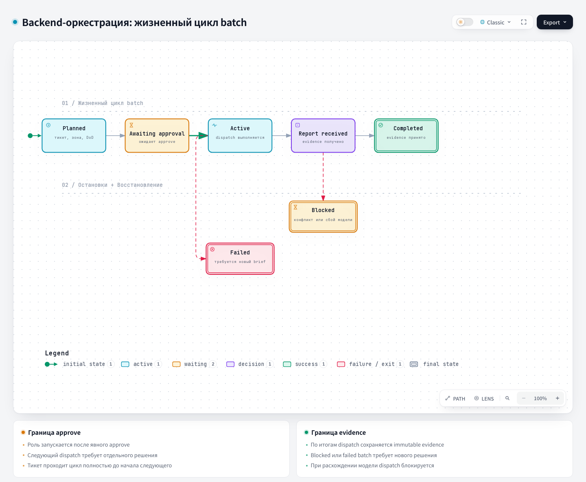

# Playbook — Orchestration playbook

Source: [`harness/orchestration/playbook.md`](https://github.com/PVMalove/agent-harness-next/blob/master/harness/orchestration/playbook.md).

## 1. Name and localization

- **English name:** `Backend Batch Orchestration Playbook`
- **Russian translation:**

```text
Руководство по оркестрации backend-batch
```

## 2. Full description

The Playbook is a runtime-neutral coordination contract for the optional `backend-orchestration` capability. It defines the coordinator's manual protocol, not a dispatch mechanism, a provider choice, or a mandatory runtime adapter. The primary source defines the coordinator's authority, the immutable briefs and reports, the batch state machine, the role order, the liveness rules, the parallelism conditions, the quality gates, and the baseline metrics.

The coordinator alone accepts a completion report, manages the lifecycle, approves dispatches, and handles scope changes. Each batch has one ticket, one issue branch, and one isolated worktree; one write role is active at a time. A change of scope, zone, DoD, purpose, or required evidence ends the dispatch and requires a new immutable brief.

The Context Package is an immutable, ledger-owned result of the deterministic `context_builder.py`. The roles of one batch
reuse it, and its freshness before each dispatch is recorded in shadow
mode. A checkpoint is a separate non-terminal record for the write role only; it allows a new
worker session to start under the same dispatch ID without carrying over the chat history and traceback. A recognized rate limit
authorizes the resume automatically; a planned trigger requires an existing coordinator decision.

Before review and publish, the coordinator runs the base-commit gate: after `git fetch origin <integration_ref>`,
the current tip must match the batch base. Drift is resolved with a new developer/rebase dispatch.
A delta-review is either test-only (after a Warning, only for a test-only diff) or follows a fix-forward:
the coordinator chooses the delta-review or the full review itself, without a separate human decision; the dispatch
is approved under `approval_policy` together with this choice. The conditions for a full review are described in
[`code-review`](code-review.md). Any delta-review is always a new independent
review dispatch. An advisory tool call remains an ephemeral non-role output and cannot authorize
work.

`approval_policy: auto` defines an automatic path from `batch approve` to an accepted publish.
The policy approves the batch, each dispatch, and a planned continuation. `batch auto-decide` makes a
decision on the report from the ledger facts: accept a clean report with risks, or retry by `route_preview`.
Each decision is written as `policy:auto` with evidence. A closed list of stops (`budget-exhausted`,
`integrity-failure`, `no-automatic-route`) stops the path and writes a final report. After
a stop, a human approves each step. Only a human opens a PR, and auto-merge is prohibited.

## 3. Contracts

- **Input (Input/Brief):** the ticket, allowed paths, issue branch/worktree, DoD, prohibitions, verification commands, provider/model assignment, and explicit human approval.
- **Process (Process):** `planned → awaiting-approval → active → awaiting-approval`, then `completed`, `blocked`, `failed`, `not-required`, or `abandoned` (`blocked` continues only through `batch resume --reason`); the Architect precedes the Developer; reports are accepted only with sufficient independent evidence.
- **Output (Output/Report):** the Context Package, checkpoints, immutable dispatch briefs, completion reports, the accepted final batch status, and the observed metric baseline.

## 4. Architecture diagram



## Source

[playbook.md](https://github.com/PVMalove/agent-harness-next/blob/master/harness/orchestration/playbook.md)
