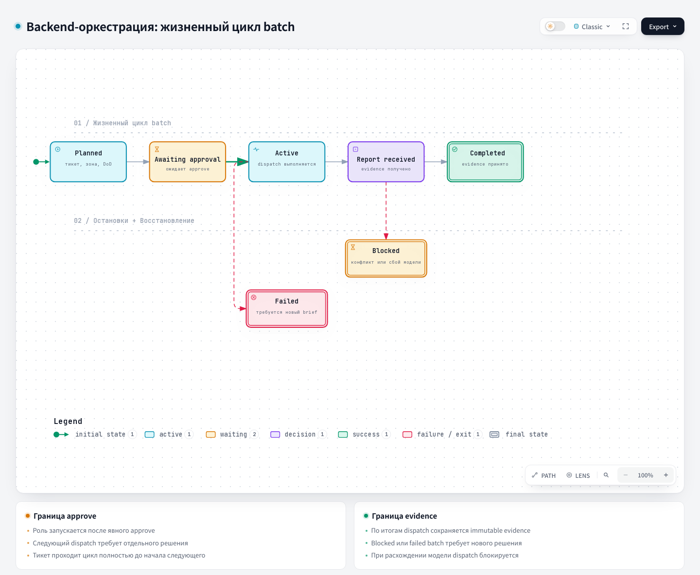

# Playbook: руководство по оркестрации

Источник: [`harness/orchestration/playbook.md`](https://github.com/PVMalove/agent-harness-next/blob/master/harness/orchestration/playbook.md).

## 1. Название и локализация

- **Английское название:** `Backend Batch Orchestration Playbook`
- **Русский перевод:**

```text
Руководство по оркестрации backend-batch
```

## 2. Полное описание

Playbook задаёт контракт координации для необязательной capability `backend-orchestration` и не зависит от runtime. Это ручной протокол координатора: сам playbook не запускает dispatch, не выбирает провайдера и не требует runtime adapter. Первоисточник определяет полномочия координатора, неизменяемые brief и reports, конечный автомат batch, порядок ролей, правила liveness, условия параллелизма, quality gates и базовые метрики.

Только координатор принимает completion report и управляет жизненным циклом batch, одобрением dispatch и изменениями scope. У каждого batch один тикет, одна issue-ветка и один изолированный worktree. В каждый момент активна только одна write-роль. Если меняется scope, зона, DoD, назначение или нужное доказательство, текущий dispatch завершается и нужен новый неизменяемый brief.

Context Package (пакет контекста для ролей) собирает детерминированный `context_builder.py`. Пакет неизменяем, им владеет ledger, и роли одного batch используют его повторно. Перед каждым dispatch coordinator проверяет свежесть пакета в shadow-режиме: записывает результат, но не блокирует dispatch. Checkpoint: отдельная нетерминальная запись только для write-роли. С ним новая worker session продолжает работу под тем же dispatch ID без истории чата и traceback. Распознанный rate limit разрешает resume автоматически. Плановый trigger требует уже записанного решения координатора.

Перед review и publish coordinator проходит base-commit gate: после `git fetch origin <integration_ref>` текущая вершина должна совпадать с base batch. Если вершина ушла вперёд, coordinator назначает новый dispatch developer или rebase.
Delta-review бывает двух видов: test-only (после Warning, только для diff из одних тестов) и после fix-forward. Coordinator сам выбирает delta-review или полный review, отдельное решение человека не нужно. Dispatch одобряется по `approval_policy` вместе с этим выбором. Когда нужен полный review, описано в [`code-review`](code-review.md). Любой delta-review всегда идёт новым независимым review dispatch. Вызов advisory tool даёт эфемерный вывод вне ролей и не может разрешить работу.

`approval_policy: auto` включает автоматический путь от `batch approve` до принятого publish. Политика одобряет batch, каждый dispatch и плановое продолжение. `batch auto-decide` решает по отчёту на основе фактов ledger: принимает чистый отчёт с рисками или назначает retry по `route_preview`. Каждое решение записывается как `policy:auto` с evidence. Путь останавливают условия из закрытого списка категорий (`integrity-failure`, `budget-exhausted`, `no-automatic-route`). При остановке coordinator пишет итоговый отчёт. Дальше каждый шаг одобряет человек. PR открывает только человек, auto-merge запрещён.

## 3. Контракты

- **Вход (Input/Brief):** тикет, allowed paths, issue-ветка и worktree, DoD, запреты, команды проверки, назначение провайдера и модели и явное одобрение человека.
- **Процесс (Process):** batch проходит `planned → awaiting-approval → active → awaiting-approval` и заканчивается в `completed` или `abandoned`. Из `blocked`, `failed` и `paused` batch возвращает только человек. `not-required` остался как старая терминальная запись, новые команды пишут `completed`. Architect работает раньше Developer. Координатор принимает report, только если независимого доказательства достаточно.
- **Выход (Output/Report):** Context Package, checkpoints, неизменяемые dispatch briefs, completion reports, принятый конечный статус batch и наблюдаемая базовая линия метрик.

## 4. Архитектурная схема



## Источник

[playbook.md](https://github.com/PVMalove/agent-harness-next/blob/master/harness/orchestration/playbook.md)
