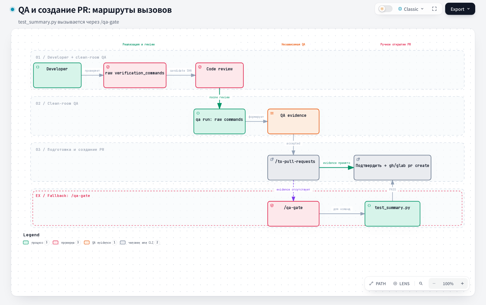

# QA Gate — Quality assurance gate

## 1. Name and localization

- **English name:** `qa-gate`
- **Russian translation:**

```text
Гейт обеспечения качества
```

## 2. Full translation of the skill text

<div class="ah-skill-text" markdown="1">

```yaml
name: qa-gate
description: Run this project's full local quality gate (the lint/typecheck/test commands from .harness/project.json) and report pass or fail. Use before opening a PR, or whenever the full set of local checks is requested.
context: fork
background: false
```

Run this project's quality gate and report the result. Nothing more — do not repeat the commands and do not add unrelated comments.

1. Find the harness root. It is the current checkout if it contains `.harness/project.json`. A linked worktree
   has no `.harness/` directory (Git ignores it): if the file is not there, the root is the main worktree —
   the first `worktree` entry in the output of `git worktree list --porcelain`. Take only
   `.harness/project.json` and `.harness/skills/qa-gate/scripts/test_summary.py` from there; run
   every command with the current checkout as the working directory, not the main worktree.
   Read `qa_gate_commands` from that `.harness/project.json` — an ordered list of shell commands (for example, `["make check", "make test"]` or `["ruff check .", "mypy .", "pytest"]`). If the file or the field is missing, tell the user to fill it in (run `harness init`/`update` again or edit `.harness/project.json` directly) and stop.
2. Read the optional `shell` field from the same file. `"bash"` (or the field absent) means this
   checkout runs commands through bash: Linux, macOS, or a Windows checkout where `bash` on `PATH`
   is really Git Bash/WSL and not the System32 WSL launcher stub. `"powershell"` means the commands run
   through PowerShell instead: pick it on a native Windows checkout where a bare `bash` resolves
   to that stub and fails with no WSL distro configured, even for a command that needs no shell at
   all. Run each command in order through the installed agent wrapper with the matching shell:

   ```bash
   # shell: "bash" (default)
   python <harness-root>/.harness/skills/qa-gate/scripts/test_summary.py -- bash -lc '<exact command from qa_gate_commands>'

   # shell: "powershell"
   python <harness-root>/.harness/skills/qa-gate/scripts/test_summary.py -- powershell -NoProfile -NonInteractive -Command '<exact command from qa_gate_commands>'
   ```

   `<harness-root>` is `.` in a regular checkout and the absolute path of the main worktree in a linked worktree.

   Stop at the first error. Return the wrapper's bounded summary — the status, the pytest totals, the IDs of the failed nodes, the structured diagnostics (traceback endings, explicit error messages, and compiler/linter errors), and the sanitized local path to the log — instead of the command output or an arbitrary tail of the log. Do not run the remaining commands. Read the error log only when the developer needs exactly this diagnostic evidence. The wrapper works with every quality command; do not add a pytest JSON/XML reporting flag unless that command already owns and documents that artifact.
3. If every command succeeds, record the pass marker yourself: from the current checkout run `bash "${CLAUDE_PROJECT_DIR:-$(git worktree list --porcelain | sed -n '1s/^worktree //p')}/.claude/hooks/record-qa-gate-pass.sh"`. A runtime that does not set `CLAUDE_PROJECT_DIR` takes the script from the main worktree: that is where `.claude/hooks/` is installed, and it is not in git. Do not rely only on the PostToolUse hook `mark-qa-gate-passed.sh`: this skill runs in a fork (see `context: fork` above), and the hook is not guaranteed to fire for Bash calls from this fork.
4. Report only a compact one-line PASS summary — do not paste the successful output.

</div>

## 3. Contracts

- **Input (Input/Brief):** `.harness/project.json` with `qa_gate_commands`.
- **Output (Output/Report):** one PASS line, or a bounded summary of the first error.

## 4. Architecture diagram



## Source

[SKILL.md](https://github.com/PVMalove/agent-harness-next/blob/master/skills/first-party/engineering/qa-gate/SKILL.md)
