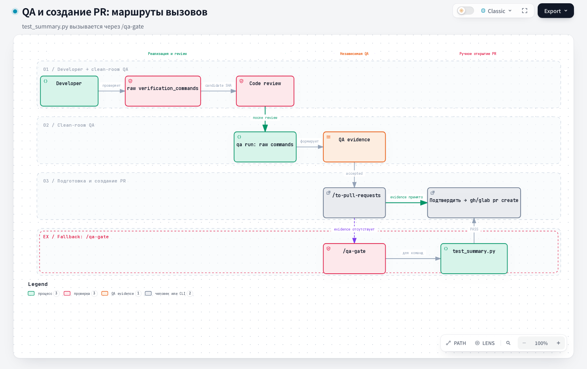

# QA Gate: гейт обеспечения качества

## 1. Название и локализация

- **Английское название:** `qa-gate`
- **Русский перевод:**

```text
Гейт обеспечения качества
```

## 2. Полный перевод текста скилла

<div class="ah-skill-text" markdown="1">

```yaml
name: qa-gate
description: Запустите полный локальный гейт качества этого проекта (команды lint/typecheck/test из .harness/project.json) и сообщите об успехе или провале. Используйте перед открытием PR или всякий раз, когда запрошен полный набор локальных проверок.
context: fork
background: false
```

Запустите гейт качества проекта и сообщите результат. Больше ничего не делайте: не пересказывайте команды и не добавляйте посторонних комментариев.

1. Найдите корень харнесса. Если в текущем checkout есть `.harness/project.json`, корень здесь. В linked worktree
   нет каталога `.harness/`, потому что Git его игнорирует. Если файла там нет, корнем считается основной worktree:
   первая запись `worktree` в выводе `git worktree list --porcelain`. Из него берите только
   `.harness/project.json` и `.harness/skills/qa-gate/scripts/test_summary.py`. Каждую команду
   запускайте из текущего checkout, никогда из основного worktree.
   Прочитайте `qa_gate_commands` из этого `.harness/project.json`. Это упорядоченный список shell-команд, например `["make check", "make test"]` или `["ruff check .", "mypy .", "pytest"]`. Если файла или поля нет, попросите пользователя заполнить его (снова запустить `harness init`/`update` или отредактировать `.harness/project.json` вручную) и остановитесь.
2. Прочитайте из того же файла необязательное поле `shell`. Значение `"bash"` или отсутствие поля значит, что
   checkout запускает команды через bash: Linux, macOS или Windows, где `bash` в `PATH` действительно Git Bash или WSL,
   а не заглушка WSL-launcher из System32. Значение `"powershell"` значит, что команды идут через PowerShell. Выбирайте его
   на нативном Windows checkout, где голый `bash` указывает на эту заглушку и падает без настроенного дистрибутива WSL,
   даже для команды, которой shell вообще не нужен. Запустите каждую команду по порядку через установленную агентскую
   обёртку с подходящим shell:

   ```bash
   # shell: "bash" (по умолчанию)
   python <корень-харнесса>/.harness/skills/qa-gate/scripts/test_summary.py -- bash -lc '<точная команда из qa_gate_commands>'

   # shell: "powershell"
   python <корень-харнесса>/.harness/skills/qa-gate/scripts/test_summary.py -- powershell -NoProfile -NonInteractive -Command '<точная команда из qa_gate_commands>'
   ```

   `<корень-харнесса>` равен `.` в обычном checkout и абсолютному пути основного worktree в linked worktree.

   На первой ошибке остановитесь. Верните ограниченную сводку обёртки: статус, итоги pytest, ID упавших узлов, структурированную диагностику (концы traceback, явные сообщения об ошибках, ошибки компилятора и линтера) и санитизированный локальный путь к логу. Не возвращайте вывод команды или произвольный хвост лога. Оставшиеся команды не запускайте. Лог ошибки читайте, только если разработчику нужно именно это диагностическое доказательство. Обёртка работает с любой командой проверки. Не добавляйте флаг отчёта pytest в JSON или XML, если команда уже не создаёт и не документирует такой файл.
3. Если все команды прошли, сами запишите маркер прохождения: из текущего checkout выполните `bash "${CLAUDE_PROJECT_DIR:-$(git worktree list --porcelain | sed -n '1s/^worktree //p')}/.claude/hooks/record-qa-gate-pass.sh"`. Если runtime не задаёт `CLAUDE_PROJECT_DIR`, скрипт берётся из основного worktree: там установлен `.claude/hooks/`, которого нет в Git. Не полагайтесь только на PostToolUse-хук `mark-qa-gate-passed.sh`: скилл работает в fork (см. `context: fork` выше), и хук может не сработать для Bash-вызовов внутри fork.
4. Сообщите только короткую однострочную сводку PASS. Успешный вывод не вставляйте.

</div>

## 3. Контракты

- **Вход (Input/Brief):** `.harness/project.json` с `qa_gate_commands`.
- **Выход (Output/Report):** одна строка PASS либо ограниченная сводка первой ошибки.

## 4. Архитектурная схема



## Источник

[SKILL.md](https://github.com/PVMalove/agent-harness-next/blob/master/skills/first-party/engineering/qa-gate/SKILL.md)
