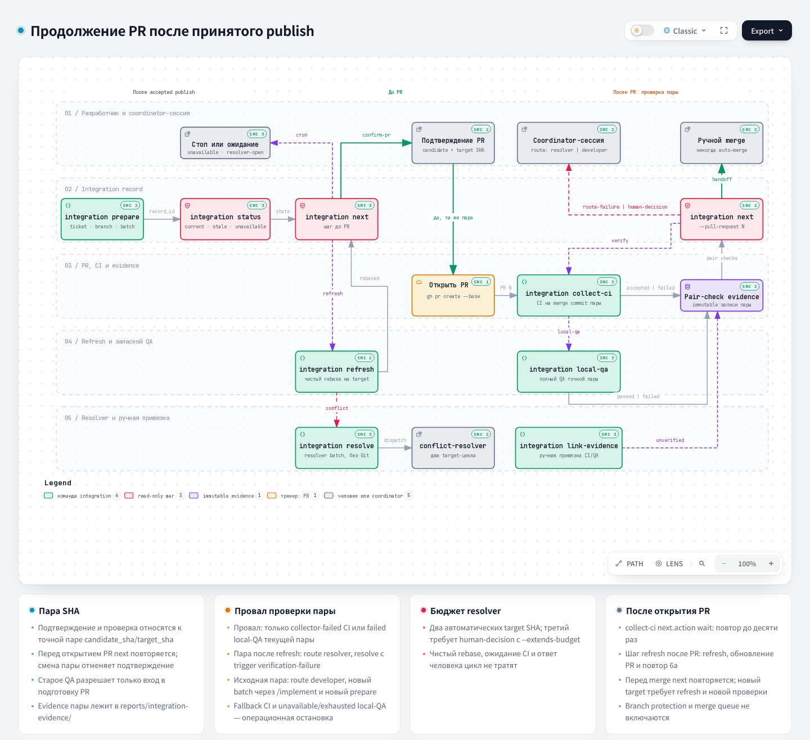

# /to-pull-requests — PR, ticket closure and integration PR

Run `/to-pull-requests <ticket>` manually (in Codex, use `$to-pull-requests`) after `/implement` or
`/fast-implement` pushed the issue branch. The skill opens the PR/MR only after your separate
confirmation. Once you confirm the merge, it closes the ticket, unblocks dependent tickets and removes
the worktree. The skill itself never merges.

## Resuming

The merge confirmation usually comes in another session. Step 0 finds the PR/MR of the current branch
(`gh pr list --head <branch> --state all`, on GitLab `glab mr list --source-branch <branch>`): without
a PR the skill starts at step 1, with an open PR it goes to verification and the handoff, and with a
merged one to the merge checks, the ticket closure and the cleanup.

## Child ticket PR

1. The target branch comes from the ticket's `## Integration Branch` or the local ticket's
   `**Integration branch:**` line, otherwise it is `base_branch`. The ticket also gives its one
   `type::*` label: with none or more than one, the skill stops and asks for the type instead of
   inferring it from the title or the diff.
2. The branch must be clean, match `branch_pattern` and equal its upstream branch.
3. QA first, then confirmation. Without the backend-orchestration opt-in, and for `pipeline::fast`,
   the skill runs `/qa-gate`. In an opt-in project it validates the accepted QA evidence of the exact
   SHA and calls `integration next` per `references/integration-route.md`, part A, instead of
   rerunning QA.
4. The PR body follows the `git-workflow.md` §3 template and is built from the ticket and the
   verification evidence, not from the diff alone. Under Verification, each `Action -> Verify`
   criterion appears with its command and result; a criterion without evidence goes under Not
   verified & risks. The ticket's `Out of scope` and the epic's Non-Goals state what the PR
   deliberately does not change. The footer (`Closes #<ID>` or `Related to #<ID>`) is chosen by
   `.harness/instructions/git-workflow.md` §2 step 6 → Ticket footer; the skill keeps no copy of that rule.
5. The separate readiness question names the QA result and, in an opt-in project, `candidate_sha`,
   `target_sha` and `qa_source`. PR metadata follows the "Project-Only Metadata" rule of §1.
   The PR gets the `pr::ticket` label and the ticket's `type::*` label; `pr::ticket` also marks the
   PR of an epic-less ticket into `base_branch`. The labels tell a ticket PR from an integration PR
   and let you filter PRs by type.
6. A `task-report::required` report is published in the `## Completion report` format of
   `project-memory.md`; otherwise `memory sync` skips it.
7. After the PR opens in an opt-in project, part B of `references/integration-route.md` collects CI
   through `integration collect-ci` or runs `integration local-qa`. With
   `verification_plan_policy.ticket_diff_selection` on, a ticket PR into `integration/*` is confirmed
   by the run of its own diff (`ticket-diff`, CI `verify-light`), and the `light_check` reason never
   confirms a `full` pair.

## After the merge

The skill proves the merge from the PR/MR state (merged into the expected target, head SHA equal to the
branch SHA), not from Git history, and for an opt-in project checks the tree of the merge commit
(`--merge-commit`, `merge-tree-mismatch`). It then replaces `status::in-progress` with `status::done`, closes the ticket or verifies its auto-close with
the commands of `.harness/instructions/git-workflow.md` §2 step 7 → Close the ticket after merge, and
moves to `status::ready` the tickets that no longer have an open blocker. Drafts in `docs/tasks/` are
not tickets. The `status::done` label is set before an explicit close, or right after the verified
close when the tracker closed the ticket by `Closes #<ID>`. The ticket closes right after the merge
into `integration/*`, without waiting for the integration PR, so native `blocked_by` links clear.
A managed worktree is removed with `coordinator.py worktree remove`, a session worktree
with the runtime's tool. When the sandbox blocks the removal, the skill hands you the command.

The skill deletes the local branch only after a proven merge and your consent. For a PR/MR, the PR
itself proves the merge: its merged state and a head SHA equal to the branch, because after a squash or
rebase merge `git branch -d` does not see the merge. `harness branch-delete <repo> <branch-name>`
deletes the branch: it refuses when the branch does not match `branch_pattern`, is checked out in a
worktree, or has a tip that is neither reachable from `origin` nor the head of a merged PR/MR. For a
local tracker without a PR, `git branch -d` deletes the branch after the `git merge-base --is-ancestor`
check. When the PR is not merged or the SHAs differ, the branch stays. The skill deletes the `origin` branch with `git push origin --delete <branch-name>`
after the same check and your consent; when a project hook blocks the command, the skill names the reason and hands
you the command.
When
the epic's last child ticket closes, the skill offers `/to-pull-requests --release <epic>`.

## Integration PR (`--release <epic>`)

Following `references/release.md`, the mode opens the integration PR of the epic's integration branch
into `base_branch` or, with `--target <branch>`, into another `integration/*` branch. It checks that
every child ticket is closed and runs the full `/qa-gate` on the head of the integration branch in its
clean checkout or in a worktree of its own. In a project with the `backend-orchestration` opt-in, the
mode also asks the Release Gate (`integration next`) for the pair `{candidate_sha, target_sha}`; when
the pair has no record, the PR lists that under unverified risks. The epic criteria are checked
against evidence on the same SHA. Every epic criterion is required: missing evidence for any criterion
blocks the PR before the confirmation request.

The PR gets the `pr::integration` label and no `type::*` label, because it collects tickets of several
types. `pr::integration` marks every PR whose head is an `integration/*` branch, including one into
another `integration/*` branch. The body lists child PRs without closing keywords and the results by
epic criterion; a child closed as `resolution::wontfix` has no PR and is listed separately. The
footer is `Closes #<epic>` only for the `base_branch` target, otherwise `Related to #<epic>`. The separate
confirmation applies to the verified SHA; you do the merge.

After a confirmed merge into `base_branch`, the skill closes the epic, replaces its `status::specs`
with `status::done` and offers `/delivery-stats <epic>`. When the epic has no `status::specs` or
more than one `status::*` label, the skill stops and asks you. A merge into another `integration/*`
branch leaves the epic open. The skill removes only the worktree it created and never deletes the
integration branch: it asks whether the branch is needed for the next epic and, on a no, gives you
the deletion commands. This mode never changes `CHANGELOG.md` or the project version.

A local markdown tracker has no PR: the mode checks that every ticket in `.scratch/<feature>/issues/`
reads `**Workflow:** done`, shows the criterion results in place of a PR body and asks you to merge
the integration branch into the target. After your confirmation, it checks the merge with
`git merge-base --is-ancestor` and offers `/delivery-stats`.

[Source SKILL.md](https://github.com/PVMalove/agent-harness-next/blob/master/skills/first-party/engineering/to-pull-requests/SKILL.md)
