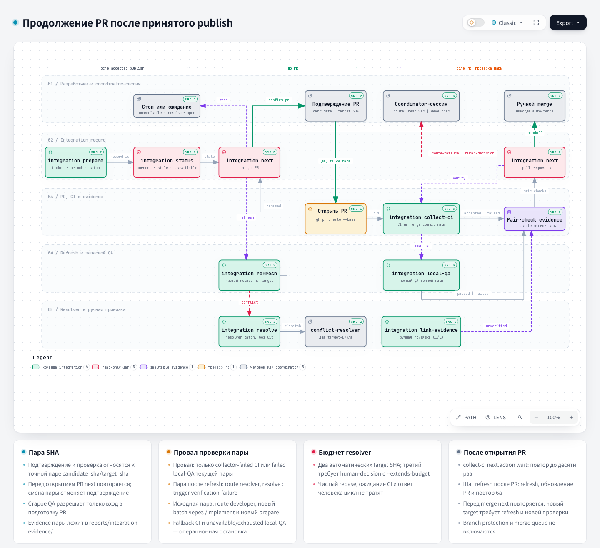

# To Pull Requests: к pull request'ам

## 1. Название и локализация

- **Английское название:** `to-pull-requests`
- **Русский перевод:**

```text
К pull request'ам
```

## 2. Полный перевод текста скилла

<div class="ah-skill-text" markdown="1">

```yaml
name: to-pull-requests
description: Готовит и открывает pull request для уже запушенной issue-ветки. Используйте, когда это предложил `/implement` или `/fast-implement` или когда разработчик явно просит открыть PR.
disable-model-invocation: true
```

### К pull request'ам

Скилл создаёт pull request для названного тикета. Это ручная команда: никогда не запускайте её только потому, что `/implement` завершился.

В GitLab называйте проект явно: каждая команда `glab` получает `-R <project-url>`, а каждый вызов `glab api` пишется как `GITLAB_HOST=<host> glab api projects/<project-id>/...`. `<host>`, `<project-url>` и `<project-id>` заданы в `docs/agents/issue-tracker.md` → GitLab → Conventions. Merge request в GitLab обозначается `!<iid>`, issue обозначается `#<iid>`. В GitHub оба обозначаются `#<n>`.

В локальном markdown-трекере (`.scratch/<feature>/issues/NN-*.md`) нет PR и MR (`docs/agents/git-workflow.md` §2, шаг 6), поэтому шаги 3–7 не применяются. Целевую ветку возьмите из строки тикета `**Integration branch:**`, а для тикета без эпика возьмите `base_branch`. Выполните проверки ветки из шага 2. Если у репозитория нет remote, проверки upstream пропустите. Попросите разработчика самому смержить issue-ветку в эту цель и подтвердить мерж. Никогда не мержите её сами. После подтверждения команда `git merge-base --is-ancestor HEAD <target-ref>` должна пройти. `<target-ref>` здесь равен `origin/<target-branch>` после fetch или локальной `<target-branch>`, если у репозитория нет remote. Затем запишите в строку `**Workflow:**` файла тикета `done`. Если в файле есть `**Task report:** required`, добавьте отчёт о завершении в то же обновление. Дальше переходите к шагам 8 и 9.

1. Определите тикет и точную целевую ветку PR: из раздела тикета `## Integration Branch`, из родительского эпика или `base_branch` для тикета без эпика. Если определить не получается, остановитесь и спросите разработчика.
2. Проверьте, что текущая ветка соответствует `branch_pattern`, не равна ни `base_branch`, ни `integration/*`, не содержит незакоммиченных изменений и коммитов, которых нет в upstream-ветке. Если ветка не запушена, остановитесь и попросите разработчика вернуться к `/implement` или `/fast-implement`, смотря по маршруту тикета. Сделайте fetch её upstream и проверьте, что `git rev-parse HEAD` равен SHA upstream-ветки. Если они различаются, перед продолжением сделайте fast-forward чистой локальной ветки.
3. Если проект действительно подключил `backend-orchestration` (opt-in), после синхронизации получите полный текущий SHA через `git rev-parse HEAD` и проверьте его до любого действия с PR. Каждая команда ниже запускается как `python .harness/orchestration/coordinator.py --repo . <команда>`, а `<ticket-branch>` означает `--ticket "#<ID>" --branch "<current-issue-branch>"`.
   Сначала прочитайте integration-запись, только на чтение: `integration status <ticket-branch>`. Отказ «integration-записи нет» PR не блокирует: пропустите integration-шаги скилла и продолжайте проверкой доказательств и прежним потоком. Если команда сообщает `unavailable`, integration ref прочитать не удалось. Остановитесь и сообщите разработчику об операционной остановке, а не о дефекте кода. Если `refreshes` не пуст, ветку уже обновляли. Тогда ниже проверяйте `original_candidate_sha`, а не текущий SHA: старое принятое QA только пускает в подготовку PR и никогда не считается QA обновлённого candidate.
   Затем проверьте принятое QA-доказательство этого SHA:
   `python .harness/orchestration/coordinator.py --repo . qa evidence --ticket "#<ID>" --branch "<current-issue-branch>" --candidate-commit "<full-SHA>"`.
   CLI выбирает единственный batch с принятым QA-доказательством для этого SHA, поэтому abandoned
   batch из истории с тем же тикетом и веткой на результат не влияют. Если один SHA принят в нескольких batch,
   остановитесь и повторите команду с явным `--batch <batch-id>`. Если команда отклоняет
   доказательства, потому что их нет, они не приняты или не совпадают с SHA, остановитесь. Исключение: тикет
   явно помечен `pipeline::fast`. Для тикетов `pipeline::fast` проверку доказательств координатора пропустите.
   Затем запросите следующий шаг, только на чтение: `integration next <ticket-branch>`. Команда ничего не пишет в Git, ledger, dispatch и PR. Действуйте по её `step`:
   - `refresh`: integration ref сдвинулся. Выполните `integration refresh <ticket-branch>`. Чистый rebase обновляет только вашу issue-ветку: повторный review не нужен, цикл resolver не тратится. Убедитесь, что `git rev-parse HEAD` равен новому `candidate_sha`, и повторите `integration next`. При `state: conflict` выполните `integration resolve <ticket-branch>`. Команда только создаёт batch resolver. Передайте его `batch_id` координаторной сессии (`batch approve`, затем `dispatch create --role conflict-resolver`). При любом другом отказе (грязный worktree, изменившийся remote) остановитесь и передайте данные разработчику по маршруту rebase из ADR 0012. Не создавайте dispatch и не перезапускайте QA сами.
   - `resolver-open`: ветку ведёт открытый resolver batch. Остановитесь и дождитесь координаторной сессии. Ожидание цикл не тратит.
   - `route-failure` или `human-decision`: проверка текущей пары провалилась. Остановитесь и передайте данные координаторной сессии. Провал обновлённой пары берёт тот же resolver в пределах бюджета (`integration resolve`). Провал исходной пары считается собственным дефектом задачи и уходит обычному developer с review и QA. Координаторная сессия планирует новый batch того же тикета и issue-ветки обычным маршрутом `/implement`: `batch create --ticket <ticket> --branch <branch> --worktree <worktree> --integration-ref <integration ref>`, затем architect, developer, code-review, QA и publish. Завершённый исходный batch терминален: решение по нему больше не принимается, и новый batch он не блокирует. После принятого publish координаторная сессия выполняет `integration prepare --ticket <ticket> --branch <branch> --batch <новый batch>`, поэтому повторите `integration next --record <новая запись> --pull-request <n>`. Когда новая запись создана, у одного тикета и ветки две integration-записи, и `<ticket-branch>` отклоняется с отказом «several integration records match». Тогда `--record <новая запись>` заменяет `<ticket-branch>` в integration-командах шагов 3, 6, 6a и 7. `human-decision` значит, что два цикла resolver или правки на том же target исчерпаны. Продлить их может только решение разработчика (`integration resolver-event --kind human-decision --extends-budget`). Ответ никогда не сбрасывает бюджет.
   - `confirm-pr`: продолжайте. `qa_source` принимает значения: `original-qa` (исходная пара), `verification-pending-after-pr` (обновлённая пара, которую ещё не покрывают ни CI, ни local-QA), `ci` или `local-qa` (обновлённая пара, у которой уже есть такое проверенное evidence).
   Если эта проверка прошла, не запускайте `/qa-gate` повторно. Вместо этого из checkout ветки PR,
   проверенного на шаге 2, выполните
   `bash "${CLAUDE_PROJECT_DIR:-$(git worktree list --porcelain | sed -n '1s/^worktree //p')}/.claude/hooks/record-qa-gate-pass.sh"`,
   чтобы PR-hook принял этот SHA. Без `CLAUDE_PROJECT_DIR` скрипт берётся из основного worktree.
   Для обновлённого SHA этот маркер только разрешает открыть PR и не
   считается QA нового candidate: его проверяет шаг 6a, когда PR уже есть. Если проект не подключил
   opt-in или тикет помечен `pipeline::fast`, запустите `/qa-gate`, если
   репозиторий его предоставляет, и остановитесь при ошибке.
4. Подготовьте тело PR по `docs/agents/git-workflow.md` §3. Храните его только в `.harness/.sandboxes/pr_body/pr-body-<issue>-<slug>.md`, никогда в `docs/tasks/`. Разработчик может вручную запустить `pr-composer` в coding application. Иначе заполните шаблон сами. Определите ветку по умолчанию репозитория. GitHub: `gh repo view --json defaultBranchRef --jq .defaultBranchRef.name`. GitLab: поле `default_branch` из `GITLAB_HOST=<host> glab api projects/<project-id>`. Пишите `Closes #<ID>`, только если целевая ветка из шага 1 и есть ветка по умолчанию. Иначе пишите `Related to #<ID>`. GitLab закрывает issue по `Closes #<ID>`, только когда MR попадает в ветку по умолчанию, и проект может отключить это автозакрытие. Поэтому шаг 7 всегда проверяет состояние тикета.
5. Попросите разработчика явно и отдельно подтвердить, что ветка готова стать PR. Этот вопрос никогда не объединяется с другим. В opt-in-проекте назовите в вопросе точные `candidate_sha` и `target_sha` из `integration next`, целевую ветку PR и `qa_source`. Подтверждение относится только к этой паре. Остановитесь и дождитесь ответа.
6. После одобрения откройте PR/MR из checkout ветки, проверенного на шаге 2. В opt-in-проекте прямо перед этим ещё раз выполните `integration next <ticket-branch>`. Если изменились `candidate_sha`, `target_sha` или `step` (`confirm-pr`), подтверждение недействительно: повторите шаги выше и спросите заново. Заголовок и тело PR, как и каждый коммит, содержат только метаданные проекта: без атрибуции автоматизированного агента, имён моделей и `Co-Authored-By`. `<target-branch>` равен цели из шага 1. Без неё оба CLI открыли бы PR/MR в ветку по умолчанию. `<title>` это заголовок тикета в одинарных кавычках, каждый апостроф записывается как `'\''` в POSIX-shell или как `''` в PowerShell. Выполняйте одну команду публикации на один вызов shell:
   - **GitHub:** `gh pr create --base <target-branch> --title '<title>' --body-file <path>`.
   - **GitLab:** `glab mr create -R <project-url> --target-branch <target-branch> --title '<title>' --description-file <path> --yes`. Номер MR `!<iid>`, где `<iid>` стоит последним сегментом URL `.../-/merge_requests/<iid>`, который печатает команда.

   Удаляйте файл тела из `.harness/.sandboxes/pr_body/` только после успеха этой команды. При ошибке оставьте его для повтора. Если у тикета есть `task-report::required`, опубликуйте в тикете его completion report, если разработчик не попросил пропустить этот шаг. Запишите отчёт в `.harness/.sandboxes/pr_body/issue-comment-<issue>-<slug>.md` и опубликуйте его через `gh issue comment <ID> --body-file <path>` в GitHub или `GITLAB_HOST=<host> glab api projects/<project-id>/issues/<ID>/notes -F body=@<path>` в GitLab.
   **6a. Проверьте открытый или обновлённый PR (opt-in-проект).** Выполняйте эти действия после открытия PR и после каждого следующего обновления его ветки (refresh или push resolver):
   - `integration collect-ci <ticket-branch> --pull-request <n>` запрашивает у трекера комбинированный результат CI. Если CI принят, он заменяет повтор полного локального QA (`qa_replacement.applies`), и больше ничего не запускается.
   - `next.action: wait` (проверка ещё идёт): повторите команду примерно через минуту, не больше десяти раз. Затем спросите разработчика, ждать ли дальше или перейти на локальный QA. Ожидание цикл resolver не тратит.
   - `next.action: local-qa` (CI нет или им нельзя воспользоваться): запустите существующий запасной путь `integration local-qa --record <integration_record_id> --ci-condition <next.ci_condition> --reason "<причина из collect-ci>"`. Это полный локальный QA точной пары через общую очередь QA. Результат `unavailable` или `exhausted` означает операционную остановку. Сообщайте о нём именно так, а не как о дефекте кода.
   - `next.action: route` (CI именно этой пары упал, и это записано): следуйте действию маршрута через `integration next` ниже. Локальный QA не запускайте. collect-ci рядом возвращает `local_qa_required: true`: это унаследованное значение для любого непринятого результата, и `route` важнее.
   - **Политика тестов по цели PR (проекты с включённым `verification_plan_policy.ticket_diff_selection`).** PR тикета в ветку `integration/*` подтверждается прогоном его собственного diff: пара требует `ticket-diff`, а CI запускает `verify-light`. PR integration-ветки в ветку по умолчанию требует пару с выбором `full`. Для неё нужен полный CI, который принимает `integration collect-ci`, или запасной `integration local-qa`. Причина `light_check` значит, что в `ci_required_checks` записана проверка `-light`. Она не подтверждает пару `full`, поэтому используйте запасной `local-qa` или попросите оператора указать полные проверки. Если полный прогон перед веткой по умолчанию упал, не правьте integration-ветку напрямую. Попросите разработчика открыть fix-тикеты с базой в этой integration-ветке. Каждый из них проходит diff-прогон своего PR.
   - Затем выполните `integration next <ticket-branch> --pull-request <n>` и действуйте по `step`, как на шаге 3: `verify` (повторите этот шаг), `route-failure`/`human-decision` (остановитесь и передайте данные; операционных сбоев здесь не бывает), `refresh` (target сдвинулся: повторите refresh, обновите PR и этот шаг), `release-gate-refused` или `handoff`. `release-gate-refused` значит, что Release Gate отказывает этой паре. Его `refusals` называют сдвинутую issue-ветку, target вне истории кандидата или QA-evidence, которое отклонил `qa.evidence.verify`. Остановитесь, передайте данные сессии координатора и не мержите.
7. Верните ссылку на PR/MR в основную сессию (в GitLab также в виде `!<iid>`). В opt-in-проекте, прежде чем просить мерж, покажите `handoff` из `integration next --pull-request <n>`: проверенные `candidate_sha` и `target_sha`, `qa_source` (`original-qa`, `ci` или `local-qa`) с его `reference` и признак обновления ветки. Скажите, что проверка относится ровно к этой паре и не обещает, что до мержа ничего не изменится. Не включайте защиту веток на сервере и merge queue. Спросите, хочет ли разработчик посмотреть PR, и прямо перед мержем повторите `integration next --pull-request <n>`. Новый target означает refresh и новую проверку, старую проверку повторно не используют. Никогда не мержите сами. С тикетом работайте только после того, как разработчик подтвердит мерж:
   - **Проверьте мерж.** GitHub: `gh pr view <n> --json state,baseRefName` (`state` равен `MERGED`, `baseRefName` равен цели из шага 1). GitLab: `glab mr view <iid> -R <project-url> -F json` (`state` равен `merged`, `target_branch` равен цели из шага 1). Если мержа в эту цель нет, оставьте тикет открытым и сообщите разработчику.
   - **Проверьте дерево.** В opt-in-проекте сравните дерево коммита, который мерж создал в целевой ветке, с `candidate_tree_sha` пары. Возьмите merge-коммит. GitHub: `gh pr view <n> --json mergeCommit --jq .mergeCommit.oid`. GitLab: `merge_commit_sha`, а если он `null`, то `squash_commit_sha` из `glab mr view <iid> -R <project-url> -F json`. Выполните `git fetch <remote> <target-branch>`, затем `integration next <ticket-branch> --pull-request <n> --merge-commit <sha>`. При `step: merged` продолжайте. При `step: merge-tree-mismatch` остановитесь с блокером: не закрывайте тикет и сообщите разработчику, что смерженное дерево не совпадает с деревом, которое проверил QA. Поэтому следующему мержу из целевой ветки нужен новый полный QA её головы. Без opt-in эту проверку пропустите.
   - **`Related to #<ID>`:** закройте тикет явно. GitHub: `gh issue close <ID> --reason completed`. GitLab: `glab issue close <ID> -R <project-url>`. Команда не принимает комментарий, поэтому нужный комментарий сначала опубликуйте через notes API, как на шаге 6.
   - **`Closes #<ID>`:** убедитесь, что трекер закрыл тикет. GitHub: `gh issue view <ID> --json state` (`state` равен `CLOSED`). GitLab: `glab issue view <ID> -R <project-url> -F json` (`state` равен `closed`). GitLab закрывает тикет асинхронно, поэтому, если он ещё `opened`, прочитайте его ещё раз. Если тикет всё ещё открыт, закройте его явной командой выше и сообщите разработчику, почему трекер этого не сделал.
8. **После каждого закрытия разблокируйте зависимые тикеты в той же сессии.** Зависимость снимают только подтверждённый мерж и штатное закрытие предшественника. Push, publish, принятый QA и открытый PR зависимость не снимают. Метку `status::in-progress` закрытого тикета не трогайте: закрытое состояние и есть его терминальный `done`. Затем найдите все открытые тикеты, которые он блокировал, и переведите те, у которых теперь закрыты все блокеры:
   - **GitHub:** перечислите открытые issue со `status::blocked` (`gh issue list --state open --label status::blocked --json number`). Для каждого прочитайте нативные блокеры (`gh api repos/<owner>/<repo>/issues/<n>/dependencies/blocked_by --jq '[.[] | select(.state=="open")] | length'`) и строку `Blocked by:` в теле. Если открытых блокеров нет ни там, ни там, выполните `gh issue edit <n> --remove-label status::blocked --add-label status::ready`.
   - **GitLab:** перечислите открытые issue со `status::blocked` (`glab issue list -R <project-url> --label status::blocked --output json`). Для каждого прочитайте нативные blocking links (`GITLAB_HOST=<host> glab api projects/<project-id>/issues/<n>/links`). Запись с `link_type` `is_blocked_by` и `state` `opened` означает открытый блокер. В GitLab Free таких links нет. Также прочитайте каждый `#<M>` в строках `Blocked by` описания (`glab issue view <n> -R <project-url> -F json`). Такой блокер открыт, пока `glab issue view <M> -R <project-url> -F json` показывает `state` `opened`. Если открытых блокеров нет ни там, ни там, выполните `glab issue update <n> -R <project-url> --unlabel status::blocked --label status::ready`.
   - **Локальный трекер** (`.scratch/<feature>/issues/*.md` или `docs/tasks/*.md`): проверьте `**Blocked by:** #<ID>` и запишите `**Workflow:** status::ready`, когда все перечисленные блокеры разрешены.
   - Сообщите, какие тикеты перешли в `status::ready`, а какие остались заблокированы и чем.
9. **Очистка:** когда подтверждено, что PR смержен и тикет закрыт, очистите локальное окружение, чтобы не копился мусор. Если нужно, выйдите из worktree и удалите его через `git worktree remove <path>`. Затем решите, что делать с локальной веткой:
   - **С PR:** мерж доказывайте по PR, а не по истории Git. После squash- или rebase-мержа коммиты ветки не попадают в историю целевой ветки, поэтому `git branch -d` и `git merge-base --is-ancestor` падают, хотя работа смержена. GitHub: `gh pr view <n> --json state,headRefOid` (`state` равен `MERGED`, `headRefOid` равен `git rev-parse <branch-name>`). GitLab: `glab mr view <iid> -R <project-url> -F json` (`state` равен `merged`, `sha` равен `git rev-parse <branch-name>`).
   - **Проверка прошла:** спросите разработчика, удалять ли локальную ветку, и дайте ему команду `git branch -D <branch-name>`, чтобы он выполнил её сам. Хук `block-dangerous-git.sh` всегда блокирует `git branch -D` для агента и не видит ответа в чате. Поэтому агент эту команду не запускает и блокировку не обходит.
   - **PR не смержен или SHA различаются:** оставьте ветку и сообщите разработчику.
   - **Локальный markdown-трекер (без PR):** когда проверка `git merge-base --is-ancestor` из абзаца про локальный трекер прошла, удалите ветку командой `git branch -d <branch-name>`.

</div>

## 3. Контракты

- **Вход (Input/Brief):** запушенная issue-ветка, тикет и точная целевая ветка PR.
- **Выход (Output/Report):** ссылка на созданный PR/MR или конкретный blocker.

## 4. Архитектурная схема



## Источник

[SKILL.md](https://github.com/PVMalove/agent-harness-next/blob/master/skills/first-party/engineering/to-pull-requests/SKILL.md)
