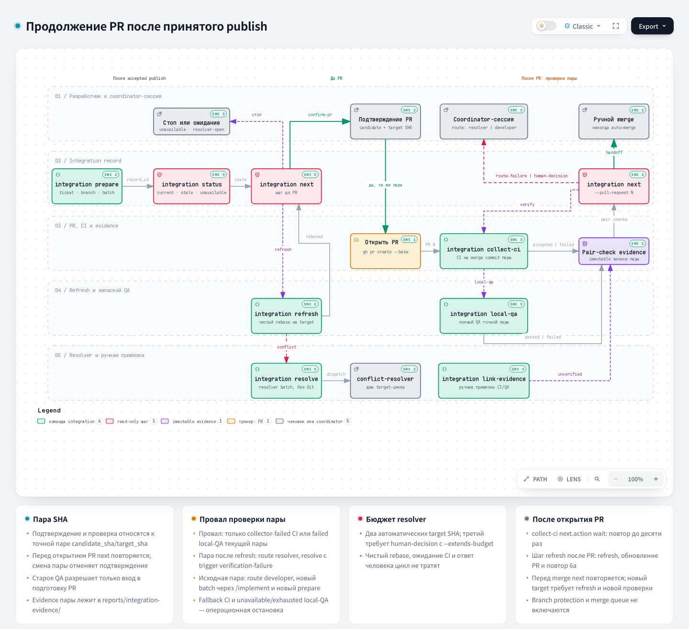

# /to-pull-requests — PR, закрытие тикета и релиз

Запускайте `/to-pull-requests <ticket>` вручную (в Codex используйте `$to-pull-requests`) после того,
как `/implement` или `/fast-implement` запушил issue-ветку. Навык открывает PR/MR только после вашего
отдельного подтверждения. После того как вы подтвердите merge, он закрывает тикет, разблокирует
зависимые тикеты и убирает worktree. Сам навык никогда не делает merge.

## Повторный вход

Подтверждение merge обычно приходит в другой сессии. Шаг 0 ищет PR/MR текущей ветки
(`gh pr list --head <branch> --state all`, на GitLab `glab mr list --source-branch <branch>`):
без PR навык начинает с шага 1, при открытом PR переходит к проверке и handoff, а при слитом — к
проверкам merge, закрытию тикета и очистке.

## PR дочернего тикета

1. Целевая ветка берётся из `## Integration Branch` тикета или строки `**Integration branch:**`
   локального тикета, иначе это `base_branch`.
2. Ветка должна быть чистой, соответствовать `branch_pattern` и совпадать со своей upstream-веткой.
3. Сначала QA, потом подтверждение. Без opt-in backend-оркестрации и для `pipeline::fast` навык
   запускает `/qa-gate`. В opt-in-проекте он проверяет принятые доказательства QA точного SHA и
   вызывает `integration next` по `references/integration-route.md`, часть A, а не перезапускает QA.
4. Тело PR пишется по шаблону `git-workflow.md` §3 из тикета и доказательств проверки, а не только по
   diff. В разделе «Проверка» каждый критерий `Action -> Verify` указан с командой и результатом;
   критерий без доказательства попадает в «Не проверено и риски». `Out of scope` тикета и Non-Goals
   эпика показывают, чего PR намеренно не меняет.
5. Отдельный вопрос о готовности называет результат QA, а в opt-in-проекте — `candidate_sha`,
   `target_sha` и `qa_source`. Метаданные PR подчиняются правилу «Project-Only Metadata» из §1.
6. Отчёт `task-report::required` публикуется в формате `## Completion report` из
   `project-memory.md`, иначе `memory sync` его пропустит.
7. После открытия PR в opt-in-проекте часть B `references/integration-route.md` собирает CI через
   `integration collect-ci` или запускает `integration local-qa`. При включённом
   `verification_plan_policy.ticket_diff_selection` PR тикета в `integration/*` подтверждается
   прогоном своего diff (`ticket-diff`, CI `verify-light`), а причина `light_check` никогда не
   подтверждает пару `full`.

## После merge

Навык проверяет merge и для opt-in — дерево merge-коммита (`--merge-commit`,
`merge-tree-mismatch`). Затем он закрывает тикет или проверяет его автозакрытие и переводит в
`status::ready` тикеты, у которых больше нет открытых блокеров. Черновики `docs/tasks/` тикетами не
считаются. Управляемый worktree удаляется через `coordinator.py worktree remove`, worktree сессии —
инструментом рантайма. Если песочница не даёт удалить worktree, навык отдаёт команду вам.

Локальную ветку навык удаляет только после доказанного merge и вашего согласия. Для PR/MR merge
доказывает сам PR: состояние «слит» и совпадение его head SHA с веткой, потому что после squash или
rebase `git branch -d` не видит слияния. Ветку удаляет `harness branch-delete <repo> <branch-name>`:
команда отказывает, если ветка не подходит под `branch_pattern`, открыта в worktree или её вершина
недостижима из `origin` и не совпадает с head слитого PR/MR. Для локального трекера без PR ветку
удаляет `git branch -d` после проверки `git merge-base --is-ancestor`. Если PR не слит или SHA
различаются, ветка остаётся. Когда
закрыт последний дочерний тикет эпика, навык предлагает `/to-pull-requests --release <epic>`.

## Релиз (`--release <epic>`)

Режим по `references/release.md` открывает PR integration-ветки эпика в `base_branch`. Он проверяет,
что все дочерние тикеты закрыты, запускает полный `/qa-gate` на integration-ветке и сверяет
критерии эпика с результатами проверок на том же SHA. В релизный PR попадают дочерние PR и
результаты по критериям эпика. Обязательны все критерии эпика: если хотя бы один не подтверждён,
навык сообщает причину и ждёт, пока пробел устранят. Подтверждение действует для проверенного SHA.
После подтверждённого merge навык закрывает эпик и предлагает `/delivery-stats <epic>`. `CHANGELOG.md` и версию проекта этот режим не меняет.

[Исходный SKILL.md](https://github.com/PVMalove/agent-harness-next/blob/master/skills/first-party/engineering/to-pull-requests/SKILL.md)
