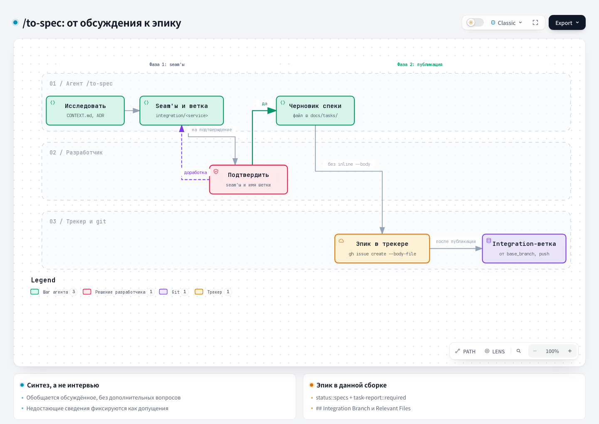

# To Spec — Into a specification

## 1. Name and localization

- **English name:** `To Spec`
- **Russian translation:**

```text
В спецификацию
```

## 2. Full translation of the skill text

<div class="ah-skill-text" markdown="1">

```yaml
name: to-spec
description: Turn the current conversation into a specification and publish it to the project's issue tracker. No interview — only a synthesis of what was already discussed.
disable-model-invocation: true
```

**Objective:** synthesize the context of the current conversation and your understanding of the codebase into a final specification.
**Strict rule:** do NOT interview the user and do not start a new round of grilling. If information seems to be missing, the previous grilling was incomplete. Synthesize the specification using only the known facts and explicit assumptions.

You should already have the issue tracker and the triage label vocabulary in `docs/agents/issue-tracker.md` and `docs/agents/triage-labels.md`. If either file is missing, tell the user to run `harness update`. It creates both files from the harness templates.

#### Execution in two phases

You must run this skill in two separate phases, so that the user agrees on the testing strategy before the final document is written.

##### Phase 1: exploration and seam proposal

1. **Explore the codebase:** use the project's domain glossary (`CONTEXT.md`) and follow every ADR in the affected area.
2. **Identify seams:** outline the seams where the feature will be tested.
   - Prefer existing seams to new ones.
   - Use the highest possible seam.
   - The ideal state is exactly *one* seam for the whole feature.
3. **STOP AND ASK:** present the proposed seams and one integration branch name in the form `integration/<service-or-team>`. Derive the slug from explicit project/domain language; never guess it. Ask the user to approve both. **Do not move to phase 2 until the user confirms.**

##### Phase 2: drafting and publishing (after user approval)

1. **Prepare the file:** write the specification from the `<spec-template>` below at the root of its own folder under `docs/tasks/`. That folder also reserves `tickets/` (one file per child ticket, filled in later by `/to-tickets`) and `artifacts/` (the `/grilling` Live Artifact).
   - *Naming convention:* if the issue ID is known, use it. If not, use a descriptive slug (for example, `docs/tasks/add-user-auth/add-user-auth.md`) and later rename both the folder and the file when the ID is created. For the full convention, including grouping in the epic folder and the `tickets/`/`artifacts/` subfolders, see `docs/agents/artifacts.md`.
   - Take the final list of Discovery Context files from `artifacts/discovery-context.md` in the same folder (written by the Persisted List step of `/grilling`). If that file does not exist because artifact tracking never ran, take the approved list of paths from the final Trunk summary instead. Add it to the closing template section `## Relevant Files (Discovery Context)`. Keep every path and the context that came with it. While drafting, do not search for this list again and do not replace it.
2. **Publish to the tracker:** publish the issue through the CLI of the configured tracker:
   - **GitHub:** `gh issue create --body-file <path>`.
   - **GitLab:** `glab issue create -R <project-url> --title '<title>' --description-file <path> --yes`. Keep `<title>` in single quotes. Write each apostrophe inside it as `'\''` in a POSIX shell or as `''` in PowerShell. `<project-url>` and the other GitLab placeholders (`<host>`, `<project-id>`) are defined in `docs/agents/issue-tracker.md` → GitLab → Conventions. The epic number is the last segment of the issue URL that the command prints.
   - Do not pass the body inline with `--body`/`--description` or a heredoc: specification bodies contain nested quotes and backticks that break shell quoting.
3. **Apply labels:** this published issue acts as the **epic** of the feature. Apply the following labels (see `docs/agents/triage-labels.md` for the full taxonomy):
   - `type::bug` OR `type::feature`;
   - `status::specs` (do NOT use `status::ready`, because decomposition is required first);
   - `task-report::required` (unless told to skip it).
   - **GitLab:** `glab issue update <epic> -R <project-url> --label 'type::feature,status::specs,task-report::required'` (`type::bug` for a bug; remove `task-report::required` if told to skip it). If a label does not exist in the project yet, GitLab silently creates it with the default color instead of failing, so run `/setup-labels` before the first epic.
   - *Note:* do NOT create arbitrary `epic::<slug>` labels. Later, `/to-tickets` links tickets to this epic through the tracker's parent link: GitHub sub-issues, and on GitLab a `## Parent: #<epic>` section plus an issue `relates_to` link. For the mechanism, see `docs/agents/issue-tracker.md#wayfinding-operations`.
4. **Make sure the chosen integration branch exists after the epic issue is created successfully:**
   - Read the required `base_branch` field from `.harness/project.json`. If it is missing, stop and report an invalid project configuration. This is the release/base branch from which the epic's integration branch starts.
   - Record the grilling documents changed in the current worktree: `git status --porcelain --untracked-files=all -- CONTEXT-MAP.md ':(glob)**/CONTEXT.md' ':(glob)**/docs/adr/**'`. `/grill-with-docs` and `/domain-modeling` write these files. Record every path. For a rename (`old -> new`), record both paths. The list may be empty.
   - Get the base ref. Create `integration/<service-or-team>` with `git branch` from `origin/<base_branch>` when a remote exists, otherwise from the local base branch. Do not use `git switch -c` or `git checkout -b`: the branch-name hook allows them only for names that match `branch_pattern`.
   - If the integration branch already exists locally or on the remote, reuse it without reset, force-update, or deletion. If publishing succeeds but branch creation fails, report the partial state and the exact recovery action. Do not create the epic issue again.
   - If the branch already exists on the remote, do not commit to it and do not switch the current worktree. If the list of grilling documents is not empty, report that they remain uncommitted in the current worktree. State the recovery action: commit them in an issue branch that starts from `integration/<service-or-team>`, for example the branch of the first child ticket, and merge them through its PR.
   - If the branch does not exist on the remote and the list of grilling documents is empty, do not switch the current worktree: it may contain unrelated changes.
   - If the branch does not exist on the remote and the list of grilling documents is not empty, commit the documents to the branch before it is pushed. Do not create a separate worktree:
     1. Switch the current worktree with `git switch integration/<service-or-team>`. Uncommitted changes move with the worktree. If `git switch` refuses because of a conflict with uncommitted changes, stop. Do not use `--force`, `--discard-changes`, `--merge`, or reset: they can overwrite changes. Report the git error and the recovery action: set the changes aside with `git stash push --include-untracked`, run `git switch integration/<service-or-team>`, restore the changes with `git stash pop`, resolve the conflicts, and continue from substep 2.
     2. Stage only the recorded grilling documents, listing the paths explicitly: `git add -- <path>...`. Do not use `git add -A`, `git add .`, or `git commit -a`. All other changes stay uncommitted in the working tree.
     3. Commit with a separate command, without `&&`, `;`, a pipeline, or a variable: `git commit -m 'docs: <short epic description>'`. Write the message following the commit rules in `docs/agents/git-workflow.md`. The `block-direct-master` hook allows a commit to `integration/*` only in this form, only if the index contains only grilling documentation paths, and only if the branch is not on `origin`.
     4. If the hook blocks the commit, stop and do not push. Report the hook text and the fact that the documents remain in the index of the current worktree. State the recovery action: remove the cause, for example a path outside the grilling documentation in the index or no access to `origin`, and repeat substep 3.
   - Push a branch that is not on the remote with `git push -u origin integration/<service-or-team>`. After the grilling documents are committed, the current worktree stays on the integration branch, and unrelated changes stay uncommitted.
   - For a local tracker, commit the grilling documents as described above, but do not push, and report that the branch was not pushed. In a repository without a remote, create a local branch, and do not commit or push it. Report that the branch was not pushed and the grilling documents remain uncommitted.

---

&lt;spec-template&gt;

#### Problem Statement
The problem the user faces, from the user's point of view.

#### Solution
The solution to the problem, from the user's point of view.

#### User Stories
A numbered list of user stories that covers every behavior of the feature.
Format: `1. As an <actor>, I want a <feature>, so that <benefit>`
*(Example: as a bank customer, I want to see my balance, so that I can make informed spending decisions.)*

#### Implementation Decisions
A list of modules to create or change, interface changes, technical clarifications, architectural decisions, schema changes, API contracts, and specific interactions.
- Do **NOT** include specific file paths or generic code snippets (they go stale quickly).
- **Exception:** if a prototype produced a snippet that encodes the decision perfectly (a state machine, a schema, a type shape), paste it and mark it as derived from the prototype. Keep only the decision-dense parts.

#### Testing Decisions
- A description of what makes a test good here (test external behavior, not implementation details).
- Which modules will be tested.
- Prior art (similar existing tests in the codebase).

#### Out of Scope
A strict list of what will NOT be done. This is your insurance against over-engineering. Set the boundaries explicitly, so that future agents do not build more than was requested.

#### Integration Branch

- Branch: `integration/<service-or-team>`
- Created from: `base_branch` from `.harness/project.json`
- Child issue branches start from this integration branch and open PRs back into it.

#### Further Notes
Any remaining context or constraints.

#### Relevant Files (Discovery Context)
The final list of Discovery Context files from the `Live Artifact` of the current session or, if artifact publishing is unavailable, from the final Trunk summary, including every path and the context that came with it.

&lt;/spec-template&gt;

</div>

## 3. Contracts

- **Input (Input/Brief):** the discussion context, the known facts and assumptions, the explored seams, and the proposed integration branch name.
- **Output (Output/Report):** the approved specification in `docs/tasks/`, the published epic issue with labels, and an existing integration branch or an exact report of the partial state.

## 4. Architecture diagram



## Source

[SKILL.md](https://github.com/PVMalove/agent-harness-next/blob/master/skills/first-party/engineering/to-spec/SKILL.md)
