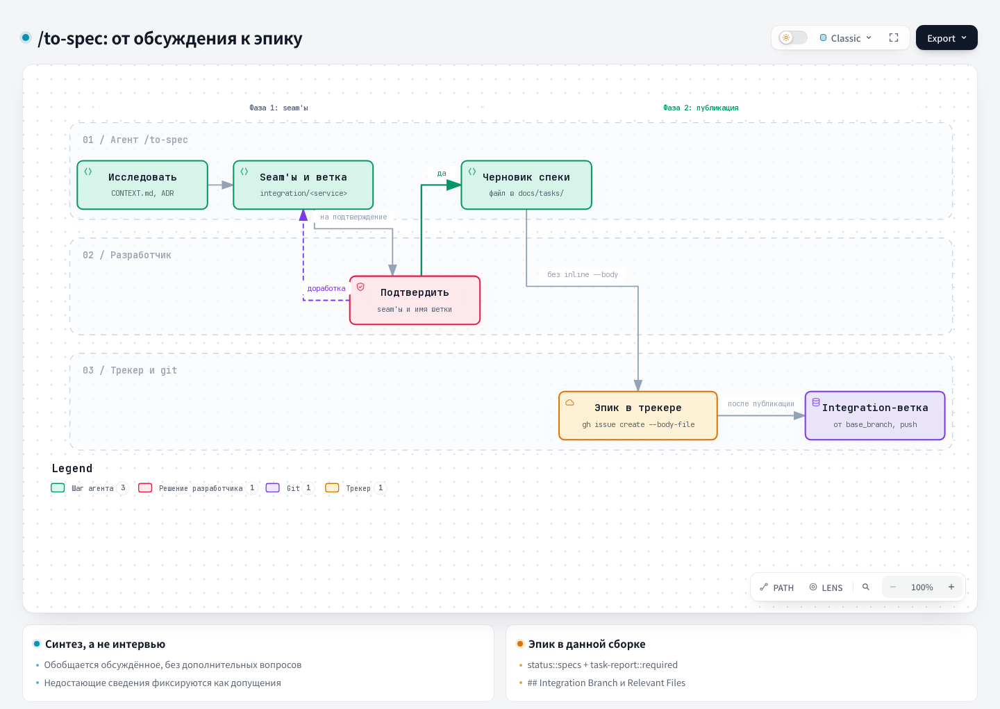

# To Spec: в спецификацию

## 1. Название и локализация

- **Английское название:** `To Spec`
- **Русский перевод:**

```text
В спецификацию
```

## 2. Полный перевод текста скилла

<div class="ah-skill-text" markdown="1">

```yaml
name: to-spec
description: Превращает текущий разговор в спецификацию и публикует её в трекере задач проекта. Без интервью, только сводка уже обсуждённого.
disable-model-invocation: true
```

**Цель:** свести контекст текущего разговора и понимание кодовой базы в окончательную спецификацию.
**Строгое правило:** НЕ интервьюируйте пользователя и не начинайте новый раунд grilling. Если кажется, что информации не хватает, значит, предыдущее grilling было неполным. Пишите спецификацию только по известным фактам и явным допущениям.

Трекер задач и словарь triage-меток вам уже должны были передать в `docs/agents/issue-tracker.md` и `docs/agents/triage-labels.md`. Если какого-то из этих файлов нет, попросите пользователя запустить `harness update`: команда создаст оба файла из шаблонов харнесса.

#### Выполнение в двух фазах

Скилл выполняется в двух отдельных фазах, чтобы пользователь согласовал стратегию тестирования до записи окончательного документа.

##### Фаза 1: исследование и предложение seams

1. **Изучите кодовую базу:** используйте глоссарий домена проекта (`CONTEXT.md`) и соблюдайте ADR затронутой области.
2. **Определите seams:** наметьте seams (публичные границы), на которых будет тестироваться функция.
   - Существующие seams лучше новых.
   - Берите самый высокий возможный seam.
   - Идеал: ровно *один* seam на всю функцию.
3. **ОСТАНОВИТЕСЬ И СПРОСИТЕ:** покажите предложенные seams и одно имя integration-ветки вида `integration/<service-or-team>`. Slug берите из явного языка проекта или домена, никогда не угадывайте его. Попросите пользователя одобрить и seams, и имя. **Не переходите к фазе 2, пока пользователь не подтвердит.**

##### Фаза 2: подготовка и публикация (после одобрения пользователя)

1. **Подготовьте файл:** напишите спецификацию по `<spec-template>` ниже и положите её в корень собственного каталога внутри `docs/tasks/`. В этом каталоге также зарезервированы `tickets/` (по файлу на каждый дочерний тикет, их потом заполняет `/to-tickets`) и `artifacts/` (Live Artifact из `/grilling`).
   - *Правило имён:* если ID issue известен, используйте его. Если нет, возьмите описательный slug (например, `docs/tasks/add-user-auth/add-user-auth.md`) и переименуйте каталог и файл, когда ID появится. Полное правило, включая группировку в каталоге эпика и подкаталоги `tickets/`/`artifacts/`, описано в `docs/agents/artifacts.md`.
   - Итоговый список файлов Discovery Context возьмите из `artifacts/discovery-context.md` того же каталога. Этот файл пишет шаг Persisted List в `/grilling`. Если файла нет, потому что учёт артефактов не запускался, возьмите утверждённый список путей из финальной Trunk summary. Добавьте список в последний раздел шаблона `## Relevant Files (Discovery Context)`. Сохраните каждый путь и переданный контекст. При подготовке не ищите этот список заново и не заменяйте его.
2. **Опубликуйте в трекере:** создайте issue через CLI настроенного трекера:
   - **GitHub:** `gh issue create --body-file <path>`.
   - **GitLab:** `glab issue create -R <project-url> --title '<title>' --description-file <path> --yes`. `<title>` остаётся в одинарных кавычках, каждый апостроф в нём записывается как `'\''` в POSIX-shell или как `''` в PowerShell. `<project-url>` и другие плейсхолдеры GitLab (`<host>`, `<project-id>`) заданы в `docs/agents/issue-tracker.md` → GitLab → Conventions. Номер эпика стоит последним сегментом URL issue, который печатает команда.
   - Не передавайте тело inline через `--body`/`--description` или heredoc: в телах спецификаций есть вложенные кавычки и обратные кавычки, которые ломают экранирование shell.
3. **Поставьте метки:** опубликованное issue служит **эпиком** функции. Поставьте метки (полная таксономия в `docs/agents/triage-labels.md`):
   - `type::bug` ИЛИ `type::feature`;
   - `status::specs` (НЕ ставьте `status::ready`: сначала нужна декомпозиция);
   - `task-report::required` (если вас не попросили пропустить).
   - **GitLab:** `glab issue update <epic> -R <project-url> --label 'type::feature,status::specs,task-report::required'` (для бага `type::bug`; если попросили пропустить отчёт, уберите `task-report::required`). Метку, которой ещё нет в проекте, GitLab молча создаёт с цветом по умолчанию и не выдаёт ошибку. Поэтому запустите `/setup-labels` до первого эпика.
   - *Примечание:* НЕ создавайте произвольные метки `epic::<slug>`. Позже `/to-tickets` свяжет тикеты с эпиком через родительскую связь трекера: в GitHub через sub-issues, в GitLab через раздел `## Parent: #<epic>` и связь issue `relates_to`. Механизм описан в `docs/agents/issue-tracker.md#wayfinding-operations`.
4. **Когда issue эпика создано, убедитесь, что выбранная integration-ветка существует:**
   - Прочитайте обязательное поле `base_branch` из `.harness/project.json`. Если его нет, остановитесь и сообщите, что конфигурация проекта некорректна. Это ветка релиза или база, от которой начинается integration-ветка эпика.
   - Запишите документы grilling, изменённые в текущем worktree: `git status --porcelain --untracked-files=all -- CONTEXT-MAP.md ':(glob)**/CONTEXT.md' ':(glob)**/docs/adr/**'`. Эти файлы пишут `/grill-with-docs` и `/domain-modeling`. Запишите каждый путь, для переименования (`old -> new`) запишите оба пути. Список может быть пустым.
   - Сделайте fetch base ref. Создайте `integration/<service-or-team>` командой `git branch` от `origin/<base_branch>`, если есть remote, иначе от локальной базовой ветки. Не используйте `git switch -c` и `git checkout -b`: хук имени ветки разрешает их только для имён по `branch_pattern`.
   - Если integration-ветка уже есть локально или в remote, используйте её повторно без reset, force-update или удаления. Если публикация прошла, а ветку создать не удалось, сообщите о частичном состоянии и точном действии восстановления. Issue эпика повторно не создавайте.
   - Если ветка уже есть в remote, не коммитьте в неё и не переключайте текущий worktree. Если список документов grilling не пуст, сообщите, что они остаются незакоммиченными в текущем worktree. Назовите действие восстановления: закоммитить их в issue-ветке от `integration/<service-or-team>`, например в ветке первого дочернего тикета, и влить через её PR.
   - Если ветки нет в remote и список документов grilling пуст, не переключайте текущий worktree: в нём могут быть несвязанные изменения.
   - Если ветки нет в remote, а список документов grilling не пуст, закоммитьте документы в ветку до её push. Отдельный worktree не создавайте:
     1. Переключите текущий worktree командой `git switch integration/<service-or-team>`. Незакоммиченные изменения переходят вместе с worktree. Если `git switch` отказывает из-за конфликта с незакоммиченными изменениями, остановитесь. Не используйте `--force`, `--discard-changes`, `--merge` и reset: они могут перезаписать изменения. Сообщите ошибку git и действие восстановления: отложить изменения командой `git stash push --include-untracked`, выполнить `git switch integration/<service-or-team>`, вернуть изменения командой `git stash pop`, разрешить конфликты и продолжить с подшага 2.
     2. Добавьте в индекс только записанные документы grilling и явно перечислите пути: `git add -- <path>...`. Не используйте `git add -A`, `git add .` и `git commit -a`. Остальные изменения остаются незакоммиченными в рабочем дереве.
     3. Выполните коммит отдельной командой, без `&&`, `;`, конвейера и переменной: `git commit -m 'docs: <краткое описание эпика>'`. Сообщение пишите по правилам коммитов из `docs/agents/git-workflow.md`. Хук `block-direct-master` разрешает коммит в ветку `integration/*` только в такой форме, только если в индексе одни пути документов grilling и только если ветки нет на `origin`.
     4. Если хук блокирует коммит, остановитесь и не пушьте. Сообщите текст хука и то, что документы остаются в индексе текущего worktree. Назовите действие восстановления: устранить причину (например, путь вне документов grilling в индексе или нет доступа к `origin`) и повторить подшаг 3.
   - Ветку, которой нет в remote, запушьте командой `git push -u origin integration/<service-or-team>`. После коммита документов grilling текущий worktree остаётся на integration-ветке, несвязанные изменения остаются незакоммиченными.
   - Для локального трекера закоммитьте документы grilling, как описано выше, но не пушьте и сообщите, что ветка не запушена. В репозитории без remote создайте локальную ветку, ничего в неё не коммитьте и не пушьте. Сообщите, что ветка не запушена, а документы grilling остаются незакоммиченными.

---

&lt;spec-template&gt;

#### Формулировка проблемы
Проблема, с которой сталкивается пользователь, с его точки зрения.

#### Решение
Решение проблемы с точки зрения пользователя.

#### Пользовательские истории
Нумерованный список пользовательских историй, который покрывает каждое поведение функции.
Формат: `1. Как <роль>, я хочу <функцию>, чтобы <выгода>`
*(Пример: как клиент банка, я хочу видеть свой баланс, чтобы принимать обоснованные решения о тратах.)*

#### Решения по реализации
Список модулей, которые нужно создать или изменить, изменений интерфейсов, технических уточнений, архитектурных решений, изменений схемы, API-контрактов и конкретных взаимодействий.
- **НЕ** указывайте конкретные пути файлов и общие фрагменты кода: они быстро устаревают.
- **Исключение:** если прототип дал фрагмент, который точно выражает решение (машина состояний, схема, форма типа), вставьте его и отметьте, что он из прототипа. Оставьте только части, в которых есть решение.

#### Решения по тестированию
- Что здесь делает тест хорошим (тестируйте внешнее поведение, а не детали реализации).
- Какие модули будут тестироваться.
- Похожие существующие тесты в кодовой базе.

#### Вне области
Строгий список того, что НЕ будет сделано. Это страховка от избыточной инженерии. Явно задайте границы, чтобы будущие агенты не построили больше, чем просили.

#### Integration-ветка

- Ветка: `integration/<service-or-team>`
- Создана от: `base_branch` из `.harness/project.json`
- Дочерние issue-ветки начинаются от этой integration-ветки и открывают PR обратно в неё.

#### Дополнительные заметки
Оставшийся контекст или ограничения.

#### Relevant Files (Discovery Context)
Итоговый список файлов Discovery Context из `Live Artifact` сессии или, если публикация артефактов недоступна, из финальной Trunk summary, с каждым путём и переданным контекстом.

&lt;/spec-template&gt;

</div>

## 3. Контракты

- **Вход (Input/Brief):** контекст обсуждения, известные факты и допущения, исследованные seams и предложенное имя integration-ветки.
- **Выход (Output/Report):** одобренная спецификация в `docs/tasks/`, опубликованное issue эпика с метками и существующая integration-ветка или точный отчёт о частичном состоянии.

## 4. Архитектурная схема



## Источник

[SKILL.md](https://github.com/PVMalove/agent-harness-next/blob/master/skills/first-party/engineering/to-spec/SKILL.md)
