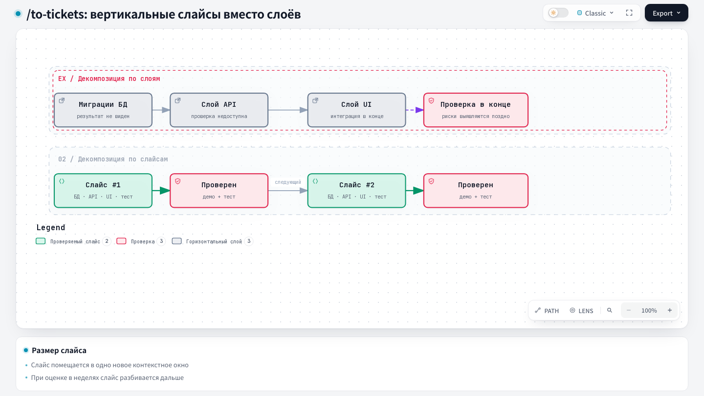

# To Tickets — Into tickets

## 1. Name and localization

- **English name:** `To Tickets`
- **Russian translation:**

```text
В тикеты
```

## 2. Full translation of the skill text

<div class="ah-skill-text" markdown="1">

```yaml
name: to-tickets
description: Break a plan, a specification, or a conversation into a set of tracer-bullet tickets with blocking edges, and publish them to the configured tracker.
disable-model-invocation: true
```

### Into tickets

**Objective:** break a plan, a specification, or a conversation into a set of **tickets** — tracer-bullet vertical slices, each declaring its blocking edges.

The issue tracker and the triage label vocabulary should already have been provided to you. If `docs/agents/issue-tracker.md` or `docs/agents/triage-labels.md` is missing, tell the user to run `harness update` — it creates both files from the harness templates.

#### Execution in two phases

Run this skill in two phases: publish nothing to the issue tracker and create no local files until the user explicitly approves the ticket breakdown.

##### Phase 1: drafting and review

1. **Gather context:** work from the conversation context. If a reference is passed (a specification path, an issue number/URL), read its full body and comments.
2. **Explore the codebase (optional):** use the project's domain glossary. Look for prefactoring opportunities ("make the change easy, then make the easy change").
3. **Draft the vertical slices:** break the work into **tracer bullet** tickets.
   - *Vertical slices:* cut a narrow but COMPLETE path through every layer (schema, API, UI, tests). It must be demoable/verifiable on its own and fit in one context window.
   - *Wide refactors (exception):* if a change has a huge blast radius (for example, renaming a shared column), use **expand-contract** instead of vertical slicing. The sequence is: Expand → Migrate (in batches) → Contract.
   - *Blocking edges:* give each ticket its blocking edges (which other tickets must complete first). Add a blocker only for a **result dependency** (the ticket uses what its predecessor delivers) or a **known requirement incompatibility** (the two requirements cannot both hold until the predecessor lands — for example, one removes what the other still needs; a textual merge conflict is not one), and write the substantive reason for each one. A **file overlap** alone is not a blocker: two independent changes to one file proceed in parallel, without artificial sequencing. A blocker holds until the predecessor is merged into the integration branch and closed — a push, a publish, an accepted QA, or an open PR does not release it.
   - *Human time estimate:* estimate the approximate time a human developer needs to complete this slice (for example, "2 hours", "1 day") — for every ticket, including `afk`, not only `hitl`. This is a signal of the decomposition quality, not a commitment: an estimate in weeks means that the slice is not tracer-bullet sized — split it before showing it to the user.
4. **Prepare the Discovery Context when the parent has `## Relevant Files (Discovery Context)`:** assign every path to every ticket that really needs it; for each one keep the supplied context and add one short reason for the ticket. If a path does not relate to any slice, show it as **unassigned** and stop for the user's decision.
   - Build a **Path inventory**: the paths from the Discovery Context, the directories that contain them, and the existing `tests/` and `shared/`. Do not read or send file contents or symbol signatures; apply the standard exclusions (secrets, dependencies, build/dist, cache, generated/minified, large logs, databases, temporary data, and unrelated media). Include a root file only as that file.
   - Make exactly one cheap-model advisory call per batch (if the runtime can pin a model — `haiku` or the cheapest equivalent). Pass the titles, the scopes, the assigned paths, and the Path inventory. The advisory may return only exact additional paths from the Path inventory with a reason; it does not remove or move assigned paths, does not invent new ones, and does not change scope. Without a cheap route, stop with a blocker.
   - Add only valid advisory dependencies to the Discovery Context of the relevant ticket. The result is ready when every original path is assigned or explicitly shown as unassigned, and every addition is traceable to the Path inventory.
5. **Draft the agent prompt blocks:** the Task Board's agent prompt carries two fixed blocks, ARCHITECTURE INVARIANTS and IMPLEMENTATION DISCIPLINE (see `docs/agents/agent-prompt.md`). The board takes each block from the epic's `## Architecture invariants` or `## Implementation discipline` section and falls back to the same section of `docs/agents/agent-prompt.md`. Keep a section the epic body already has. Draft a missing one from the spec and its ADRs, starting from the project default. Write only rules that hold for every ticket of the epic, as short list items in English.
6. **STOP AND ASK (quiz the user):** present the proposed breakdown as a numbered list. For each ticket, show:
   - **Title:** a short descriptive name;
   - **Blocked by:** which tickets gate it, each with its reason (result dependency or known incompatibility);
   - **Est. time (human):** the estimated human time to complete;
   - **What it delivers:** the end-to-end behavior;
   - **Relevant Files (Discovery Context):** the assigned and advisory-added paths with reasons; omit the field if the parent has no Discovery Context.
   - After the list, show the drafted `## Architecture invariants` and `## Implementation discipline` sections of the epic, or say which block stays as it is.
   - *Ask the user:* is the granularity right? Are the blocking edges correct? Should anything be merged or split? Is the time estimate realistic?
   - Stop here until the user approves the breakdown.

##### Phase 2: publishing and summary (after approval)

1. **Publish to the tracker:** the method depends on the configured tracker:
   - **Integration branch:** read the `## Integration Branch` section of the parent epic before writing any child ticket. Copy its exact branch name into every child ticket; if the epic has no integration branch, stop and report the missing prerequisite instead of inferring a branch.
   - **Local files:** append the approved `## Architecture invariants` and `## Implementation discipline` sections to the epic's `.scratch/<feature-slug>/spec.md`; the board reads that file as the epic body. write one file per ticket under `.scratch/<feature-slug>/issues/<NN>-<slug>.md` (01, 02...). Use `<local-ticket-template>`. Set `**Workflow:**` to `status::blocked` if there are blockers, otherwise to `status::ready`. Set `**Execution:**` to `hitl` or `afk` by your best judgment about the ticket (see `docs/agents/triage-labels.md`). Add `**Task report:** required` unless told to skip it (omit the line entirely if it is not required). `/fast-implement` finds the next ticket by reading the `**Workflow:**` field of each file — a purely linear chain is resolved from top to bottom.
   - **GitHub / GitLab:** `<project-url>`, `<host>`, and `<project-id>` in the GitLab commands are defined in `docs/agents/issue-tracker.md` → GitLab → Conventions.
     - Publish one issue per ticket in dependency order using `<issue-template>`. GitHub: `gh issue create --body-file <path>`. GitLab: `glab issue create -R <project-url> --title '<title>' --description-file <path> --yes`, where `<title>` is in single quotes and each apostrophe inside it is written as `'\''` in a POSIX shell or as `''` in PowerShell; the ticket number is the last segment of the issue URL that the command prints. Do not pass the body inline with `--body`/`--description` or a heredoc — it breaks shell quoting (see `docs/agents/git-workflow.md` §1). Record each blocker with its reason: a native dependency on GitHub, a `Blocked by #<M>` line on GitLab; the text fallback carries the same edge and the same reason.
     - Apply labels (see `docs/agents/triage-labels.md` for the full taxonomy): `bug`/`enhancement`, `status::ready` (or `status::blocked` if the ticket is gated by another ticket in this batch), `hitl`/`afk`, and `task-report::required` unless told to skip it. GitLab: `glab issue update <n> -R <project-url> --label '<label>,<label>'`; a label that the project does not have yet is silently created by GitLab with the default color, so `/setup-labels` must have run beforehand.
     - *Grouping:* link every ticket to the parent epic through the tracker's parent link. Do NOT use `epic::<slug>` labels.
       - GitHub: link the ticket to the epic as a **native sub-issue**.
       - GitLab: the `## Parent: #<epic>` section in the ticket plus exactly one `relates_to` link from the ticket to the epic, created right after the ticket: `GITLAB_HOST=<host> glab api --method POST projects/<project-id>/issues/<n>/links -F target_project_id=<numeric-project-id> -F target_issue_iid=<epic> -F link_type=relates_to`. `<numeric-project-id>` is the `id` field of `GITLAB_HOST=<host> glab api projects/<project-id>`; read it once per batch. Blocking edges stay in the `Blocked by #<M>` lines; no links are created between tickets. Epics, `blocks` links, and the native issue hierarchy are GitLab Premium features, and they are not used.
     - *Local mirror:* the specification of the epic already lives in its own folder under `docs/tasks/` (per `docs/agents/artifacts.md`) — first rename that folder to `issue-<epic-id>-<epic-slug>/` if it still contains only the slug. Save the issue body of each published ticket in the same folder as `issue-<ID>-<slug>.md`.
     - *Frontier:* do not trace `Blocked by` by hand to find out what can be taken — query it: the same fields and mechanism as the frontier query of `/wayfinder` for the configured tracker (`docs/agents/issue-tracker.md#wayfinding-operations`), but limited to the child tickets of the epic instead of the children of the map: its GitHub sub-issues, and on GitLab the issues linked to the epic whose description carries `## Parent: #<epic>`. `/fast-implement` runs this same query itself when it is handed an epic instead of a specific ticket.
     - Do not close or rewrite the parent issue of the epic, except to add a short list of the created subtask numbers and the approved `## Architecture invariants` and `## Implementation discipline` sections. Read its current body: GitHub — `gh issue view <epic> --json body --jq .body`; GitLab — the `description` field of `glab issue view <epic> -R <project-url> -F json`. Append the list and save the result in the specification file of the epic in its `docs/tasks/` folder. Publish that file: GitHub — `gh issue edit <epic> --body-file <path>`; GitLab — `glab issue update <epic> -R <project-url> --description-file <path>`.
2. **Summarize the batch:**
   - Read `language` from `.harness/project.json` (the default is `ru` if the file or the field is missing) — it determines only the "What to build" column below, not the titles or bodies of the published tickets, which stay in the language in which you prepared them.
   - If this runtime supports dispatching a sub-agent pinned to a specific model, send one call with `model: haiku` (the cheapest available, one call per batch) — pass it the title and body of each ticket plus the target language, asking for one concise sentence for each ticket in that language. Otherwise, write the descriptions yourself, with your own model, in the same language.
   - Output the final table that combines all the data. The labels column must list all applied taxonomy tags (for example, `enhancement`, `status::ready`, `afk`, `task-report::required`).

   | Ticket | What to build | Est. time (human) | Labels |
   |---|---|---|---|
   | <number/link/path> | <one-line summary> | <time> | <comma-separated labels> |

---

&lt;local-ticket-template&gt;
### &lt;NN&gt; — <Ticket title>

**What to build:** the end-to-end behavior that this ticket makes work from the user's point of view.
**Blocked by:** the numbers/titles of the tickets that gate this ticket, each with its reason, or "None — can start immediately".
**Integration branch:** the exact branch recorded by the parent epic.

**Category:** bug / enhancement
**Workflow:** status::ready (or status::blocked)
**Execution:** hitl / afk
**Task report:** required (omit the line entirely if it is not required)

- [ ] Acceptance criterion 1
- [ ] Acceptance criterion 2
&lt;/local-ticket-template&gt;

&lt;issue-template&gt;
#### Parent: #&lt;epic&gt;
The heading line itself carries the number of the parent epic and serves as a fixed marker for the frontier query: keep it exactly in this form and never translate it. Omit the section if the ticket has no parent epic.

#### Integration branch

The exact integration branch recorded by the parent epic. Child implementation branches start from this branch, and their PRs target it.

#### What to build
The end-to-end behavior that this ticket makes work from the user's point of view.

#### Acceptance criteria
- [ ] Criterion 1
- [ ] Criterion 2

#### Blocked by
- Blocked by #&lt;M&gt; — one such line per blocking ticket with its reason, or "None — can start immediately".

#### Relevant Files (Discovery Context)
- `<path>` — why this file is needed for the task; omit the section if the parent has no Discovery Context.
&lt;/issue-template&gt;

*Note for both templates: avoid specific file paths or code fragments unless it is a vitally important prototype fragment (keep only the parts that are dense with decisions).*

</div>

## 3. Contracts

- **Input (Input/Brief):** a plan, a specification, or the conversation context; the parent epic and its integration branch; explicit approval of the proposed decomposition.
- **Output (Output/Report):** tracer-bullet tickets with dependencies, labels, estimates, and a local mirror; the final batch table.

## 4. Architecture diagram



## Source

[SKILL.md](https://github.com/PVMalove/agent-harness-next/blob/master/skills/first-party/engineering/to-tickets/SKILL.md)
