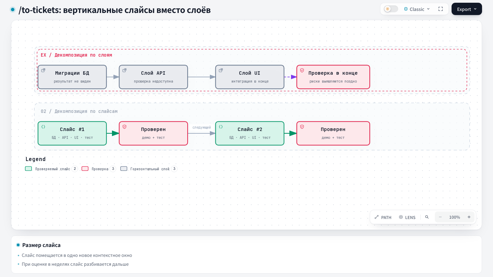

# To Tickets: в тикеты

## 1. Название и локализация

- **Английское название:** `To Tickets`
- **Русский перевод:**

```text
В тикеты
```

## 2. Полный перевод текста скилла

<div class="ah-skill-text" markdown="1">

```yaml
name: to-tickets
description: Делит план, спецификацию или разговор на набор tracer-bullet тикетов с блокирующими связями и публикует их в настроенном трекере.
disable-model-invocation: true
```

### В тикеты

**Цель:** разбить план, спецификацию или разговор на набор **тикетов**. Каждый тикет это tracer-bullet вертикальный срез, и каждый называет свои блокирующие связи.

Трекер задач и словарь triage-меток вам уже должны были передать в `docs/agents/issue-tracker.md` и `docs/agents/triage-labels.md`. Если какого-то из этих файлов нет, попросите пользователя запустить `harness update`: команда создаст оба файла из шаблонов харнесса.

#### Выполнение в двух фазах

Скилл работает в две фазы. Пока пользователь явно не одобрит разбиение на тикеты, ничего не публикуйте в трекере и не создавайте локальные файлы.

##### Фаза 1: подготовка и review

1. **Соберите контекст:** работайте по контексту разговора. Если передана ссылка (путь к спецификации, номер или URL issue), прочитайте всё тело и комментарии.
2. **Изучите кодовую базу (необязательно):** используйте глоссарий домена проекта. Ищите возможности для prefactoring («сначала сделайте изменение простым, затем сделайте простое изменение»).
3. **Подготовьте вертикальные срезы:** разбейте работу на тикеты **tracer bullet**.
   - *Вертикальные срезы:* каждый срез проходит узким, но ПОЛНЫМ путём через все слои (схема, API, UI, тесты). Его можно показать и проверить отдельно, и он помещается в одно контекстное окно.
   - *Широкие рефакторинги (исключение):* если изменение задевает очень многое (например, переименование общего столбца), используйте **expand-contract** вместо вертикальных срезов. Порядок: Expand → Migrate (пакетами) → Contract.
   - *Блокирующие связи:* для каждого тикета укажите, какие тикеты должны завершиться раньше. Блокер ставьте только за **зависимость по результату** (тикет использует то, что даёт предшественник) или за **известную несовместимость требований** (оба требования не могут выполняться, пока предшественник не влит; например, один убирает то, что другому ещё нужно). Текстовый merge-конфликт несовместимостью не считается. Для каждого блокера напишите содержательную причину. **Пересечение файлов** само по себе не блокер: два независимых изменения одного файла идут параллельно, без искусственной очерёдности. Блокер держится, пока предшественник не влит в integration-ветку и не закрыт. Push, publish, принятый QA или открытый PR блокер не снимают.
   - *Story Points:* дайте каждому тикету `afk` оценку в story points по Фибоначчи. Если в `.harness/project.json` есть `story_points.scale`, берите шкалу оттуда, иначе `1, 2, 3, 5, 8, 13…`. Оценка показывает качество декомпозиции и не служит обязательством. Тикеты `hitl` оценку не получают, это поле для них пропустите.
   - *Проверка серой зоны:* если основная оценка тикета равна `story_points.gray_zone` (по умолчанию `4`), сделайте для этого тикета один advisory-вызов дешёвой модели (`model: haiku` или самый дешёвый настроенный аналог). Модель выбирается так же, как для вызова Discovery Context в шаге 4, но вызов один на каждый тикет серой зоны, а не один на весь batch. Если две оценки расходятся, оставьте большую, более осторожную. Если маршрута к дешёвой модели нет, остановитесь и сообщите о блокере до запроса одобрения, как в шаге 4.
   - *Метка pipeline:* метку `pipeline::*` выводите из итоговой оценки. `pipeline::fast`, если оценка `≤ story_points.fast_threshold` (по умолчанию `3`) *и* `Execution: afk`. `pipeline::full`, если оценка `≥ story_points.full_threshold` (по умолчанию `5`) *и* `Execution: afk`. Оценка `≥13` значит ещё и то, что срез больше tracer bullet: отметьте на шаге 6 (ОСТАНОВИТЕСЬ И СПРОСИТЕ), что его нужно делить дальше. Тикеты `hitl` метку `pipeline::*` никогда не получают.
4. **Подготовьте Discovery Context (если у родителя есть `## Relevant Files (Discovery Context)`):** разберите этот раздел после черновика тикетов. Это одобренный стартовый контекст, он не заменяет собственный scope тикета.
   - Назначьте каждый путь из списка всем срезам, которым он действительно нужен. Общий путь может попасть в несколько тикетов. Для каждого назначения сохраните переданный контекст и добавьте короткую причину для этого тикета. Если путь не нужен ни одному тикету, покажите его как **unassigned** и остановитесь, чтобы решил пользователь. Никогда не назначайте путь искусственно.
   - Постройте **Path inventory** на весь batch. Для каждого пути из Discovery Context включите сам путь и перечислите все пути в его непосредственном родительском каталоге, а также в существующих каталогах `tests/` и `shared/`. При раскрытии каталогов применяйте исключения репозитория по умолчанию: секреты, зависимости, вывод build/dist, кэши, сгенерированные и минифицированные файлы, большие логи, базы данных, временные данные и несвязанные медиафайлы. Явно одобренный файл Discovery Context оставьте, даже если он попадает под исключение, но эту исключённую категорию не раскрывайте. Файл Discovery Context в корне репозитория включается как файл, корень репозитория не добавляется. Не читайте и не отправляйте содержимое файлов и сигнатуры символов. Пути вне этих каталогов не включайте.
   - Сделайте **один advisory-вызов дешёвой модели** ровно один раз на batch. Если runtime умеет закрепить модель, берите `model: haiku` (или самый дешёвый настроенный аналог), иначе настроенный в runtime маршрут к самой дешёвой модели. Передайте названия тикетов, их scope, назначенные пути и Path inventory. Попросите вернуть только добавления: для каждого тикета точные пути, которые уже есть в Path inventory, и по одной короткой причине. Модель может добавить зависимости, особенно тесты и общий код. Она не может удалять или перемещать назначенные пути, придумывать пути или менять scope тикета. Если маршрута к дешёвой модели нет, остановитесь и сообщите о блокере до запроса одобрения. Текущую модель вместо дешёвой не используйте.
   - Добавьте каждую допустимую зависимость в Discovery Context нужного тикета вместе с причиной. Отбросьте предложения, которых нет в Path inventory дословно или которые не поддерживают сквозное поведение этого тикета. Списки по тикетам готовы, только когда каждый исходный путь назначен (или явно показан как unassigned) и каждое добавление прослеживается до Path inventory.
5. **Подготовьте блоки промпта агента:** промпт агента в Task Board («Agent prompt») содержит два постоянных блока: ARCHITECTURE INVARIANTS и IMPLEMENTATION DISCIPLINE (см. `docs/agents/agent-prompt.md`). Доска берёт каждый блок из раздела эпика `## Architecture invariants` или `## Implementation discipline`, а если раздела нет, то из такого же раздела `docs/agents/agent-prompt.md`.
   - Если раздел уже есть в теле эпика, пропустите этот блок и оставьте раздел как есть.
   - Для каждого недостающего блока напишите черновик раздела по спецификации и ADR, на которые она ссылается. Если в `docs/agents/agent-prompt.md` есть значение проекта по умолчанию, начните с него. Пишите только правила, верные для каждого тикета эпика. Инварианты: границы архитектуры и владения, которые тикеты не должны нарушать. Дисциплина: как агент работает над тикетом (что прочитать первым, seam для тестов, какие проверки запускать). Каждое правило пишите одним коротким пунктом списка на английском.
   - Если спецификация не даёт правил для блока, а значение проекта по умолчанию подходит, черновик не пишите и скажите об этом на шаге одобрения.
6. **ОСТАНОВИТЕСЬ И СПРОСИТЕ (опросите пользователя):** покажите предложенное разбиение нумерованным списком. Для каждого тикета покажите:
   - **Название:** короткое описательное имя;
   - **Заблокирован:** какие тикеты его держат, с причиной для каждого (зависимость по результату или известная несовместимость);
   - **Story Points / Pipeline:** для тикетов `afk` итоговая оценка по Фибоначчи и выведенная метка `pipeline::fast`/`pipeline::full`. Если оценка `≥13`, добавьте пометку `⚠️ score ≥13 — split further`. Для тикетов `hitl` поле пропустите: у них нет ни оценки, ни метки `pipeline::*`;
   - **Что он даёт:** сквозное поведение;
   - **Relevant Files (Discovery Context):** назначенные пути и пути, добавленные advisory-вызовом, каждый с причиной. Если у родителя нет Discovery Context, поле пропустите.
   - После списка покажите черновики разделов эпика `## Architecture invariants` и `## Implementation discipline` из шага 5 или скажите, какой блок остаётся с существующим разделом эпика или со значением проекта по умолчанию.
   - *Спросите пользователя:* подходит ли гранулярность? Верны ли блокирующие связи? Что-то нужно объединить или разделить? Подходит ли оценка в story points и верна ли выведенная метка pipeline? Пользователь может на этом шаге заменить метку, не меняя оценку. Подходят ли черновики блоков промпта каждому тикету эпика?
   - Остановитесь здесь, пока пользователь не одобрит разбиение.

##### Фаза 2: публикация и сводка (после одобрения)

1. **Опубликуйте в трекере:** способ зависит от настроенного трекера.
   - **Integration-ветка:** до записи любого дочернего тикета прочитайте раздел родительского эпика `## Integration Branch`. Скопируйте точное имя ветки в каждый дочерний тикет. Если у эпика нет integration-ветки, остановитесь и сообщите, что не выполнено обязательное условие. Не выводите имя ветки сами.
   - **Локальные файлы:** допишите одобренные разделы `## Architecture invariants` и `## Implementation discipline` в файл эпика `.scratch/<feature-slug>/spec.md`: доска читает этот файл как тело эпика. Запишите по файлу на тикет в `.scratch/<feature-slug>/issues/<NN>-<slug>.md` (01, 02...) по `<local-ticket-template>`. Если был Discovery Context, включите готовый список `Relevant Files (Discovery Context)` тикета. Запишите в `**Workflow:**` значение `status::blocked`, если у тикета есть блокеры, иначе `status::ready`. В `**Execution:**` запишите `hitl` или `afk` по вашему суждению о тикете (см. `docs/agents/triage-labels.md`). Для тикетов `afk` запишите в `**Story Points:**` итоговую оценку из шага 3, а в `**Pipeline:**` метку, одобренную на шаге 6: выведенную или ту, которой её заменил пользователь. Сама оценка не меняется. Для тикетов `hitl` обе строки полностью пропустите. Добавьте `**Task report:** required`, если вас не попросили пропустить отчёт (иначе строку полностью пропустите). `/fast-implement` находит следующий тикет по полю `**Workflow:**` каждого файла, поэтому чисто линейная цепочка идёт сверху вниз.
   - **GitHub / GitLab:** `<project-url>`, `<host>` и `<project-id>` в командах GitLab заданы в `docs/agents/issue-tracker.md` → GitLab → Conventions.
     - Опубликуйте по одному issue на тикет в порядке зависимостей по `<issue-template>`. GitHub: `gh issue create --body-file <path>`. GitLab: `glab issue create -R <project-url> --title '<title>' --description-file <path> --yes`. `<title>` стоит в одинарных кавычках, каждый апостроф в нём записан как `'\''` в POSIX-shell или как `''` в PowerShell. Номер тикета стоит последним сегментом URL issue, который печатает команда. Не передавайте тело inline через `--body`/`--description` или heredoc: это ломает экранирование shell (см. `docs/agents/git-workflow.md` §1). Каждый блокер записывайте с причиной: в GitHub нативной зависимостью, в GitLab строкой `Blocked by #<M>`. Текстовый запасной вариант несёт ту же связь и ту же причину.
     - Если был Discovery Context, включите готовый раздел тикета `## Relevant Files (Discovery Context)`. Сохраните точные пути и причины: это отобранный стартовый контекст тикета реализации.
     - Для тикетов `afk` включите готовый раздел `## Story Points` (одобренную оценку). Для тикетов `hitl` раздел полностью пропустите.
     - Поставьте метки (полная таксономия в `docs/agents/triage-labels.md`): `type::*`, `status::ready` (или `status::blocked`, если тикет держит другой тикет этого batch), `hitl`/`afk`, для тикетов `afk` метку `pipeline::fast` или `pipeline::full` и `task-report::required`, если вас не попросили пропустить отчёт. Метка pipeline берётся с шага 6: выведенная или заменённая пользователем. Тикетам `hitl` её не ставят. GitLab: `glab issue update <n> -R <project-url> --label '<label>,<label>'`. Метку, которой ещё нет в проекте, GitLab молча создаёт с цветом по умолчанию, поэтому `/setup-labels` нужно запустить заранее.
     - *Группировка:* свяжите каждый тикет с родительским эпиком через родительскую связь трекера. НЕ используйте метки `epic::<slug>`.
       - GitHub: свяжите тикет с эпиком как **нативную подзадачу** (sub-issue).
       - GitLab: раздел `## Parent: #<epic>` в тикете и ровно одна связь `relates_to` от тикета к эпику, которую вы создаёте сразу после тикета: `GITLAB_HOST=<host> glab api --method POST projects/<project-id>/issues/<n>/links -F target_project_id=<numeric-project-id> -F target_issue_iid=<epic> -F link_type=relates_to`. `<numeric-project-id>` это поле `id` из `GITLAB_HOST=<host> glab api projects/<project-id>`. Прочитайте его один раз на batch. Блокирующие связи остаются в строках `Blocked by #<M>`, связи между тикетами не создаются. Epics, связи `blocks` и нативная иерархия issue есть только в GitLab Premium, и скилл их не использует.
     - *Локальное зеркало:* спецификация эпика уже лежит в собственном каталоге внутри `docs/tasks/` (по `docs/agents/artifacts.md`). Если каталог ещё назван только slug, сначала переименуйте его в `issue-<epic-id>-<epic-slug>/`. Тело каждого опубликованного тикета сохраните в подкаталог `tickets/` этого каталога как `tickets/issue-<ID>-<slug>.md`, а не рядом со спецификацией.
     - *Frontier:* не прослеживайте `Blocked by` вручную, чтобы понять, что можно взять в работу. Запросите frontier теми же полями и тем же механизмом, что frontier-запрос `/wayfinder` для настроенного трекера (`docs/agents/issue-tracker.md#wayfinding-operations`), но только по дочерним тикетам эпика, а не по элементам карты. В GitHub это sub-issues эпика, в GitLab это связанные с эпиком issue, в описании которых есть `## Parent: #<epic>`. `/fast-implement` сам выполняет этот запрос, если ему передали эпик, а не конкретный тикет.
     - НЕ закрывайте и не переписывайте родительское issue эпика. Можно только дописать короткий список номеров созданных подзадач и одобренные разделы `## Architecture invariants` и `## Implementation discipline`. Прочитайте текущее тело: GitHub `gh issue view <epic> --json body --jq .body`, GitLab поле `description` из `glab issue view <epic> -R <project-url> -F json`. Допишите список и разделы и сохраните результат как файл спецификации эпика в его каталоге `docs/tasks/`. Опубликуйте этот файл: GitHub `gh issue edit <epic> --body-file <path>`, GitLab `glab issue update <epic> -R <project-url> --description-file <path>`.
2. **Сделайте сводку batch:**
   - Прочитайте `language` из `.harness/project.json` (если файла или поля нет, то `ru`). Язык задаёт только колонку «Что построить» ниже. Названия и тела публикуемых тикетов остаются на том языке, на котором вы их написали.
   - Если runtime умеет запускать субагента с закреплённой моделью, сделайте один вызов с `model: haiku` (самая дешёвая доступная модель, один вызов на весь batch). Передайте название и тело каждого тикета и целевой язык и попросите по одному короткому предложению на тикет на этом языке. Иначе напишите описания сами, своей моделью, на том же языке.
   - Выведите итоговую таблицу со всеми данными. В колонке меток перечислите все поставленные метки таксономии (например, `type::feature`, `status::ready`, `afk`, `pipeline::fast`, `task-report::required`).

   | Тикет | Что построить | Story Points | Метки |
   |---|---|---|---|
   | <номер/ссылка/путь> | <однострочная сводка> | <оценка или «—» для `hitl`> | <метки через запятую> |

---

&lt;local-ticket-template&gt;
### &lt;NN&gt; — <Название тикета>

**Что построить:** сквозное поведение, которое этот тикет делает рабочим с точки зрения пользователя.
**Заблокирован:** номера или названия тикетов, которые держат этот тикет, с причиной для каждого, или «Нет, можно начать сразу».
**Integration-ветка:** точная ветка, записанная родительским эпиком.

#### Relevant Files (Discovery Context)
- `<path>` — зачем этот файл нужен тикету (раздел пропустите, если у родителя нет Discovery Context).

**Категория:** type::bug / type::feature / type::refactoring / type::chore / type::security / type::performance / type::hotfix
**Workflow:** status::ready (или status::blocked)
**Выполнение:** hitl / afk
**Story Points:** оценка по Фибоначчи (только для тикетов afk; для hitl строку полностью пропустите)
**Pipeline:** pipeline::fast / pipeline::full (только для тикетов afk, выводится из Story Points; для hitl строку полностью пропустите)
**Отчёт о задаче:** required (если не нужен, строку полностью пропустите)

- [ ] Критерий приёмки 1
- [ ] Критерий приёмки 2
&lt;/local-ticket-template&gt;

&lt;issue-template&gt;
#### Parent: #&lt;epic&gt;
Сама строка заголовка несёт номер родительского эпика. Это постоянный маркер, который читает frontier-запрос: сохраняйте его ровно в этой форме и никогда не переводите. Если у тикета нет родительского эпика, раздел пропустите.

#### Integration-ветка

Точная integration-ветка, записанная родительским эпиком. Дочерние ветки реализации начинаются от неё, и их PR направлены в неё.

#### Что построить
Сквозное поведение, которое этот тикет делает рабочим с точки зрения пользователя.

#### Story Points
Одобренная оценка по Фибоначчи (только для тикетов afk; для hitl раздел полностью пропустите). Выведенная метка pipeline::fast/pipeline::full ставится в трекере, здесь её не пишут.

#### Relevant Files (Discovery Context)
- `<path>` — зачем этот файл нужен тикету (раздел пропустите, если у родителя нет Discovery Context).

#### Критерии приёмки
- [ ] Критерий 1
- [ ] Критерий 2

#### Заблокирован
- Blocked by #&lt;M&gt; — по одной такой строке на каждый блокирующий тикет с причиной, или «None — can start immediately».
&lt;/issue-template&gt;

*Примечание для обоих шаблонов: `Relevant Files (Discovery Context)` единственный раздел с путями файлов. Оставьте в нём только назначенные пути и короткие причины. В остальных местах не указывайте пути и фрагменты кода, если это не важный фрагмент прототипа (оставьте только части, в которых есть решение).*

</div>

## 3. Контракты

- **Вход (Input/Brief):** план, спецификация или контекст разговора; родительский эпик и его integration-ветка; явное одобрение предложенной декомпозиции.
- **Выход (Output/Report):** tracer-bullet тикеты с зависимостями, метками, story points, метками pipeline и локальным зеркалом; итоговая таблица batch.

## 4. Архитектурная схема



## Источник

[SKILL.md](https://github.com/PVMalove/agent-harness-next/blob/master/skills/first-party/engineering/to-tickets/SKILL.md)
