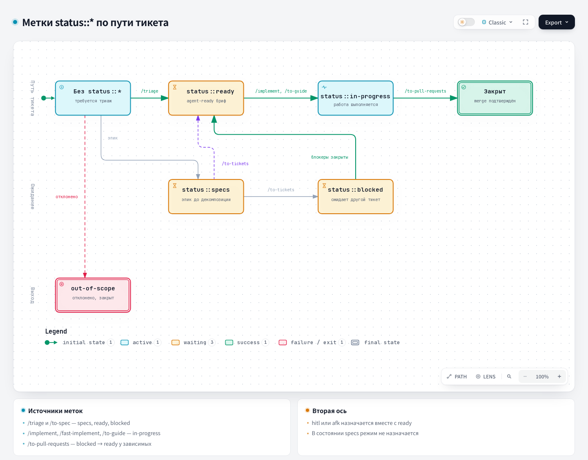

# Triage — Triage

## 1. Name and localization

- **English name:** `Triage`
- **Russian translation:**

```text
Триаж
```

## 2. Full translation of the skill text

<div class="ah-skill-text" markdown="1">

```yaml
name: triage
description: Move issues and external PRs through a state machine of triage roles: categorize, verify, grill if needed, and write agent-ready briefs.
disable-model-invocation: true
```

### Triage

Move issues on the project's issue tracker through a small state machine of triage roles.

If this repository treats external pull requests (merge requests on GitLab) as a request surface (see the issue tracker configuration), triage covers them too: **a PR is an issue with attached code**. It has the same roles, the same states, and the same machine, with a few changes marked "for a PR" below. Resolve a bare `#42` to an issue or a PR according to the tracker configuration.

Every comment or issue posted to the issue tracker during triage **must** start with this disclaimer:

```
> *This was generated by AI during triage.*
```

#### Reference documents

- [AGENT-BRIEF.md](https://github.com/PVMalove/agent-harness-next/blob/master/skills/first-party/engineering/triage/AGENT-BRIEF.md) — how to write reliable agent briefs
- [OUT-OF-SCOPE.md](https://github.com/PVMalove/agent-harness-next/blob/master/skills/first-party/engineering/triage/OUT-OF-SCOPE.md) — how the `.out-of-scope/` knowledge base works

#### Roles { #roles }

This project uses a namespace-based, enterprise-style label taxonomy. Every triaged issue has exactly one `type::*` label and exactly one `status::*` label. While the issue holds `status::specs`, the execution-mode axis below is not yet applied (see that role). In every other state, the issue also carries exactly one of `hitl`/`afk`. Optional `priority::*`/`severity::*` labels are purely informational and are not part of this required-axis check. If any required axis has zero or several labels, flag it and ask the maintainer before you do anything else.

**Type** (`type::*`):

- `type::bug` — something is broken
- `type::feature` — a new feature or an improvement
- `type::refactoring` — internal restructuring, no behavior change
- `type::chore` — maintenance, tooling, or dependency upkeep
- `type::security` — a security fix or hardening
- `type::performance` — a performance improvement
- `type::hotfix` — an urgent production fix

**Workflow state** (`status::*`) — where the issue is in the pipeline:

- `status::specs` — design/specification writing: an epic or a large task is still being turned into a specification and decomposed into tickets (usually applied by `/to-spec`, not by triage directly — see below). Too early to take into development; the execution mode is not defined yet.
- `status::ready` — fully specified and ready to be picked up (by an agent if `afk`, by a maintainer if `hitl`)
- `status::in-progress` — currently being worked on in an active session
- `status::blocked` — blocked either by the dependency on another ticket or because triage is waiting for more information from the reporter (in either case, post triage notes; see the triage notes template below)

**Execution mode** — who does the work (required if the issue leaves `status::specs`):

- `hitl` — human in the loop; an architecture review, testing, or maintainer approval is required
- `afk` — away from keyboard; an agent can do this on its own

**Context labels** — applied when needed and not part of the axes above:

- `resolution::wontfix` — the request was explicitly rejected. Apply it at closing time (see "Apply the outcome" below), not during ordinary triage.

`task-report::required` is also a context label, but `triage` neither applies nor reads it. `/to-spec` and `/to-tickets` apply it, and `/to-pull-requests` acts on it. See `docs/agents/triage-labels.md`.

An unlabeled issue implicitly means "needs triage". There is no special label for this state; the required axes are simply missing.

For a PR, the same labels are read next to the attached code. `status::ready` + `afk` means that a brief is attached and an agent should take the next step on the diff. `status::ready` + `hitl` means that the PR is ready for review or merge by a maintainer.

These are the actual label strings for this repository. See `docs/agents/triage-labels.md`.

Never apply the upstream canonical labels (`ready-for-agent`, `ready-for-human`, `needs-triage`, `needs-info`, `wontfix`) or an `epic::<slug>` label. This repository groups a ticket under an epic with the tracker's parent link: a GitHub sub-issue, on GitLab a `## Parent: #<epic>` section plus an issue `relates_to` link, or the folder structure of the local tracker (see `docs/agents/issue-tracker.md#wayfinding-operations`). Explain this if a maintainer asks for an epic label.

State transitions: analyze an unlabeled issue to determine its `type::*` label and whether it is `hitl` or `afk`. Then move it to `status::ready` or `status::blocked` (a dependency or missing information). If it is too large to specify in one triage pass, set `status::specs` and point the maintainer to `/to-spec`. `status::blocked` returns to `status::ready` as soon as the blocker clears or the reporter replies. `/to-pull-requests` moves the dependent tickets of a closed ticket, and `/implement`/`/fast-implement` re-check blockers in pre-flight. `triage` does not perform this cleanup on its own initiative. A maintainer may override this at any time. Flag transitions that look unusual and ask before you continue.

#### Tracker commands

Read and list issues (and PRs/MRs, if they are in scope) with the commands from `docs/agents/issue-tracker.md` for the configured tracker. On GitLab, `<host>`, `<project-url>`, and `<project-id>` are defined in the GitLab → Conventions section of that guide. Write each comment body to a file first, at the path from `docs/agents/git-workflow.md` §1 (`.harness/.sandboxes/pr_body/issue-comment-<issue>-<slug>.md`, or `pr-comment-<issue>-<slug>.md` for a PR/MR).

- **Comment:** GitHub `gh issue comment <n> --body-file <path>`; GitLab `GITLAB_HOST=<host> glab api projects/<project-id>/issues/<n>/notes -F body=@<path>` (on GitLab, comments are called notes).
- **Label replacement:** one command that adds the new label and removes the previous label with the same `key::` prefix. GitHub `gh issue edit <n> --remove-label <old> --add-label <new>`; GitLab `glab issue update <n> -R <project-url> --unlabel <old> --label <new>`. On GitLab Free, a `key::value` label is an ordinary label (mutually exclusive scoped labels exist only in Premium). A single `--label` would leave both `status::*` labels on the issue and break the invariant of the [Roles](#roles) section: exactly one `status::*` label.
- **Closing:** post the comment first, then GitHub `gh issue close <n>`; GitLab `glab issue close <n> -R <project-url>`.
- **For a PR/MR:** on GitHub, use the `gh pr` equivalents with the same flags. On GitLab, a comment goes through `GITLAB_HOST=<host> glab api projects/<project-id>/merge_requests/<n>/notes -F body=@<path>`, label replacement goes through `glab mr update <n> -R <project-url> --unlabel <old> --label <new>`, and closing goes through `glab mr close <n> -R <project-url>`.

#### Invocation

A maintainer invokes `/triage` and describes in natural language what they want. Interpret the request and act. Examples:

- "Show me everything that needs my attention"
- "Let's look at #42" (an issue or a PR)
- "Move #42 to `status::ready`"
- "What are the agents ready to pick up?"

#### Show what needs attention

Query the issue tracker and list three buckets, oldest first:

1. **Unlabeled** — triage has not been done.
2. **Missing one of the required axes** — partly triaged, assessment in progress.
3. **`status::blocked` with reporter activity since the last triage notes** — re-assessment is required.

If PRs are in scope, include external PRs in these buckets and mark each row `[PR]` or `[issue]`. Discovery shows only *external* PRs (the tracker configuration defines who counts as external). A contributor's in-flight PR is not triage work. This filter is for discovery only. A PR that is named explicitly is always triaged, regardless of the author.

Show the count and a one-line summary for each item. Let the maintainer choose.

#### Triage a specific issue or PR

1. **Gather context.** Read the whole issue or PR (text, comments, labels, author, dates; for a PR, also the diff). Parse all previous triage notes, so that you do not ask again about questions that are already resolved. Explore the codebase using the project's domain glossary and respecting the ADRs in that area. Perform two codebase checks: (a) **redundancy** — find an existing implementation of the requested behavior by the domain concept (not only by the wording of the request) and report where you looked. If you find one, this is an already-implemented rejection, handled under `resolution::wontfix` (step 5). (b) **prior rejection** — read `.out-of-scope/*.md` and name every request similar to this one.

2. **Recommend.** Tell the maintainer your recommended type (`type::*`), execution mode (`hitl`/`afk`), and workflow state, with the reasoning, and a short summary of the codebase relevant to the request, including whether it is already implemented. If the request is epic-sized (too large to specify in this pass), recommend `status::specs` and point to `/to-spec` instead of a state/mode pair. Wait for direction.

3. **Verify the claim.** Before you start grilling, make sure the claim is real. For a bug, reproduce it by the reporter's steps. For a PR, confirm that the diff does what it claims: check it out and run the relevant tests or commands. Report what happened: confirmed (with the code path), failed, or insufficiently detailed (a strong signal to route to `status::blocked` while waiting for more information). A confirmed verification makes the agent brief much more reliable.

4. **Grill (if needed).** If the request needs to be specified in more detail, call the Skill tool twice, for "grilling" and "domain-modeling". Grill it into shape a few questions at a time, sharpen the domain terms, and update `CONTEXT.md`/ADRs as decisions are made.

5. **Apply the outcome:**
   - `status::ready` + `afk` — post an agent brief comment ([AGENT-BRIEF.md](https://github.com/PVMalove/agent-harness-next/blob/master/skills/first-party/engineering/triage/AGENT-BRIEF.md)).
   - `status::ready` + `hitl` — the same brief structure, but note why it cannot be delegated (judgment calls, external access, design decisions, manual testing).
   - `status::specs` — point the maintainer to `/to-spec` to turn it into a proper specification and decomposition; do not write an agent brief for it.
   - `status::blocked` — post triage notes (template below): the dependency ticket to wait for, or the information missing from the reporter.
   - Rejected — apply `resolution::wontfix`, remove all `status::*` labels, and close with a comment that depends on *why*:
     - **Already implemented** — the change already exists in the codebase. Say where it lives; do **not** write to `.out-of-scope/` (this knowledge base is for *rejected* requests, not for what is already built).
     - **Rejected (bug-shaped report)** — a polite explanation and closing. Skip the `.out-of-scope/` entry: this knowledge base is for rejected requests, not for invalid bug reports.
     - **Rejected (feature/behavior request)** — write to `.out-of-scope/`, link to it from the comment, then close ([OUT-OF-SCOPE.md](https://github.com/PVMalove/agent-harness-next/blob/master/skills/first-party/engineering/triage/OUT-OF-SCOPE.md)).
   - Still unlabeled after steps 1–4 (only partial progress) — leave it unlabeled, or apply only the axis that you resolved. Add an optional comment noting what is already settled.

#### Quick state override

If the maintainer says "move #42 to `status::ready`", trust them and apply the label directly. Ask only if the execution mode (`hitl`/`afk`) is not yet clear from the context. Confirm what you are about to do (change a label, comment, close), then act. Skip grilling. If you move to `status::ready` + `afk` without a grilling session, ask whether they want to write an agent brief.

#### Triage notes template (for `status::blocked`)

```markdown
## Triage Notes

**What we've established so far:**

- point 1
- point 2

**What we still need from you (@reporter):**

- question 1
- question 2
```

Record everything that was settled during grilling in the "What we've established so far" section, so that the work is not lost. The questions must be specific and actionable, not "please provide more information".

#### Resuming a previous session

If an issue or PR has previous triage notes, read them, check whether the reporter answered any open questions, and present an updated picture before you continue. Do not ask again about questions that are already resolved.

</div>

## 3. Contracts

- **Input (Input/Brief):** an issue or an external PR, tracker data, history, and label rules.
- **Process (Process):** categorize, verify the claim, grill if needed, and apply the confirmed outcome.
- **Output (Output/Report):** an agent-ready brief, or the correct workflow state, triage notes, or an out-of-scope decision.

## 4. Architecture diagram



## Source

[SKILL.md](https://github.com/PVMalove/agent-harness-next/blob/master/skills/first-party/engineering/triage/SKILL.md)
