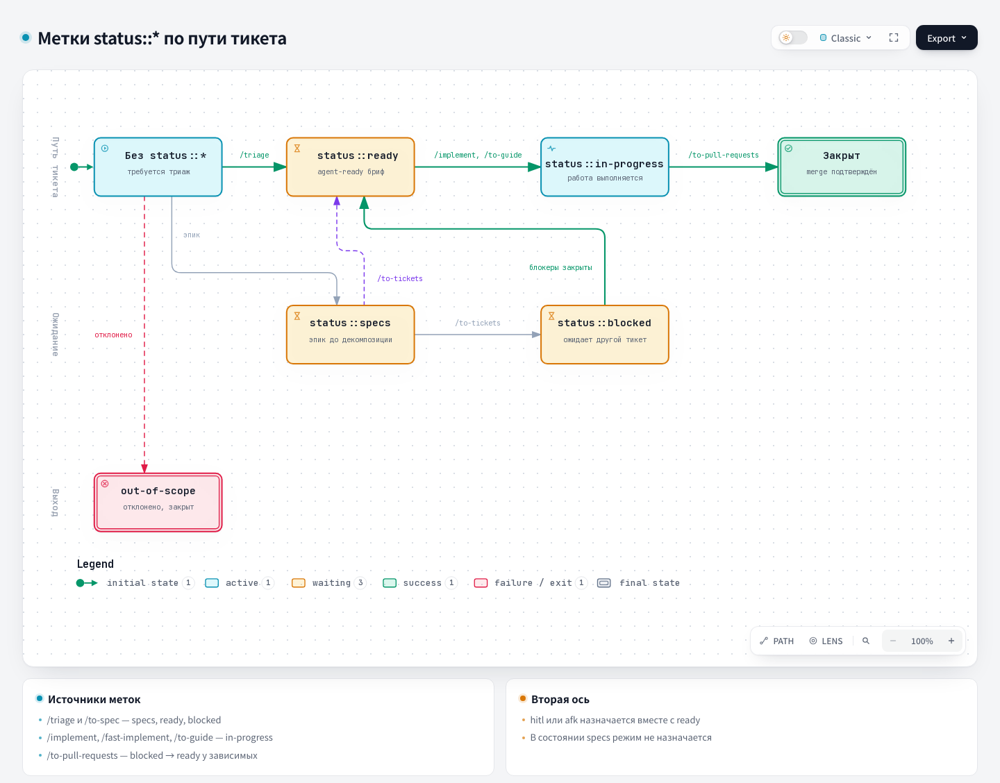

# Triage: триаж

## 1. Название и локализация

- **Английское название:** `Triage`
- **Русский перевод:**

```text
Триаж
```

## 2. Полный перевод текста скилла

<div class="ah-skill-text" markdown="1">

```yaml
name: triage
description: Проводит issues и внешние PR через конечный автомат ролей triage: классифицирует, проверяет, при необходимости проводит grilling и пишет briefs, готовые для агентов.
disable-model-invocation: true
```

### Триаж

Скилл проводит issues в трекере проекта через небольшой конечный автомат ролей triage.

Если репозиторий принимает внешние pull request (в GitLab merge request) как канал запросов (см. конфигурацию трекера), triage охватывает и их. **PR это issue с приложенным кодом**: те же роли, те же состояния, тот же автомат. Отличия для PR отмечены ниже словами «для PR». Голый `#42` относите к issue или PR по конфигурации трекера.

Каждый комментарий или issue, который triage публикует в трекере, **обязан** начинаться с этой оговорки:

```
> *This was generated by AI during triage.*
```

#### Справочные документы

- [AGENT-BRIEF.md](https://github.com/PVMalove/agent-harness-next/blob/master/skills/first-party/engineering/triage/AGENT-BRIEF.md): как писать надёжные briefs для агентов.
- [OUT-OF-SCOPE.md](https://github.com/PVMalove/agent-harness-next/blob/master/skills/first-party/engineering/triage/OUT-OF-SCOPE.md): как работает база знаний `.out-of-scope/`.

#### Роли { #roles }

Проект использует таксономию меток с пространствами имён в корпоративном стиле. У каждого issue после triage ровно одна метка `type::*` и ровно одна метка `status::*`. Пока у issue `status::specs`, ось режима выполнения ниже ещё не применяется (см. эту роль). В остальных случаях у issue также ровно одна из меток `hitl`/`afk`. Необязательные метки `priority::*`/`severity::*` только информируют и в проверку обязательных осей не входят. Если на какой-то обязательной оси нет меток или их несколько, отметьте это и спросите мейнтейнера, прежде чем делать что-то ещё.

**Тип** (`type::*`):

- `type::bug`: что-то сломано;
- `type::feature`: новая функция или улучшение;
- `type::refactoring`: внутренняя перестройка без изменения поведения;
- `type::chore`: сопровождение, инструменты или обновление зависимостей;
- `type::security`: исправление безопасности или её усиление;
- `type::performance`: улучшение производительности;
- `type::hotfix`: срочное исправление в production.

**Состояние** (`status::*`): где issue стоит в конвейере.

- `status::specs`: проектирование и написание спецификации. Эпик или большую задачу ещё превращают в спецификацию и делят на тикеты. Обычно метку ставит `/to-spec`, а не triage (см. ниже). Брать в разработку рано, режим выполнения ещё не выбран.
- `status::ready`: всё описано, можно брать в работу (агенту, если `afk`, мейнтейнеру, если `hitl`).
- `status::in-progress`: над issue сейчас работают в активной сессии.
- `status::blocked`: issue заблокирован зависимостью от другого тикета или тем, что triage ждёт дополнительных сведений от автора. В обоих случаях опубликуйте triage notes (шаблон ниже).

**Режим выполнения**: кто делает работу (обязателен, когда issue уходит из `status::specs`).

- `hitl` (human-in-the-loop): нужен архитектурный review, тестирование или одобрение мейнтейнера;
- `afk` (away-from-keyboard): агент может сделать работу сам.

**Контекстные метки**: ставятся, когда нужны, и не входят в обязательные оси выше.

- `resolution::wontfix`: запрос явно отклонён. Метка ставится при закрытии (см. «Применение результата» ниже), а не в обычном triage.

`task-report::required` тоже контекстная метка, но `triage` её не ставит и не читает. Её ставят `/to-spec` и `/to-tickets`, а `/to-pull-requests` действует по ней. См. `docs/agents/triage-labels.md`.

Issue без меток по умолчанию значит «нужен triage». Отдельной метки для этого состояния нет: просто нет обязательных осей.

Для PR те же метки читаются применительно к приложенному коду. `status::ready` + `afk` значит, что brief приложен и агент должен сделать следующий шаг по diff. `status::ready` + `hitl` значит, что PR готов к review или мержу мейнтейнером.

Это реальные строки меток этого репозитория. См. `docs/agents/triage-labels.md`.

Никогда не ставьте канонические upstream-метки (`ready-for-agent`, `ready-for-human`, `needs-triage`, `needs-info`, `wontfix`) или метку `epic::<slug>`. Этот репозиторий привязывает тикет к эпику родительской связью трекера: sub-issue в GitHub, раздел `## Parent: #<epic>` и связь issue `relates_to` в GitLab или структура каталогов локального markdown-трекера (см. `docs/agents/issue-tracker.md#wayfinding-operations`). Если мейнтейнер просит метку эпика, объясните это.

Переходы состояний. Разберите issue без меток: определите метку `type::*` и режим `hitl` или `afk`, затем поставьте `status::ready` или `status::blocked` (зависимость или нехватка сведений). Если issue слишком велик, чтобы описать его за один проход triage, поставьте `status::specs` и направьте мейнтейнера к `/to-spec`. `status::blocked` возвращается в `status::ready`, когда блокер снят или автор ответил. Зависимые тикеты закрытого тикета переводит `/to-pull-requests`, а `/implement`/`/fast-implement` перепроверяют блокеры в pre-flight. `triage` по своей инициативе такую проверку не запускает. Мейнтейнер может переопределить состояние в любой момент. Если переход выглядит необычно, отметьте это и спросите, прежде чем продолжать.

#### Команды трекера

Читайте и перечисляйте issues (и PR/MR, если они входят в область) командами из `docs/agents/issue-tracker.md` для настроенного трекера. В GitLab `<host>`, `<project-url>` и `<project-id>` заданы в разделе GitLab → Conventions этого руководства. Тело каждого комментария сначала запишите в файл по пути из `docs/agents/git-workflow.md` §1 (`.harness/.sandboxes/pr_body/issue-comment-<issue>-<slug>.md` или `pr-comment-<issue>-<slug>.md` для PR/MR).

- **Комментарий:** GitHub `gh issue comment <n> --body-file <path>`; GitLab `GITLAB_HOST=<host> glab api projects/<project-id>/issues/<n>/notes -F body=@<path>` (в GitLab комментарии называются notes).
- **Замена метки:** одна команда добавляет новую метку и снимает прежнюю с тем же префиксом `key::`. GitHub `gh issue edit <n> --remove-label <old> --add-label <new>`; GitLab `glab issue update <n> -R <project-url> --unlabel <old> --label <new>`. В GitLab Free метка `key::value` обычная (взаимоисключающие scoped labels есть только в Premium). Поэтому голый `--label` оставит на issue обе метки `status::*` и нарушит правило из раздела [Роли](#roles): ровно одна метка `status::*`.
- **Закрытие:** сначала опубликуйте комментарий, затем GitHub `gh issue close <n>`; GitLab `glab issue close <n> -R <project-url>`.
- **Для PR/MR:** в GitHub используются аналоги `gh pr` с теми же флагами. В GitLab комментарий идёт через `GITLAB_HOST=<host> glab api projects/<project-id>/merge_requests/<n>/notes -F body=@<path>`, замена метки через `glab mr update <n> -R <project-url> --unlabel <old> --label <new>`, закрытие через `glab mr close <n> -R <project-url>`.

#### Вызов

Мейнтейнер вызывает `/triage` и описывает, что ему нужно, обычным языком. Поймите запрос и действуйте. Примеры:

- «Покажи всё, что требует моего внимания»
- «Давай посмотрим #42» (issue или PR)
- «Переведи #42 в status::ready»
- «Что готово, чтобы агенты взяли в работу?»

#### Показать, что требует внимания

Запросите трекер и покажите три группы, старые сначала:

1. **Без меток:** triage не проводился.
2. **Не хватает одной из обязательных осей:** triage начат, оценка идёт.
3. **`status::blocked`, где автор что-то написал после последних triage notes:** нужна повторная оценка.

Если PR входят в область, включите внешние PR в эти группы и пометьте каждую строку `[PR]` или `[issue]`. Поиск показывает только *внешние* PR (кого считать внешним, задаёт конфигурация трекера). PR участника, который ещё в работе, не задача для triage. Этот фильтр действует только при поиске: PR, названный явно, проходит triage независимо от автора.

Покажите количество и однострочную сводку по каждому элементу. Пусть мейнтейнер выберет.

#### Triage конкретного issue или PR

1. **Соберите контекст.** Прочитайте issue или PR целиком (тело, комментарии, метки, автор, даты; для PR ещё и diff). Разберите прежние triage notes, чтобы не переспрашивать решённое. Изучите кодовую базу с глоссарием домена проекта и соблюдайте ADR этой области. Сделайте две проверки по кодовой базе. (a) **Дублирование:** найдите существующую реализацию запрошенного поведения по понятию домена, а не только по словам запроса, и сообщите, где искали. Если реализация есть, это отказ «уже реализовано», его обрабатывают через `resolution::wontfix` (шаг 5). (b) **Прежний отказ:** прочитайте `.out-of-scope/*.md` и покажите записи, похожие на этот запрос.

2. **Дайте рекомендацию.** Назовите мейнтейнеру рекомендуемый тип (`type::*`), режим выполнения (`hitl`/`afk`) и состояние с обоснованием, а также кратко опишите код, связанный с запросом, в том числе реализован ли он уже. Если запрос размером с эпик (слишком велик, чтобы описать его за этот проход), рекомендуйте `status::specs` и направьте к `/to-spec` вместо пары состояние и режим. Дождитесь решения.

3. **Проверьте утверждение.** До любого grilling проверьте, что утверждение верно. Для бага воспроизведите его по шагам автора. Для PR убедитесь, что diff делает то, что заявлено: сделайте checkout и запустите нужные тесты или команды. Сообщите результат: подтверждено (с путём в коде), не удалось или не хватает деталей. Последнее сильно указывает на `status::blocked` до получения сведений. Подтверждённая проверка делает brief для агента гораздо надёжнее.

4. **Grilling (при необходимости).** Если запрос нужно доработать, вызовите инструмент Skill дважды: для «grilling» и для «domain-modeling». Доводите запрос до формы раундами вопросов, уточняйте термины домена и сразу обновляйте `CONTEXT.md`/ADR, когда принимаются решения.

5. **Примените результат:**
   - `status::ready` + `afk`: опубликуйте комментарий с brief для агента ([AGENT-BRIEF.md](https://github.com/PVMalove/agent-harness-next/blob/master/skills/first-party/engineering/triage/AGENT-BRIEF.md)).
   - `status::ready` + `hitl`: та же структура brief, но укажите, почему работу нельзя делегировать (нужны суждения, внешний доступ, проектные решения, ручное тестирование).
   - `status::specs`: направьте мейнтейнера к `/to-spec`, чтобы превратить запрос в нормальную спецификацию и декомпозицию. Brief для агента не пишите.
   - `status::blocked`: опубликуйте triage notes (шаблон ниже): тикет-зависимость, которого нужно дождаться, или сведения, которых не хватает от автора.
   - Отказ: поставьте `resolution::wontfix`, снимите все метки `status::*` и закройте с комментарием, который зависит от *причины*:
     - **Уже реализовано:** изменение уже есть в кодовой базе. Укажите, где оно. В `.out-of-scope/` **не** пишите: эта база знаний для *отклонённых* запросов, а не для уже сделанных.
     - **Отказ (отчёт в форме бага):** вежливо объясните и закройте. В `.out-of-scope/` не пишите: эта база знаний для отклонённых запросов, а не для неверных отчётов о багах.
     - **Отказ (запрос функции или поведения):** запишите в `.out-of-scope/`, дайте ссылку на запись в комментарии, затем закройте ([OUT-OF-SCOPE.md](https://github.com/PVMalove/agent-harness-next/blob/master/skills/first-party/engineering/triage/OUT-OF-SCOPE.md)).
   - Если после шагов 1–4 issue всё ещё без меток (есть только частичный прогресс), оставьте его без меток или поставьте только ту ось, которую уже решили. Можно оставить комментарий о том, что уже решено.

#### Быстрая смена состояния

Если мейнтейнер говорит «переведи #42 в status::ready», доверьтесь ему и поставьте метку сразу. Спрашивайте, только если режим выполнения (`hitl`/`afk`) не ясен из контекста. Скажите, что собираетесь сделать (изменить метки, написать комментарий, закрыть), затем действуйте. Grilling пропустите. Если issue переходит в `status::ready` + `afk` без grilling, спросите, хочет ли мейнтейнер написать brief для агента.

#### Шаблон triage notes (для `status::blocked`)

```markdown
## Triage Notes

**What we've established so far:**

- point 1
- point 2

**What we still need from you (@reporter):**

- question 1
- question 2
```

Всё, что решено во время grilling, запишите в «established so far», чтобы работа не пропала. Вопросы должны быть конкретными и выполнимыми, а не «пожалуйста, дайте больше информации».

#### Продолжение прошлой сессии

Если у issue или PR уже есть triage notes, прочитайте их, проверьте, ответил ли автор на открытые вопросы, и покажите обновлённую картину, прежде чем продолжать. Решённые вопросы повторно не задавайте.

</div>

## 3. Контракты

- **Вход (Input/Brief):** issue или внешний PR, данные трекера, история и правила меток.
- **Процесс (Process):** скилл классифицирует запрос, проверяет утверждение, при необходимости проводит grilling и применяет подтверждённый результат.
- **Выход (Output/Report):** brief, готовый для агента, или верное состояние workflow, triage notes или решение out-of-scope.

## 4. Архитектурная схема



## Источник

[SKILL.md](https://github.com/PVMalove/agent-harness-next/blob/master/skills/first-party/engineering/triage/SKILL.md)
