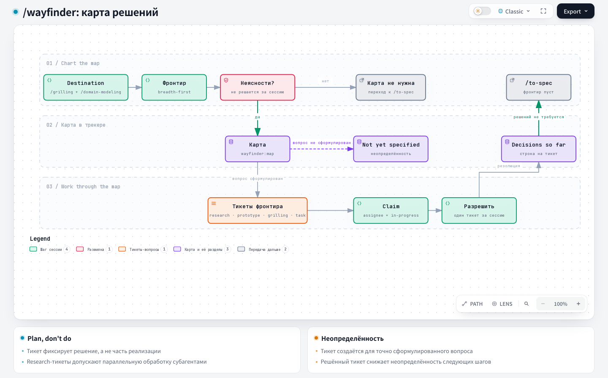

# Wayfinder — Wayfinder

## 1. Name and localization

- **English name:** `Wayfinder`
- **Russian translation:**

```text
Поиск пути
```

## 2. Full translation of the skill text

<div class="ah-skill-text" markdown="1">

```yaml
name: wayfinder
description: Plan a huge amount of work that does not fit in one agent session as a shared map of decision tickets in the issue tracker, and resolve them one at a time until the path to the goal is clear.
disable-model-invocation: true
```

A vague idea has arrived. It is too big for one agent session and wrapped in fog: the path from here to the **destination** is not visible yet. Navigation is wayfinding, not charging at the destination. This skill lays out the path as a **shared map** in the repository's issue tracker. Then it works through the **decision tickets** one at a time, until the route is clear. A decision ticket is a question whose resolution is a decision, not a piece of build work to be done.

The destination varies with the effort, and naming it is the first step of drawing the map. It shapes every ticket. It may be a specification to hand off and iterate on, a decision that blocks the start of planning, or a change to be made, such as a data structure migration. The map is domain-independent: engineering work, course content, anything that fits the shape.

#### Plan, do not do

By default, Wayfinder **plans**. Each ticket defines a decision, and the map is complete when the path is clear: nothing is left to decide before someone goes and does the work. An urge to just do the work is usually a signal that you have reached the edge of the map and it is time to hand off. An effort may override this in its **Notes** (moving execution into the map itself). Otherwise, the output is decisions, not deliverables.

#### Address by name

Every map and ticket is an issue, so each has a **name**: its title. In everything a human reads (the narrative, the Decisions on the map), refer to it by this name, not by a bare ID, number, or slug. A wall of `#42, #43, #44` is unreadable. Names read at a glance. The ID and the URL do not disappear: the name wraps the link. They live _inside_ the name and never replace it.

#### The map

The map is a single issue in this repository's issue tracker, labeled `wayfinder:map`. It is the canonical artifact. Its tickets are child issues of the map.

The map is an **index**, not a store. It lists the decisions made and points to the tickets that hold their details. A decision lives in exactly one place, its ticket. So the map never repeats it and shows only its gist and links.

**Where the map, its child tickets, blocking edges, and frontier queries physically live depends on the tracker.** You should already have the issue tracker. If `docs/agents/issue-tracker.md` is missing, tell the user to run `harness update`. It creates the file from the harness templates. See the "Wayfinding operations" section of the tracker document to learn how these are expressed in _this_ repository. If no tracker is specified, the default is the local markdown tracker.

##### Map body

The whole map at low resolution, loaded once per session. Open tickets are **not** listed: they are the open child issues, found by query.

```markdown
## Destination

<what reaching the end of this map looks like — the spec, decision, or change this effort is finding its way to. One or two lines; every session orients to it before choosing a ticket.>

## Notes

<domain; skills every session should consult; standing preferences for this effort>

## Decisions so far

<!-- the index — one line per closed ticket: enough to judge relevance, then zoom the link for the detail the ticket holds -->

- [<closed ticket title>](<ticket URL>) — <one-line gist of the answer>

## Not yet specified

<!-- see "Fog of war": in-scope fog you can't ticket yet; graduates as the frontier advances -->

## Out of scope

<!-- see "Out of scope": work ruled beyond the destination; closed, never graduates -->
```

##### Tickets { #tickets }

Each ticket is a **child issue** of the map. The tracker's issue ID is its identity. Its body is a question sized to one agent session:

```markdown
## Question

<the decision or investigation this ticket resolves>
```

Each ticket has a `wayfinder:<type>` label, one of `research`, `prototype`, `grilling`, `task` (see [Ticket types](#ticket-types)). It also has the matching `hitl`/`afk` label and `status::ready`, this repository's own taxonomy, which shows who does the work and where the ticket is in the pipeline (see `docs/agents/triage-labels.md`).

A session **claims** a ticket by assigning it to the developer who runs the map, **first**, before any work, so that parallel sessions skip it. This assignee is the claim: an open, unassigned ticket is unclaimed. Blocking uses the tracker's **own** dependency relation where the tracker document uses it. This matters because it shows the frontier _visually_ in the tracker's own UI, so a human sees what can be taken without opening the map. Otherwise, in local markdown or on GitLab, where blocking links exist only in Premium, a body convention that the tracker document names is used. A ticket is **unblocked** when every ticket that blocks it is closed. The **frontier** is the open, unblocked, unclaimed children: the edge of the known.

The answer is not part of the body. It is recorded on resolution (see [Working the map](#work-the-map)). Resources created while resolving a ticket are linked to the issue, not pasted into it.

#### Ticket types { #ticket-types }

Each ticket is either **HITL** (human in the loop, working _with_ a human who speaks for themselves) or **AFK** (driven by an agent alone). A HITL ticket is resolved only through this live exchange. The agent never stands in for the human side (a grilling agent that answers its own questions has broken this).

- **Research** (AFK): read documentation, third-party APIs, or local resources such as knowledge bases, to establish the facts that a decision depends on. The ticket is resolved by a `/research` **subagent**. Use it when knowledge from outside the current working directory is required.
- **Prototype** (HITL): raise the precision of the discussion by building a cheap, rough, concrete artifact that people can react to: a sketch, a draft, a stub, or UI/logic code made with the /prototype skill. Link the prototype as an asset. Use it when the key question is "how should this look" or "how should this behave".
- **Grilling** (HITL): a conversation. This is the default case. Always use the /grilling and /domain-modeling skills.
- **Task** (HITL or AFK): manual work that must be done before a _decision_ can be made. There is nothing to decide, prototype, or research, but the discussion is blocked until the work is complete. Examples: signing up for a service so that its API can be evaluated, granting access, moving data so that its shape can be seen. This is the type that _does_ instead of deciding. It earns its place by unblocking a decision, not by delivering the destination. The agent drives it alone where it can (AFK). Otherwise, it hands the human an exact checklist (HITL). It is resolved when the work is finished. The answer records what was done and any resulting facts (credential location, new URLs, row counts) that the following tickets depend on.

#### Fog of war

The map is _deliberately_ incomplete: do not chart what you cannot see yet. Beyond the live tickets lies the **fog of war**. This is a vague view of decisions and investigations that you can tell are coming but cannot yet define precisely, because they depend on questions that are still open. Resolving a ticket clears the fog in front of it and turns whatever can now be specified into new tickets, one at a time, until the path to the destination is clear and no tickets remain.

The map section **Not yet specified** records this vague view: an anticipated question, an area to return to later. This is the unexplored edge _toward_ the destination. Everything here is in scope, just not sharp enough to buy a ticket. Write it as loosely or as fully as the view allows. It also serves as a pointer for collaborators who read where the effort is heading.

**Fog or ticket?** The test is whether you can state the question precisely now, not whether you can answer it now.

- **Ticket, when** the question is already sharp, even if it is blocked and you cannot act on it yet.
- **Not yet specified, when** you cannot yet state it that sharply. Do not cut the fog into ticket-sized pieces in advance. It is coarser than a ticket, and one patch may turn into several tickets or none once the frontier reaches it.

**Not yet specified** excludes what is already decided (Decisions so far), what is already a live ticket, and what is out of scope (next section).

#### Out of scope

Fog only ever gathers toward the destination. The destination fixes the scope, so work beyond it is **out of scope**. It is not fog and does not belong in **Not yet specified**. On the map it has its own section, **Out of scope**: work that you deliberately excluded from _this_ effort. Here, the reach matters, not the sharpness.

Out-of-scope work is never completed, because the frontier stops at the destination. So it returns only if the destination is redrawn, and then as a new effort, not a resumption.

Deciding that something is out of scope is a preliminary act, not a step on the path. When an already existing ticket turns out to be beyond the destination (mis-scoped during mapping, or revealed in a resolution), **close it** (a closed ticket is unambiguously outside the frontier) and leave one line in the **Out of scope** section: the gist and the reason it is out of scope, linking the closed ticket. It does not go into the **Decisions so far** section, which records the route actually traveled. A scope boundary is not a step on that route.

#### Invocation

There are two modes. In either mode, **never resolve more than one ticket per session**, except research tickets.

##### Draw the map

The user invokes the skill with a vague idea.

1. **Name the destination.** Run `/grilling` and `/domain-modeling` sessions to define what this map is aiming at: a specification, a decision, or a change. The destination fixes the scope, so it is defined first.
2. **Map the frontier.** Grill again, this time **breadth-first**: spread across the whole space instead of going deep on any one thread. Surface the open decisions and the first steps that can be taken right now. **If no fog surfaces**, the path to the destination is already clear and the whole path is small enough for one session, so you do not need a map. Stop and ask the user how they want to proceed.
3. **Create the map** (label `wayfinder:map`): the destination and notes are filled in, the decisions are empty for now, and the fog is drawn as **Not yet specified**.
4. **Create the tickets you can specify now** as child issues of the map. Give each one its `wayfinder:<type>` label, the matching `hitl`/`afk` label, and `status::ready` (see [Tickets](#tickets)). Then connect the edges in a **second pass** (the tickets need IDs before they can refer to each other). The wiring sorts them into frontier and blocked. Anything you still cannot specify stays in the fog, in the **Not yet specified** section.
5. **Launch research subagents.** For each newly created `research` ticket, deploy a `/research` subagent to resolve it in parallel. It records its results in the issue branch of that research ticket (the name follows `branch_pattern` from `.harness/project.json`, see `docs/agents/git-workflow.md`), with a context pointer from the ticket.
6. Stop. Charting is the work of one session. It resolves nothing by hand.

##### Working the map { #work-the-map }

The user invokes the skill with a map (URL or number). The ticket is **optional**: without it, you choose the next decision, not the user.

1. Load the **map**: the low-resolution view, not the body of every ticket.
2. Choose a ticket. If the user named one, use it. Otherwise, take the first frontier ticket in order. **Claim it**: assign it to yourself before any work and set `status::in-progress`. This is the same convention that `/fast-implement` and `/to-guide` use (`docs/agents/triage-labels.md`).
3. Resolve it, and **zoom in as needed**: fetch the full body of any linked or closed ticket on demand. Invoke the skills that the `## Notes` block names and those that the ticket type requires (see the Ticket types section).
4. Record the decision. Post the answer as a **decision comment**, **close** the issue, and **add a context pointer** to the "Decisions so far" item on the map.
5. Add new tickets (create them, then wire them). Clear any fog that the answer made specifiable, and remove each graduated patch from **Not yet specified**, so that it lives only as a new ticket. If the answer shows that a ticket, this one or another, is beyond the destination, **take it out of scope** instead of resolving it on the route. If the decision invalidates other parts of the map, update or remove those tickets.

The user may run unblocked tickets in parallel, so expect other sessions to edit the tracker at the same time.

</div>

## 3. Contracts

- **Input (Input/Brief):** a vague large goal or an existing decision map in the tracker.
- **Process (Process):** create or maintain the decision map, take one frontier ticket per session, and reduce the fog of war.
- **Output (Output/Report):** a map with decisions, dependencies, and the next decision tickets, or a clear handoff into the main flow.

## 4. Architecture diagram



## Source

[SKILL.md](https://github.com/PVMalove/agent-harness-next/blob/master/skills/first-party/engineering/wayfinder/SKILL.md)
