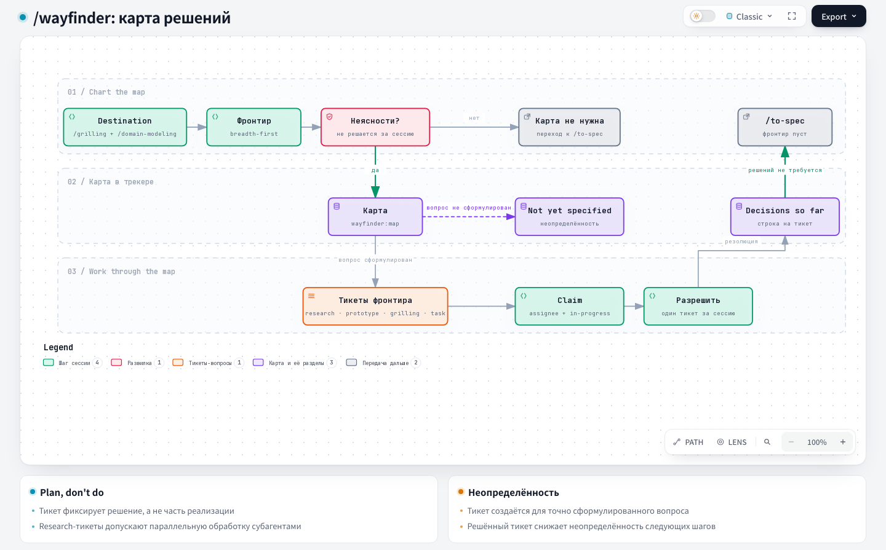

# Wayfinder: поиск пути

## 1. Название и локализация

- **Английское название:** `Wayfinder`
- **Русский перевод:**

```text
Поиск пути
```

## 2. Полный перевод текста скилла

<div class="ah-skill-text" markdown="1">

```yaml
name: wayfinder
description: Планирует очень большую работу, которая не помещается в одну сессию агента, как общую карту тикетов-решений в трекере задач и закрывает их по одному, пока путь к цели не станет ясен.
disable-model-invocation: true
```

Пришла расплывчатая идея. Она слишком велика для одной сессии агента и скрыта в тумане: путь отсюда до **цели** (destination) пока не виден. Wayfinding ищет этот путь, а не рвётся сразу к цели. Скилл прокладывает путь как **общую карту** в трекере репозитория и затем по одному закрывает её **тикеты-решения** (decision tickets), пока маршрут не станет ясен. Тикет-решение это вопрос, ответом на который будет решение, а не кусок сборки, который нужно выполнить.

Цель у каждой работы своя, и назвать её первый шаг при построении карты: от неё зависит каждый тикет. Целью может быть спецификация, которую передадут дальше и будут дорабатывать, решение, которое нужно зафиксировать до начала планирования, или изменение на месте, например миграция структуры данных. Карта не привязана к домену: подходит инженерная работа, содержание курса и всё, что имеет такую форму.

#### Планировать, а не делать

По умолчанию Wayfinder **планирует**. Каждый тикет закрывает одно решение. Карта готова, когда путь ясен: больше нечего решать, прежде чем кто-то пойдёт и сделает работу. Желание просто сделать работу обычно значит, что вы дошли до края карты и пора передавать её дальше. Работа может изменить это правило в своих **Notes** и включить выполнение в саму карту. Без такой записи результатом будут решения, а не готовые изделия.

#### Называть по имени

Каждая карта и каждый тикет это issue, поэтому у них есть **имя**: заголовок. Во всём, что читает человек (в пояснениях, в разделе карты Decisions so far), называйте их по имени, а не голым id, номером или slug. Стену `#42, #43, #44` прочитать нельзя, а имена читаются с одного взгляда. Id и URL не пропадают: имя оборачивает ссылку. Но они стоят _внутри_ имени и никогда его не заменяют.

#### Карта

Карта это одно issue в трекере репозитория с меткой `wayfinder:map`, канонический артефакт. Её тикеты это дочерние issues карты.

Карта служит **указателем**, а не хранилищем. Она перечисляет принятые решения и ссылается на тикеты с подробностями. Каждое решение живёт ровно в одном месте, в своём тикете, поэтому карта его не пересказывает, а даёт суть и ссылку.

**Где физически живут карта, её дочерние тикеты, блокировки и запросы frontier, зависит от трекера.** Трекер вам должны были передать в `docs/agents/issue-tracker.md`. Если файла нет, попросите пользователя запустить `harness update`: команда создаст файл из шаблонов харнесса. Как _этот_ репозиторий их выражает, описано в разделе «Wayfinding operations» документа трекера. Если трекер не задан, по умолчанию используется локальный markdown-трекер.

##### Тело карты

Вся карта в низком разрешении, её загружают один раз за сессию. Открытые тикеты в ней **не** перечислены: это открытые дочерние issues, их находят запросом.

```markdown
## Destination

<what reaching the end of this map looks like — the spec, decision, or change this effort is finding its way to. One or two lines; every session orients to it before choosing a ticket.>

## Notes

<domain; skills every session should consult; standing preferences for this effort>

## Decisions so far

<!-- the index — one line per closed ticket: enough to judge relevance, then zoom the link for the detail the ticket holds -->

- [<closed ticket title>](<ticket URL>) — <one-line gist of the answer>

## Not yet specified

<!-- see "Fog of war": in-scope fog you can't ticket yet; graduates as the frontier advances -->

## Out of scope

<!-- see "Out of scope": work ruled beyond the destination; closed, never graduates -->
```

##### Тикеты { #tickets }

Каждый тикет это **дочернее issue** карты, его идентичность задаёт id issue в трекере. Тело тикета это вопрос размером на одну сессию агента:

```markdown
## Question

<the decision or investigation this ticket resolves>
```

У каждого тикета есть метка `wayfinder:<type>`, одна из `research`, `prototype`, `grilling`, `task` (см. [Типы тикетов](#ticket-types)), а также подходящая метка `hitl`/`afk` и `status::ready`. Это собственная таксономия репозитория: кто делает работу и где она стоит в конвейере (см. `docs/agents/triage-labels.md`).

Сессия **забирает** тикет: назначает его разработчику, который ведёт карту, **первым делом**, до любой работы. Так параллельные сессии его пропускают. Назначение и есть отметка «забран»: открытый тикет без исполнителя никем не забран.

Для блокировок используется **нативная** связь зависимостей трекера там, где её использует документ трекера. Это важно: так frontier _видно_ прямо в интерфейсе трекера, и человек видит, что можно взять, не открывая карту. В остальных случаях (локальный markdown или GitLab, где связи блокировки есть только в Premium) используется соглашение о теле issue, которое называет документ трекера. Тикет **разблокирован**, когда закрыт каждый тикет, который его блокирует. **Frontier** это открытые, разблокированные и никем не забранные дочерние тикеты: край известного.

Ответ не входит в тело тикета: его записывают при закрытии (см. [Работа по карте](#work-the-map)). Материалы, созданные при работе над тикетом, прикрепляются к issue ссылками, а не вставляются в текст.

#### Типы тикетов { #ticket-types }

Каждый тикет либо **HITL** (human in the loop: работа идёт _вместе_ с человеком, который сам отвечает за себя), либо **AFK** (агент работает один). Тикет HITL закрывается только в живом обмене с человеком. Агент никогда не отвечает за человека. Агент на grilling, который сам отвечает на свои вопросы, нарушает это правило.

- **Research** (AFK): чтение документации, сторонних API или локальных ресурсов, например баз знаний, чтобы найти факт, от которого зависит решение. Тикет закрывает **субагент** `/research`. Используйте, когда нужны знания за пределами текущего рабочего каталога.
- **Prototype** (HITL): поднимите точность обсуждения дешёвым, грубым, конкретным артефактом, на который можно отреагировать: план, черновой вариант, заглушка или код интерфейса и логики через скилл /prototype. Прототип прикрепляется ссылкой как материал. Используйте, когда главный вопрос «как это должно выглядеть» или «как это должно себя вести».
- **Grilling** (HITL): разговор. Это случай по умолчанию. Всегда вызывайте скиллы /grilling и /domain-modeling.
- **Task** (HITL или AFK): ручная работа, без которой нельзя принять _решение_. Решать, прототипировать или исследовать нечего, но обсуждение стоит, пока работа не сделана. Например, зарегистрироваться в сервисе, чтобы оценить его API, выдать доступ, перенести данные, чтобы увидеть их форму. Это единственный тип, который _делает_, а не решает. Он нужен, потому что разблокирует решение, а не потому, что приближает цель. Где может, агент делает работу сам (AFK). Иначе он даёт человеку точный чек-лист (HITL). Тикет закрывается, когда работа сделана. Ответ записывает, что сделано, и факты, от которых зависят следующие тикеты (где лежат учётные данные, новые URL, число строк).

#### Туман войны

Карта _намеренно_ неполная: не наносите на неё то, чего ещё не видите. За живыми тикетами лежит **туман войны**: смутный вид решений и исследований, которые точно предстоят, но которые пока нельзя чётко сформулировать, потому что они зависят от ещё открытых вопросов. Закрытый тикет рассеивает туман перед собой: всё, что теперь можно описать, превращается в новые тикеты, по одному, пока путь к цели не станет ясен и тикетов не останется.

Раздел карты **Not yet specified** записывает этот смутный вид: предполагаемый вопрос, область, к которой надо вернуться. Это неразведанный frontier _в сторону_ цели. Всё здесь входит в область работы, просто ещё недостаточно чётко для тикета. Пишите так свободно или так полно, как позволяет видимость. Раздел заодно показывает участникам, куда движется работа.

**Туман или тикет?** Вопрос в том, можете ли вы точно сформулировать вопрос сейчас, а _не_ в том, можете ли вы на него ответить.

- **Тикет**, если вопрос уже чёткий, даже если тикет заблокирован и действовать пока нельзя.
- **Not yet specified**, если так чётко сформулировать ещё нельзя. Не режьте туман заранее на куски размером с тикет: он грубее тикета, и один участок, когда до него дойдёт frontier, может стать несколькими тикетами или ни одним.

В **Not yet specified** не входит то, что уже решено (Decisions so far), то, что уже стало живым тикетом, и то, что вне области (следующий раздел).

#### Вне области

Туман собирается только _в сторону_ цели. Цель задаёт область работы, поэтому всё за её пределами **вне области** (out of scope). Это не туман, и в **Not yet specified** оно не попадает. Для такой работы на карте есть свой раздел **Out of scope**: работа, которую вы сознательно исключили из _этой_ задачи. Сюда работу приводит область, а не чёткость.

Работа вне области никогда не превращается в тикеты: frontier останавливается на цели. Она возвращается, только если цель перерисуют, и тогда как новая работа, а не продолжение старой.

Решение «вне области» определяет границы, это не шаг маршрута. Если существующий тикет оказался за целью (ошибочно попал в карту при построении или это выяснилось при закрытии другого тикета), **закройте его**: закрытый тикет однозначно ушёл из frontier. Оставьте одну строку в разделе **Out of scope**: суть, причину, почему это вне области, и ссылку на закрытый тикет. В **Decisions so far** он не попадает: там записан пройденный маршрут, а граница области не шаг на нём.

#### Вызов

Есть два режима. В обоих **никогда не закрывайте больше одного тикета за сессию**. Исключение: тикеты research.

##### Построить карту

Пользователь вызывает скилл с расплывчатой идеей.

1. **Назовите цель.** Проведите сессию `/grilling` и `/domain-modeling`, чтобы зафиксировать, к чему ведёт карта: к спецификации, решению или изменению. Цель задаёт область, поэтому её определяют первой.
2. **Наметьте frontier.** Снова проведите grilling, на этот раз **в ширину**: пройдите по всему пространству, а не вглубь одной нити, и найдите открытые решения и первые шаги, которые можно сделать уже сейчас. **Если тумана не нашлось** (путь к цели уже ясен и вся работа помещается в одну сессию), карта не нужна. Остановитесь и спросите пользователя, как он хочет продолжить.
3. **Создайте карту** (метка `wayfinder:map`): Destination и Notes заполнены, Decisions so far пуст, туман набросан в **Not yet specified**.
4. **Создайте тикеты, которые можно описать уже сейчас,** как дочерние issues карты. У каждого метка `wayfinder:<type>`, подходящая метка `hitl`/`afk` и `status::ready` (см. [Тикеты](#tickets)). Затем **вторым проходом** проставьте блокирующие связи: issues нужны id, прежде чем они смогут ссылаться друг на друга. Связи делят тикеты на frontier и заблокированные. Всё, что пока нельзя описать, остаётся в тумане, в разделе **Not yet specified**.
5. **Запустите субагентов research.** Для каждого только что созданного тикета `research` запустите субагента `/research`, чтобы он параллельно закрыл тикет. Выводы он записывает в issue-ветку этого тикета research с именем по `branch_pattern` из `.harness/project.json` (`docs/agents/git-workflow.md`) и с указателем на контекст из тикета.
6. Остановитесь. Построение карты занимает одну сессию, вручную в ней ничего не закрывают.

##### Работа по карте { #work-the-map }

Пользователь вызывает скилл с картой (URL или номер). Тикет указывать **необязательно**: если его нет, следующее решение выбираете вы, а не пользователь.

1. Загрузите **карту**: вид в низком разрешении, а не тело каждого тикета.
2. Выберите тикет. Если пользователь назвал тикет, берите его. Иначе берите первый по порядку тикет из frontier. **Заберите его**: до любой работы назначьте себе и поставьте `status::in-progress`. Так же делают `/fast-implement` и `/to-guide` (`docs/agents/triage-labels.md`).
3. Закройте вопрос и **приближайтесь по мере надобности**: по требованию получайте полное тело связанного или закрытого тикета. Вызывайте скиллы, которые названы в блоке `## Notes`, и те, которых требует тип тикета (см. [Типы тикетов](#ticket-types)).
4. Запишите решение: опубликуйте ответ **комментарием с решением**, **закройте** issue и **добавьте указатель на контекст** в раздел карты Decisions so far.
5. Добавьте новые тикеты, которые появились (сначала создать, потом связать). Туман, который ответ сделал описываемым, превратите в тикеты и уберите каждый такой участок из **Not yet specified**, чтобы он жил только как новый тикет. Если ответ показал, что тикет (этот или другой) лежит за целью, **объявите его вне области** и не закрывайте его на маршруте. Если решение делает недействительными другие части карты, обновите или удалите эти тикеты.

Пользователь может вести разблокированные тикеты параллельно, поэтому другие сессии могут одновременно менять трекер.

</div>

## 3. Контракты

- **Вход (Input/Brief):** неясная крупная цель или существующая карта решений в трекере.
- **Процесс (Process):** скилл создаёт или ведёт карту решений, берёт один тикет из frontier за сессию и уменьшает туман войны.
- **Выход (Output/Report):** карта с решениями, зависимостями и следующими тикетами-решениями или ясная передача работы в основной flow.

## 4. Архитектурная схема



## Источник

[SKILL.md](https://github.com/PVMalove/agent-harness-next/blob/master/skills/first-party/engineering/wayfinder/SKILL.md)
